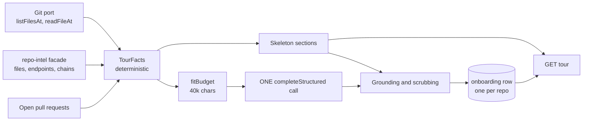

# Onboarding Tour

How a repository's five-section onboarding tour is built: what comes from git and the index, what the one model call adds, and what is allowed to survive from the model's answer.

The feature spans the server (`server/src/modules/onboarding/`), the contracts in `@devdigest/shared` (`server/src/vendor/shared/contracts/knowledge.ts`, mirrored in the client's vendor copy), the client page (`client/src/app/repos/[repoId]/tour/`) and an e2e smoke flow (`e2e/specs/09-onboarding-tour.flow.json`). The guiding rule is in the header of `server/src/modules/onboarding/grounding/helpers.ts`: the model never decides a path, a command or a task target. It can only attach text to rows the facts already contain.

## The shape of it

`GET` never leaves the left half of the diagram. Only `POST .../generate` walks the whole path.

## The five sections

Every response carries all five keys under `sections`. A section with nothing to show says why through a `gap` value (`needs_clone`, `needs_index`, `not_ranked`, `no_edges`, `no_manifest`, `no_candidates`) instead of being omitted (`server/src/modules/onboarding/helpers.ts`, `TourSectionGap` in the contract).

| Section | Deterministic part | What the model adds |
|---|---|---|
| Architecture | stack (languages by indexed-file count, frameworks from a dependency allow-list, runtime) and up to 30 top-level folders | markdown prose and a box-and-arrow diagram |
| Critical paths | up to 6 files, chains from the index flattened in order, first occurrence kept | one reason line per row |
| Run locally | commands derived from the tree and `package.json` scripts | a step order and a one-line comment per command |
| Reading path | the 8 top-ranked files, with importer count and "top N%" | one "why" per row |
| First tasks | up to 15 candidates, of which 5 are shown | a title and reason per chosen candidate |

The stack, folder list and every file row come from facts in both the skeleton and a generated tour; the model's text is layered on top in `generatedSections`.

### Where the facts come from

`collectFacts` in `server/src/modules/onboarding/service.ts` gathers everything for one revision: the index's last indexed sha, else HEAD. If the tree at that sha is gone, HEAD is used for the whole set. Content is read only through the git port at that sha, and only for four kinds of file: `package.json` (the root plus at most four first-level directories, picked by indexed-file count), the root README, the env example, and the 30 top-ranked files. Each excerpt is cut to 6,000 characters. Lockfiles and compose files are recognised by name and never read; env examples contribute variable names only, never values. Nothing is executed. A failed read leaves that fact out rather than failing the request.

The index is reached through a small structural `IndexFacade` declared inside the module, since a module may not import a sibling. The facade methods the tour added to `repo-intel` are:

- `getIndexedFiles` returns every ranked file with rank, percentile and distinct-importer count, rank descending then path ascending (`server/src/modules/repo-intel/service.ts`, `repository.ts`).
- `getEndpoints` returns each `(file, endpoint)` pair from the stored file facts, deduplicated and sorted.
- `getIndexState` gained a `coverage` object: `totalSourceFiles` (what the latest walk saw, or `null` for an older row), `bounded`, and `softBudgetReached`.

All of them return empty when `repoIntelEnabled` is off.

### The reading-path rank

The reading path is `getTopFilesByRank(repoId, 8)`: files ordered by `file_rank.rank` descending with path ascending as the tiebreak, after tests, configs, declaration files, migrations and fixtures are dropped. The facade over-fetches ten times before filtering so the filter can still return eight. The rank itself is produced by the indexer (see `server/src/modules/repo-intel/README.md`). Each row then shows `importers` (distinct files importing it) and `top_percent`, which is `max(1, round(100 - percentile))`, so the highest-ranked file reads "top 1%".

The 30-file scan set for TODOs and missing tests is the same call with a larger n, which is why the reading path and the first tasks agree about what "important" means.

### Run commands

`deriveCommands` builds each command from fixed templates only: `cp <env example> <.env>`, `docker compose up -d` when a root compose file exists, the lockfile's install command, and `<pm> run <script>` for scripts on a fixed allow-list (`SCRIPT_ALLOW_LIST` in `constants.ts`). The package manager comes from the lockfile name, defaulting to `npm`. A directory is interpolated into a command only if every segment matches a conservative character pattern. Commands get ids `cmd-1`, `cmd-2` and so on, which is what the model refers to.

### First-task candidates

Candidates are TODO/FIXME/HACK markers inside comments of the scanned files, scanned files with no test file of the same stem anywhere in the tree, and open pull requests (not merged or closed, newest first). They are ordered by the file's rank, then kind, then line, with open PRs after the file candidates, and the first 15 are kept. Open PRs are not part of the memoised fact set and are re-read on every request.

## Exactly one model call

A generation makes one `completeStructured` call, with temperature 0, a 4,000-token output cap, `maxRetries: 0` and a 120-second wall around it (`constants.ts`; the `withTimeout` in `OnboardingService.run`). There is no schema re-ask and no repair pass: an answer that fails the schema is a failure, not a retry. The system prompt is `server/src/prompts/onboarding.system.md`; every repo-derived string reaches the model inside a `wrapUntrusted` block, with no keyword scanning, and the prompt's `SECURITY:` paragraph is the guard.

### The handler that never throws

Generation runs as a `JobRunner` job so it outlives the HTTP request. `JobRunner` wraps a handler in retry and a timeout of its own, and a retry would call the model again. So `handleJob` in `service.ts` catches everything: any error is classified and stored as the repo's failure, and the repo's lock is released in a `finally`. From the runner's point of view the job always succeeds, so there is nothing to retry. If the runner's own timeout fires first, the job row is marked failed but nothing retries, and the handler still finishes and records its own outcome.

The 409 lock is an in-process map keyed by repo. It is taken in the synchronous prefix of `startGeneration`, before the first `await`, so two calls in the same tick cannot both pass, and every pre-check failure releases it. Failures live in memory too. The consequence is stated in the file header: it assumes one API process per database, and a restart loses an in-flight generation and stores nothing.

A failed generation stores nothing and leaves the previous tour untouched. Failure codes are `no_api_key`, `timeout`, `invalid_output` (fixed message, no model text echoed) and `provider_error` (message capped at 300 characters).

## Statuses and blockers

`deriveStatus` in `helpers.ts` computes status and blockers from the clone, the index and the key:

| `status` | When |
|---|---|
| `generated` | a stored tour exists whose envelope parses, whatever the clone and index look like now |
| `ready` | cloned, index usable, nothing stored |
| `index_not_ready` | cloned, but the index is `degraded` or `failed`, or has no ranked files |
| `not_cloned` | no clone path |

`blockers` is a separate list explaining why Generate is off, in fixed order: `not_cloned`, `index_not_ready` (only when cloned), `no_api_key` (independent of the other two). `can_generate` is true only when the list is empty and nothing is running. A stored tour therefore keeps showing after a clone is removed, while the blockers still say why Regenerate is disabled. `index_reason` carries the degraded reason, the index reason, or `not_ranked`.

What the page shows without a stored tour:

- **No clone.** `noCloneSections`: four sections are empty with `needs_clone`; first tasks are fallback tasks built from open PRs, or `no_candidates`.
- **Cloned, not generated.** `skeletonSections`: the facts-only version of every section. This is also what the e2e flow's "Not cloned" path exercises, since the seeded demo repo has no clone.

`GET` checks only whether the feature's provider has a key (`hasLlmKey`); it never builds an LLM client and never calls a model.

## Grounding and scrubbing

`generatedSections` starts from the skeleton and lets the model's answer through `server/src/modules/onboarding/grounding/helpers.ts`. The model's schema (`schema.ts`) has no length limits, so every cap is enforced here, in code, after the call.

- **Diagram.** A component survives only if its `ref` is an indexed file path, a top-level folder or a dependency name from a manifest that was read (compared lower-cased). First duplicate id wins; at most 12 components and 24 connections, no self-loops, no duplicate edges. Fewer than two components or no connections means no diagram at all.
- **Row reasons.** Critical-path reasons are matched by path, first one wins. Reading-path reasons are accepted only in the facts' order: an entry whose row comes at or before the last accepted one is dropped. Row set and order always stay the facts'.
- **Commands.** The model supplies ids and comments. Known ids are placed first in the model's order, unknown or repeated ids are dropped, and any derived command it left out is appended in derivation order with no comment. The command text is always the derived one.
- **Tasks.** A model task is kept only if its `candidate_id` is a known candidate not yet used; at most five. Path, line and PR always come from the candidate. If fewer than three survive, the whole section falls back to the first five candidates, marked `source: 'fallback'` with null title and reason.
- **Prose.** `scrubProse` removes code spans that look like paths but are not in the known set (tree paths, indexed paths and their directory prefixes). Links are kept only when relative and known; external, unknown and image links collapse to their text. Bare URLs become code so they are not auto-linked. Known paths outside code are wrapped in backticks. HTML is neither parsed nor emitted.
- **One-line fields** are collapsed to a single line and capped at 200 characters (labels at 40, command comments at 160).

## Budgets for large repos

The facts the model sees are capped at 40,000 characters (`FACTS_MAX_CHARS`). `fitBudget` in `prompt/helpers.ts` drops blocks in a fixed order until the text fits: the README block, then non-root manifest blocks (last first), then route lines from the end, then folder lines from the end. Routes are sorted by their file's rank and cut to 60 before any of that. The reading path, critical paths, commands and task candidates are never dropped. If they alone exceed the budget, what is left is sent and `trimmed` is set.

Other bounds come from the constants file: 4 sub-manifests, 30 scan files, 15 candidates, 50 open PRs, 50 env-example names. The fact set is memoised per `(repo, revision, index updatedAt)` in a 20-entry LRU, so repeated `GET`s of an unchanged repo do not re-run `git show`. Reads run at most six at a time.

The stored envelope records what the tour was built from: `index_files` (N), `source_files` (M, from index coverage), `coverage_partial` (the walk was bounded or hit its soft budget), `index_partial` (the index status was `partial`) and `trimmed`. The header uses them for its generated line (a separate wording when coverage is partial and `source_files` is known) and for the partial-index and trimmed badges (`TourHeader.tsx`).

## Staleness

A tour stores the revision it was built at. `toTourDto` sets `meta.outdated` to whether that revision differs from the index's current `lastIndexedSha`, and the header shows an "Outdated" badge (`TourHeader.tsx`). Nothing regenerates automatically; the user presses Regenerate. `meta` is non-null exactly when a stored tour is shown.

## The API

Both routes are in `server/src/modules/onboarding/routes.ts`. Each first confirms the repo belongs to the caller's workspace, so another workspace's repo is a 404, never a 403. The service is built once per app so there is one lock registry and one registered job handler. The full API list stays in `server/README.md`.

| Route | Behaviour |
|---|---|
| `GET /repos/:id/tour` | the stored tour, or a skeleton; never calls a model |
| `POST /repos/:id/tour/generate` | `202 { running: true }` once a generation has started |

The POST answers `409 tour_generation_running` while one runs and `422` for `tour_not_cloned`, `tour_index_not_ready` (with a `reason`) or `tour_no_api_key`. The provider and model come from the workspace's "onboarding" feature model. The response shape is `OnboardingTour` in the contract file above.

## The client page

`TourView` (`client/src/app/repos/[repoId]/tour/_components/TourView/TourView.tsx`) renders loading skeletons, an error state with Retry, or the header, an "On this page" list and the five sections, whatever the status. The data hooks are in `client/src/lib/hooks/onboarding.ts`: `useTour` polls every two seconds while `generation.running`, and refetches on mount, so leaving the page during a generation and coming back shows the finished tour. `useGenerateTour` marks the cached tour as running at once on 202 and refetches on both success and rejection, because a missing key is recorded server-side.
