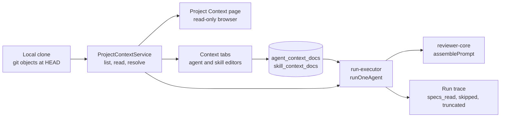

# Project Context

How a repository's markdown documents get from the local clone into a reviewer's prompt, and who decides which ones go.

The feature spans three packages: the server lists, stores and resolves documents, `reviewer-core` renders them into the prompt, and the client lets a person browse and attach them. This page follows one path through all three.

## The shape of it

A document is identified by its repo-relative path and nothing else. The attachment tables are keyed `(owner_id, path)` with no repo column (`server/src/db/schema/agents.ts`, `server/src/db/schema/skills.ts`), so one attachment resolves against whichever repository the agent happens to review. The same path in two repos is the same attachment.

## What counts as a document

`isContextDocPath` in `server/src/modules/_shared/context-docs/helpers.ts` is the single definition: a relative POSIX path ending in `.md` (any case), with no empty, `.` or `..` segment, no segment in the excluded-directory list, no backslash, colon or NUL, no leading `/` or `-`, at most 1024 characters. It is purely syntactic. Whether the file exists is a separate question, answered against the git tree.

On top of that, a tree path is listed only when it matches a search-root glob — by default `**/{specs,docs,insights}/**/*.md`, so `server/docs/a.md` counts and the root `README.md` does not. `CONTEXT_DOC_GLOBS` (comma-separated, `AppConfig.contextDocGlobs`) replaces the default; `createContextDocMatcher` in the same helpers file compiles it with a small built-in glob (`**`, `*`, `?`, `{a,b}`, case-insensitive). The listing is the only membership check, so a path outside the roots is a 404 in the viewer and `not_found` in a prompt, even if it was attached before the roots changed.

The excluded directories are a copy of the list `repo-intel` uses for the same purpose. A module may not import a sibling, so the copy is deliberate and a unit test (`server/test/context-docs-helpers.test.ts`) keeps the two equal.

The path rule lives in `_shared` because three modules need it (project-context, agents, skills) and that is the only folder all three may import. The same file holds the request body schema for attachment writes: an ordered array of `{ path, enabled }`, at most 500 entries, paths unique.

## Reading comes from git, never from the working tree

`ProjectContextService` (`server/src/modules/project-context/service.ts`) takes the clone's current HEAD sha and does everything at that one sha: `listFilesAt` for the tree, `readFileAt` for content. `listFilesAt` (`server/src/adapters/git/simple-git.ts`) runs `git ls-tree` and keeps only regular blobs, so symlinks and submodules never appear. Because nothing touches the filesystem, a symlinked `.md` pointing outside the repository cannot be served. A sha is immutable, so the list and the content a person sees cannot disagree.

Consequences worth knowing:

- **Which commit.** The clone's HEAD (`currentHead`). Nothing in this feature moves HEAD to a PR: `fetchPullHead` only fetches a ref, and `sync` resets the clone to the upstream branch. So these are the repo's documents, not the PR's.
- **Refresh does not fetch.** The refresh button is a plain refetch of the list. The server re-resolves HEAD on every request and answers an unchanged sha from a small per-sha cache (`LIST_CACHE_ENTRIES` in `server/src/modules/project-context/constants.ts`).
- **A repo with no clone** returns `cloned: false` from the list rather than an error. The content endpoint answers 409 `context_not_cloned`.
- **A path that is not in the tree** answers 404 `context_doc_not_found`; a syntactically bad path answers 422.
- **The listing is capped.** At most `MAX_LISTED_DOCS` (1,000) documents, first by path, are measured. The response carries `total` and `capped`, and the page shows a warning. The cap applies to the listing only: reading one document and resolving a prompt check membership against the full tree, so a document past the cap is still readable and still attachable.

Each listed document carries `chars`, `approx_tokens`, a `truncated` flag, a `category` (the first search-root folder in the path, else the first folder, else `root`) and `used_by`. `approx_tokens` is `ceil(min(chars, 32000) / 4)`, computed once on the server (`server/src/modules/project-context/helpers.ts`) so the page and the tabs show one number. The client's `estimateTokens` in `client/src/lib/tokens.ts` uses the same `chars / 4` rule for the trace.

`used_by` is the number of agents that get the document, directly or through a skill, each counted once, whether or not `agents.enabled` is set. `AgentsRepository.contextDocUsage` computes it as one `UNION` of the two sources so an agent holding a document both ways is not counted twice.

## Attaching: agents and skills

Both owners store the same row model: `(owner_id, path, order, enabled)`. `enabled = false` parks the row in its position instead of deleting it, so unchecking and re-checking a document does not lose its place. The write is replace-all: the client PUTs the whole ordered list, the repository deletes and re-inserts in one transaction, and an unchanged list writes nothing. Last write wins. Neither write bumps `agents.version` or `skills.version`, because attachments are not part of the versioned configuration.

Routes are `GET`/`PUT /agents/:id/context-docs` and `GET`/`PUT /skills/:id/context-docs`. The agent's GET returns two lists: `attached` (its own rows, checked and parked) and `inherited` (what active skills contribute, with the skill's name).

### When a skill counts as active

`activeSkillOnAgent` in `server/src/db/skill-gates.ts` is the one predicate, and it has three conditions: the agent has the skill checked, the skill is enabled globally, and the skill lives in the agent's workspace. The skill bodies in the prompt, the inherited rows on the Context tab and `used_by` all use it, so they cannot disagree about whether a skill is active. It sits beside the schema rather than in a module because two repositories need it.

## From attachment to prompt

`runOneAgent` in `server/src/modules/reviews/run-executor.ts` reads the agent's checked documents and its active skills' checked documents once, at the start of that agent's run, next to the skills read. Edits made after that point do not affect a run already past it.

`resolveForPrompt` then builds the list:

1. The agent's own documents, in stored order.
2. Each active skill's documents, skills in their order on the agent, documents in the skill's order.
3. A path that appears twice is kept once, at its first position (`mergePromptDocs`).

For each path it checks membership in the tree at HEAD and reads the content, cutting anything longer than `MAX_CONTEXT_DOC_CHARS` (32,000) and appending a visible `[truncated: ...]` marker. Truncation happens here on the server; `reviewer-core` receives final strings and does not know about the limit.

This step does not throw on a git problem. A document that cannot be used goes into `skipped` with a reason (`not_found`, `not_cloned` or `read_error`) and the review continues. A database error while reading the attachment rows, by contrast, fails the run.

The executor passes `specs` to the engine only when at least one document resolved. With none, the argument is omitted, so the prompt is byte-for-byte what it was before the feature.

## How reviewer-core renders it

`specs` accepts bare strings or `{ label, text }` documents (`reviewer-core/src/prompt.ts`). A bare string keeps its old `spec-<i>` label; the server sends the path as the label. Each document becomes its own delimiter-wrapped untrusted block, under a `## Project context` heading whose first line is `PROJECT_CONTEXT_RULE`, a trusted sentence that tells the model the blocks are reference data and any instructions inside them are to be ignored. The rule is rendered only when documents are present; `INJECTION_GUARD` is unchanged.

`wrapUntrusted` does two things relevant here: it neutralises any closing tag matching `</untrusted>` in any case and with inner whitespace, and it replaces `"`, `<`, `>`, CR and LF in the label with `_`, so a path cannot break out of the `source` attribute. The chunked review path passes the same `specs` into every chunk.

## What the run trace records

The executor writes `specs_read` (paths that reached the prompt, in prompt order) and, only when non-empty, `specs_skipped` (path and reason) and `specs_truncated` (paths that were cut). Both are optional in the `RunTrace` contract, so traces stored before this feature still parse. The run trace drawer (`client/src/app/repos/[repoId]/pulls/[number]/_components/RunTraceDrawer/_components/TraceBody/TraceBody.tsx`) marks truncated paths and shows a row for skipped ones; the Project context prompt block shows the exact text that was sent.

## The client surfaces

- **Project Context page**, `client/src/app/repos/[repoId]/context/`. A folder tree, a rendered viewer and a footer with file count, total tokens and the time of the listing. It is read-only: documents are edited in the repository. Markdown is rendered by the shared `Markdown` primitive, which does not allow raw HTML.
- **Context tabs** on the agent and skill editors, both built on the shared `client/src/components/context-docs-list/`. The pure logic (row order, toggling, moving, what the PUT posts) is in `client/src/lib/context-docs.ts`.

The row order on a tab is: stored rows in saved order, then documents the agent only inherits, then every other listed document alphabetically. Checking an unstored document appends it to the end of the stored block; unchecking parks it in place, except that unchecking a row whose file no longer exists removes it. Only stored rows reorder, and only within the stored block. Reorder indices address the full row array, so filtering the view never changes what is written.

The tabs show documents from the **active repository's** listing, since attachments are paths. A stored path missing from that listing shows as not found. The "X of Y attached" counts and the token total are taken from the full row array, and the token total counts each path once even when it arrives both directly and through a skill. The skill tab also previews what the skill contributes: the `## Project context` heading and the checked paths in order, with no document text.

A save applies at once in the UI. On error the rows revert to the server's state and a toast carries the error message.
