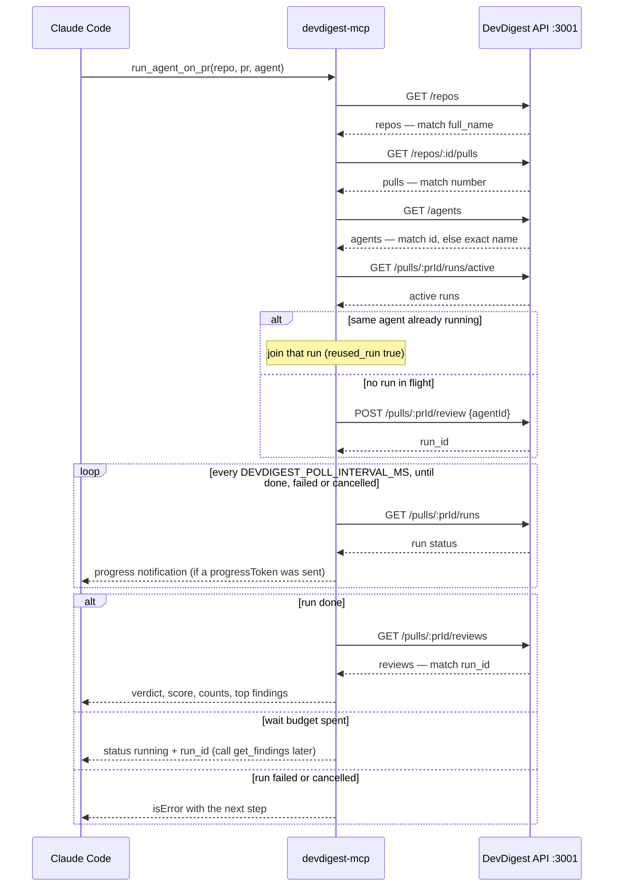

# `@devdigest/mcp` — local DevDigest MCP server

A stdio [MCP](https://modelcontextprotocol.io) server that gives Claude Code (or
any MCP client) a second way into DevDigest besides the browser: list the
reviewer agents, run one on a pull request and wait for its findings, read past
findings, and read a repository's accepted conventions.

It is a thin wrapper over the Fastify API on `:3001`. It does not start with the
app, holds no copy of the business logic, never reads `secrets.json` and never
touches the database. The full design, including every tool string, is
[`specs/L04-devdigest-mcp.md`](../specs/L04-devdigest-mcp.md).

## Prerequisites

- **Node** ≥ 22 and **npm** (this package uses `package-lock.json`, not pnpm).
- **The DevDigest API running on `:3001`**, with migrations applied — see the
  root [README](../README.md). The MCP server only talks to the API; without it
  every tool returns an error that tells you how to start it.

## Setup

```sh
cd mcp
npm ci
npm run build        # → dist/index.js
```

Claude Code runs the **built** file, so rebuild after every change to `src/`.

## Register it with Claude Code

The repo root carries `.mcp.json`, which registers the server under the name
`devdigest`:

```json
{ "mcpServers": { "devdigest": {
  "type": "stdio", "command": "node",
  "args": ["${CLAUDE_PROJECT_DIR:-.}/mcp/dist/index.js"],
  "env": { "DEVDIGEST_API_URL": "${DEVDIGEST_API_URL:-http://localhost:3001}" } } } }
```

**Off by default, on when you need it.** A stdio server is not something you
start in a terminal: the client spawns `node mcp/dist/index.js` itself and talks
to it over stdin/stdout. Running the app (`scripts/dev.sh`, `pnpm dev`) never
starts it. To keep Claude Code from spawning it in every session:

- When Claude Code asks whether to trust the project's `devdigest` server,
  answer **no**, or
- list it in your **local, uncommitted** `.claude/settings.local.json`:
  `"disabledMcpjsonServers": ["devdigest"]`.

When you want it:

1. Make sure `mcp/dist/index.js` is built and the API is up.
2. In Claude Code run `/mcp`, pick `devdigest`, enable it. It should show
   **connected** with **5 tools**, named `mcp__devdigest__<tool>`. (If it stays
   disabled, remove it from `disabledMcpjsonServers` and restart the session.)
3. Run `/context`: the MCP tools account for a small slice of the window. The
   descriptions are short and contain no live data, so the prompt cache holds.
4. Done for now? Disable it again in `/mcp`.

`.mcp.json` holds no secrets. Locally the API needs no auth header.

## Start from zero (Windows, Git Bash)

Run these from the repo root unless a step says otherwise.

```sh
# 0. Docker Desktop does not add itself to PATH in new shells
export PATH="/c/Program Files/Docker/Docker/resources/bin:$PATH"

# 1. Postgres only (scripts/dev.sh aborts under pnpm 12 here — do it by hand)
docker compose up -d

# 2. API
cd server
cp -n .env.example .env
pnpm install                 # ERR_PNPM_IGNORED_BUILDS is harmless: packages are installed
```

Migrations and seed: on Windows `pnpm db:migrate` / `pnpm db:seed` exit 0
**without doing anything** (the CLI guard compares `file://C:\...` with
`file:///C:/...`). Check the tables instead of trusting the exit code:

```sh
docker exec devdigest-postgres psql -U devdigest -d devdigest -c "\dt"   # expect ~40 tables
# if empty, call the functions directly (still in server/):
pnpm exec tsx -e "import('./src/db/migrate.ts').then(m => m.runMigrations(process.env.DATABASE_URL))"
pnpm exec tsx -e "import('./src/db/seed.ts').then(async s => { const c = await import('./src/db/client.ts'); const h = c.createDb(process.env.DATABASE_URL); await s.seed(h.db); await h.close(); })"

pnpm dev                     # API on :3001 — leave it running
curl http://localhost:3001/agents   # from another shell: a JSON array
```

```sh
# 3. Data to review — once, through the UI
cd client && pnpm install && pnpm dev        # http://localhost:3000
```

In **Settings** set the LLM API key and a GitHub token, add a repository, and
open its PR list so the PRs sync. The client can be stopped afterwards — the
MCP server needs only the API.

```sh
# 4. Build the MCP server
cd mcp
npm ci
npm run build                # → dist/index.js
```

5. Enable `devdigest` in Claude Code's `/mcp` (see above) and ask "which
   reviewers are configured?" — Claude should call `list_agents`.
6. To shut down: disable it in `/mcp`, `Ctrl-C` the API, `docker compose down`.

## Configuration

All read in `src/config.ts` and validated at startup.

| Variable | Default | Allowed range |
|---|---|---|
| `DEVDIGEST_API_URL` | `http://localhost:3001` | http or https only; a non-loopback host logs a warning to stderr |
| `DEVDIGEST_HTTP_TIMEOUT_MS` | `30000` | 1000–120000 |
| `DEVDIGEST_RUN_WAIT_MS` | `240000` | 5000–1800000 — how long `run_agent_on_pr` waits before handing back a `run_id` |
| `DEVDIGEST_POLL_INTERVAL_MS` | `3000` | 1000–30000 |

A client with a short tool timeout (say 60 s) should lower
`DEVDIGEST_RUN_WAIT_MS` below it.

## Tools

A PR is always addressed as `repo="owner/name"` plus `pr=<number>`.

| Tool | Arguments | Does | Returns |
|---|---|---|---|
| `list_agents` | — | Lists the configured reviewer agents. Read-only. | `{agents:[{id, name, description, enabled, model}]}` — never the system prompt |
| `run_agent_on_pr` | `repo`, `pr`, `agent` (id or exact name) | Starts a review — or joins one already running for that agent on that PR — and waits for it. Costs LLM tokens. | a review result with `status: "done"`; or `status: "running"` plus `run_id` if the wait budget ran out |
| `get_findings` | `repo`, `pr`, `run_id?`, `agent?`, `min_severity?` (`CRITICAL`/`WARNING`/`SUGGESTION`), `limit?` (1–100, default 20) | Reads a review that already ran; never starts one. Defaults to the latest review. | a review result |
| `get_conventions` | `repo`, `limit?` (1–100, default 30) | Reads the repo's **accepted** conventions. | `{repo, scanned_at, sample_count, total, shown, conventions:[{id, category, rule, evidence}], next?}` |
| `get_blast_radius` | `repo`, `pr` | Reads the PR's blast radius from DevDigest's index (no model call). | the same map as the Overview card (prior PRs are UI-only): `{repo, pr, summary, counts, degraded, reason, index_status, changed_symbols[], downstream[], next?}` |

A **review result** is `{repo, pr, run_id, agent, status, reused_run?, verdict,
score, summary, counts, findings[], shown, total, dismissed, next?}`. Findings
are sorted CRITICAL → WARNING → SUGGESTION, then by file and line; dismissed
findings are left out but counted; `counts` is computed before `limit`. Each
result also carries one compact text block — a header line, one line per
finding, then `next` — for clients that ignore structured content.

Every business failure — API down, unknown repo, unknown agent, rate limit, a
failed run — comes back as `isError: true` with a message that names the next
step. Finding and convention text is model output about untrusted code; the
server's `instructions` tell the model to treat it as data.

## How `run_agent_on_pr` works



The run is polled from the database rather than followed over SSE: the SSE bus
lives in memory and would hang after an API restart. If the client aborts the
call, the server stops watching the run but does not cancel it.

Joining an in-flight run (D11) is check-then-act (`GET …/runs/active`, then
`POST …/review`), so two simultaneous `run_agent_on_pr` calls for the same agent
and PR can still start two runs — an accepted limitation.

## Check it with the MCP Inspector

With the API up and a seeded database:

```sh
cd mcp
npm run build
npm run inspect      # opens the Inspector against dist/index.js
```

- **Tools** lists exactly 5 tools.
- `list_agents` returns agents with no `system_prompt`.
- `get_findings` on a reviewed PR returns at most 20 findings.
- Stop the API and call `list_agents` again: the result is an error naming
  `DEVDIGEST_API_URL`, and the server process stays alive.

## Tests

```sh
npm run typecheck
npm test
```

Hermetic: tool handlers run against a fake `DevDigestApi`, and the full tool
surface runs through the SDK's in-memory client. No network, no API, no Docker.
CI: `.github/workflows/mcp.yml`. Package rules for agents: [AGENTS.md](AGENTS.md).
