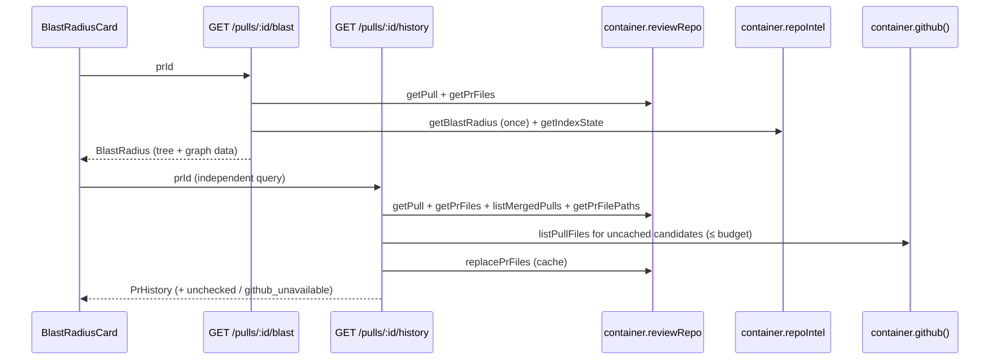

# L04 — Blast Radius

**Goal:** a reviewer opening a PR sees, on the Overview tab:
- which symbols the PR touches;
- who calls them, as clickable `file:line`, in a Tree or a Graph view;
- which HTTP endpoints and crons depend on them;
- which earlier merged PRs touched the same files.

Claude Code gets the same impact map from `get_blast_radius`.

**Not in scope:**
- Any new code analysis. The map reads what `repo-intel` already indexed. It does
  not parse, rebuild the import graph or call a model.
- Changing the `repo-intel` facade (`server/src/modules/repo-intel/**`). The
  discrepancies below are recorded, not fixed. The user decided Q1: **do not fix
  the cap; say so in the PR description.**
- A database migration. No table or column changes. The "Prior PRs" cache reuses
  the existing `pr_files` table.
- A new npm dependency. The graph is hand-laid-out SVG (D12).
- Prior PRs in the MCP tool (D15).
- Restoring a removed implementation from git history (root `INSIGHTS.md:97`).

**Branch:** `lesson/L04-lab-homework` (already cut from `main` after PR #26; never `main`)

**Scope (from the brief, updated by the user):**
- all of P1 and all of P2;
- P3: collapsible tree, sort by rank, crons apart from endpoints, labels from `blast.json`, a resync button by the badge;
- P3, added later by the user: the **Graph view with a Tree/Graph toggle**, and **"Prior PRs touching these files"**.

## What the code actually has (verified against the fork, 2026-10-26)

The brief describes the starter. The fork differs in the places below, and the
plan is built for the code as it is.

| Brief says | Code says | Consequence for this plan |
|---|---|---|
| `repoIntel.getBlastRadius(repoId, changedFiles)` returns `BlastResult` | true: `server/src/modules/repo-intel/service.ts:220`, type at `repo-intel/types.ts:74-87` | used as-is, called **once** per request |
| caps at 20 callers **per symbol** (`MAX_CALLERS_PER_SYMBOL`) | the persistent path sorts **all** callers by rank, then cuts the whole list at 20: `callers.slice(0, MAX_CALLERS_PER_SYMBOL)` (`service.ts:386`). The ripgrep fallback (`service.ts:262-289`) has no cap | the map shows at most 20 callers **in total** on a full index. Not fixed (user decision, Q1); it goes into the PR description. The client never hardcodes 20 (P2.6) |
| `degraded` + `reason` ∈ `flag_off, index_failed, index_partial, repo_too_large, no_data` | `getBlastRadius` only ever returns `degraded: true, reason: 'no_data'` (fallback) or `degraded: false` (persistent). A **`partial`** index is served as `degraded: false` (`service.ts:320-321`). With the flag off it falls through to the ripgrep path, which also reports `no_data` | `degraded`/`reason` pass through unchanged (P2.7). The service **also** reads `getIndexState(repoId)` and returns `index_status` and `indexed_sha`, so a partial or failed index still gets its own label (P1.6) |
| the facade drops the file where the symbol is declared | true only for the ripgrep path (`service.ts:270`). The persistent path does **not**: `getResolvedCallers` filters on `decl_file IN changedFiles` and `to_symbol IN names` only (`repo-intel/repository.ts:503-531`) | the mapping helper drops callers whose file declares the symbol they call (P2.5) |
| `factsByFile` gives endpoints and crons per caller file | present only on the persistent path (`types.ts:79-84`); the fallback has only the flat `impactedEndpoints` | on the fallback path groups and callers have no endpoints or crons; the degraded badge explains why (Q3) |
| `BlastRadius` contract: `changed_symbols`, `downstream`, `summary` | true, identical in both copies (`server/src/vendor/shared/contracts/brief.ts:60-88` = client copy; `diff -r` of the two `vendor/shared` trees is empty) | extended with **defaulted** fields (see `## Contract`) |
| (graph) edges symbol → caller → endpoint | the contract has endpoints **per symbol group** only. Which caller leads to which endpoint is in `factsByFile` (per file), and the current mapping would lose it | `BlastCaller` gets defaulted `endpoints`/`crons`, filled from `factsByFile[caller.file]`, so the graph edges are real (D13) |
| (Prior PRs) `PrHistory` schema exists | true (`brief.ts:108-122`): `{ history: [{ pr_number, title, merged_at, author, files_overlap, notes }] }`. **Nothing produces it**, and the `pr_brief` table that would hold a composed `PrBrief` (`db/schema/reviews.ts:106-110`) is unused | new producer. See D14 for where the data comes from |
| (Prior PRs) data sources | the clone is **shallow**: `CLONE_DEPTH = 1` (`repos/constants.ts:9`), with ≤50 commits after a resync (`adapters/git/simple-git.ts:20`), so `git log` cannot answer. `pull_requests` holds the ≤50 most recently updated PRs per repo, with GitHub status `merged` stored on sync (`pulls/routes.ts:76-84`, `server/INSIGHTS.md:184-193`), but **no merge timestamp**. `pr_files` is filled only when a PR's detail is opened (`pulls/routes.ts:238-249`). The GitHub port has no "list a PR's files" method; `getPullRequest` costs 3–4 calls (`octokit.ts:70-124`) | D14: DB candidates + `pr_files` as a durable cache + a new one-call `listPullFiles` port method to fill it, bounded per request |
| `githubBlobUrl(repoFullName, sha, file, startLine)` | true: `client/src/lib/github-urls.ts:24`. `githubPrUrl` is at `:16` | used for caller and prior-PR links |
| `client/messages/en/blast.json` labels | exist: `stat.*`, `view.tree`, `view.graph`, `callerCount`, `noDownstream`, `graph.empty`, `graph.ariaLabel`. There is no title, loading, error, degraded, reason, resync, legend or history key | the keys are added to the same file |
| `GET /repos/:id/index-state`, `POST /repos/:id/resync` | both exist (`repo-intel/routes.ts:32-71`) and check the workspace. The hooks `useRepoIntelStatus` / `useResyncRepoIntel` already exist in `client/src/lib/hooks/repo-intel.ts`, with **no consumer yet** | reused |
| `OverviewTab` shows only the description | its props are `{ prId, prBody }` only (`OverviewTab.tsx:8-11`). It already renders `IntentCard` in a two-column grid that keeps the right column empty "until Blast Radius ships" (`OverviewTab/styles.ts:16-21`) | the card goes into that column. The page must also pass `repoId`, `repoFullName`, `headSha` |
| MCP stub `get_blast_radius` | `mcp/src/tools/get-blast-radius.ts`, `mcp/src/server.ts:73-77,115-118,215-223`. Its title and description are **checked verbatim** against `specs/L04-devdigest-mcp.md` (`mcp/test/hygiene.test.ts:97-101,196`) | that spec's table changes first (step 23) |
| no `blast/` module, no route | true; `server/src/modules/index.ts` has no `blast` entry | new modules `blast/` and `pr-history/` |



## Touches

**server:**
- new module `src/modules/blast/` (`types.ts`, `helpers.ts`, `service.ts`, `routes.ts`);
- new module `src/modules/pr-history/` (`constants.ts`, `types.ts`, `helpers.ts`, `service.ts`, `routes.ts`);
- `src/modules/index.ts` (two entries);
- `src/modules/reviews/repository.ts` + `repository/pull.repo.ts` (three shared pull-repo methods);
- `src/adapters/github/octokit.ts` and `src/adapters/mocks.ts` (`listPullFiles`);
- both `vendor/shared/contracts/brief.ts`;
- both `vendor/shared/adapters.ts`;
- `README.md`;
- tests in `server/test/`.

**client:** under `src/app/repos/[repoId]/pulls/[number]/`:
- `_components/BlastRadiusCard/` (new, route-local), with sub-folders `BlastSymbolNode`, `BlastIndexNotice`, `BlastViewToggle`, `BlastGraph`, `PriorPrs`;
- `_components/OverviewTab/`;
- `page.tsx` (props only).

Outside that folder:
- `src/lib/hooks/blast.ts` (new), plus one line in `src/lib/hooks/index.ts`;
- `messages/en/blast.json`.

**mcp:**
- `src/tools/get-blast-radius.ts`;
- `src/api/{port,types,http-client}.ts`;
- `src/format.ts`;
- `src/server.ts`;
- `test/*`;
- `README.md`;
- `specs/L04-devdigest-mcp.md` (tool text).

**reviewer-core:** nothing.

**Decisions made here (not asked):**

| # | Decision | Why |
|---|---|---|
| D1 | `GET /pulls/:id/blast` lives in a **new** `modules/blast/` | the brief names it; the registry comment expects it (`modules/index.ts:22-24`) |
| D2 | Services take **explicit deps** typed by narrow interfaces in their own `types.ts`, never the whole `Container` | the target shape in `onion-architecture`. `no-cross-module` with `tsPreCompilationDeps: true` forbids even `import type` from `../repo-intel/` or `../reviews/` (`server/.dependency-cruiser.cjs:115-124`, `server/INSIGHTS.md:216-217`). `container.reviewRepo`, `container.repoIntel` and `container.github()` satisfy the interfaces structurally |
| D3 | Besides the one `getBlastRadius` call, the blast service reads `getIndexState(repoId)` | otherwise a partial or failed index is invisible. A cheap read, not analysis |
| D4 | `downstream` lists only symbols with ≥1 caller; `changed_symbols` lists them all | screenshot `hw4-5.png` ("14 symbols", 4 groups) |
| D5 | Sorting happens on the **server**. Groups: top caller `rank` desc → caller count desc → symbol asc. Callers: `rank` desc → file → line | `rank` is not in the contract; tree, graph and MCP must agree |
| D6 | `counts` and `summary` are computed from `downstream` (unique endpoints and crons across the groups), not from `impactedEndpoints` | `impactedEndpoints` / `factsByFile` also cover callers cut by the cap (`service.ts:376-386`). A count shown above a list is counted from that list (`client/INSIGHTS.md:168-179`) |
| D7 | Caller links point at `indexed_sha`, falling back to the PR `head_sha` | line numbers come from the index, and caller files are outside the diff (P1.5) |
| D8 | In the tree, the first group is expanded and the rest are collapsed; each node owns its `open` state | screenshot `hw4-2.png` |
| D9 | Everything client-side is route-local under `pulls/[number]/_components/BlastRadiusCard/` | one consumer; promote on the second |
| D10 | MCP returns the blast map **uncapped**, with strings cleaned, and no `limit` | "the same map as the page" (P1.7). The server cap bounds it (Q4) |
| D11 | Test PR target: a function in `server/src/modules/_shared/context.ts` (`getContext` / `requireRepoInWorkspace`) | it has ~10 `routes.ts` callers with single-line `app.get('/…'` registrations, so endpoints are detected (Q5). Merged PR **#6** on the fork touched this file, so Prior PRs has something real to show |
| D12 | **Graph = hand-laid-out SVG, no dependency.** A pure `layoutGraph()` places three fixed columns (changed symbol → caller function → endpoint/cron) on a fixed `viewBox`; edges are cubic Béziers | the layout is a 3-layer bipartite fan-out with ≤20 callers (cap) and small target sets. That needs no force or Dagre layout. A graph library would add bundle weight and a lockfile commit for something about 80 lines of pure, unit-testable code do |
| D13 | `BlastCaller` gains `endpoints`/`crons` (from `factsByFile[caller.file]`) | without them a caller→endpoint edge would be guessed from the group union, which is wrong whenever two callers sit in different route files |
| D14 | **Prior PRs, data source:** candidates are **DB-only**: merged PRs DevDigest already synced for this repo (`pull_requests.status='merged'`, same workspace and repo, not this PR), newest first, at most `PRIOR_PR_CANDIDATES = 30`. A candidate's files come from `pr_files` if present. Otherwise **one** GitHub call (`pulls.listFiles`, new port method `listPullFiles`) fetches them and writes them to `pr_files`, which is the same rows the PR-detail route writes, so it is a durable cache. A merged PR's file list never changes, so there is no TTL. At most `PRIOR_PR_FETCH_BUDGET = 8` GitHub calls per request; the rest are reported as `unchecked` and filled on later loads | cheapest honest source. `git log` is impossible on a depth-1 clone. GitHub-only (per-file commit search → commit-to-PR) costs files × commits calls per request. DB-only without the fill would be almost always empty, because `pr_files` is only filled for PRs someone opened. No migration: `pr_files` already models "files of a PR" |
| D14a | **Degradation:** if `container.github()` throws (no token) or a call fails (offline, 401, rate limit), the PRs already cached are still matched, the rest count as `unchecked`, and `github_unavailable: true` is set. The route never 5xx's because of GitHub | the card must say "N merged PRs not checked — GitHub unreachable", not show a false "none" |
| D14b | **`merged_at` = the PR's `updated_at`** (DevDigest stores no merge time). The contract comment says so, and the UI labels the date "updated", not "merged" | honest without a migration. Adding a `merged_at` column is a follow-up (Q8) |
| D14c | "Prior" = merged PRs only. Other **open** PRs touching the same files are not listed | `PrHistoryItem.merged_at` is required, and the block's meaning is history. Open-PR overlap is a different feature (Q8) |
| D15 | Prior PRs is its **own route** `GET /pulls/:id/history` in its own module `modules/pr-history/`. It is **not** part of `/pulls/:id/blast`, and **not** in the MCP tool | different source (DB+GitHub vs. index), latency and failure mode. Keeping blast a pure index read is what P2.1 asks for. The MCP tool's contract is "the same **map**", and history is not part of the map. One server rule per module |
| D16 | The view toggle (`tree` / `graph`) is component state in `BlastRadiusCard`, default `tree`, not persisted | no requirement to persist it. Persisting it is UI polish for later |

## Contract

Both copies, **same commit**, byte-identical:
`server/src/vendor/shared/contracts/brief.ts` and `client/src/vendor/shared/contracts/brief.ts`.
Every new field has a default. The existing bare-shape parses in
`server/test/contracts.test.ts:70-110`, and the `PrBrief` composition (`brief.ts:165-170`), still parse.

```ts
// ---- Blast radius ----  (ChangedSymbol, DownstreamImpact unchanged)

export const BlastCaller = z.object({
  name: z.string(),
  file: z.string(),
  line: z.number().int(),
  /** Endpoints / crons declared in this caller's file (index facts). Graph edges. */
  endpoints: z.array(z.string()).default([]),
  crons: z.array(z.string()).default([]),
});

/** Why repo-intel served a degraded map. Mirrors repo-intel's DegradedReason. */
export const BlastDegradedReason = z.enum([
  'flag_off', 'index_failed', 'index_partial', 'repo_too_large', 'no_data',
]);
export type BlastDegradedReason = z.infer<typeof BlastDegradedReason>;

/** repo_index_state.status of the PR's repo at read time. */
export const BlastIndexStatus = z.enum(['full', 'partial', 'degraded', 'failed']);
export type BlastIndexStatus = z.infer<typeof BlastIndexStatus>;

/** The numbers in the summary row, counted from `downstream` (+ changed_symbols). */
export const BlastCounts = z.object({
  symbols: z.number().int().nonnegative(),
  callers: z.number().int().nonnegative(),
  endpoints: z.number().int().nonnegative(),
  crons: z.number().int().nonnegative(),
});
export type BlastCounts = z.infer<typeof BlastCounts>;

export const BlastRadius = z.object({
  changed_symbols: z.array(ChangedSymbol),
  downstream: z.array(DownstreamImpact),
  summary: z.string(),
  counts: BlastCounts.default({ symbols: 0, callers: 0, endpoints: 0, crons: 0 }),
  /** Passed through verbatim from the facade. */
  degraded: z.boolean().default(false),
  reason: BlastDegradedReason.nullable().default(null),
  /** From getIndexState; lets the UI flag a partial/failed index the facade served as non-degraded. */
  index_status: BlastIndexStatus.nullable().default(null),
  /** Commit the index was built from; caller line links point here. null when never indexed. */
  indexed_sha: z.string().nullable().default(null),
});

// ---- PR History ----
export const PrHistoryItem = z.object({
  pr_number: z.number().int(),
  title: z.string(),
  /**
   * ISO timestamp. For PRs DevDigest synced from GitHub this is the merged PR's
   * last-update time — no merge timestamp is stored (pull_requests has none).
   */
  merged_at: z.string(),
  author: z.string(),
  files_overlap: z.array(z.string()),
  notes: z.string(),
});

export const PrHistory = z.object({
  history: z.array(PrHistoryItem),
  /** How many merged PRs DevDigest knows for this repo were compared. */
  candidates: z.number().int().nonnegative().default(0),
  /** Candidates whose files could not be read this time (budget or GitHub down). */
  unchecked: z.number().int().nonnegative().default(0),
  /** True when GitHub could not be reached for an uncached candidate. */
  github_unavailable: z.boolean().default(false),
});
```

`BlastDegradedReason` and `BlastIndexStatus` must list exactly the members of
`DegradedReason` / `IndexStatus` (`repo-intel/types.ts:25-32`). Typecheck enforces
it through the structural port in step 2.

**Port** (both copies of `vendor/shared/adapters.ts`, same commit). Add to `GitHubClient`:

```ts
  /** Files of one PR (pulls.listFiles, one page of 100). For the Prior-PRs cache. */
  listPullFiles(repo: RepoRef, n: number): Promise<PrFile[]>;
```

## Skill map

Derived from `.claude/skills/pr-self-review/references/routing.md`, then reconciled.

| Step | Path | Skills the implementer loads |
|---|---|---|
| 1 | `{server,client}/src/vendor/shared/contracts/brief.ts`, `server/test/contracts.test.ts` | `zod` |
| 2–3 | `server/src/modules/blast/{types,helpers}.ts` | `onion-architecture`, `typescript-expert` |
| 4, 6 | `server/test/blast-*.test.ts` | **not in routing.md** (`server/test/**` is unrouted). Use `onion-architecture` ("Tests prove the architecture") |
| 5 | `server/src/modules/blast/service.ts` | `onion-architecture`. Perf rubric: `docs/agent-prompts/performance-reviewer.md` (routing's `perf-prompt` lens. **Not a skill.**) |
| 7 | `server/src/modules/blast/routes.ts`, `server/src/modules/index.ts` | `fastify-best-practices`, `onion-architecture`, `security`. Perf rubric as above |
| 8 | `server/test/blast-route.it.test.ts` | unrouted. `fastify-best-practices`, `drizzle-orm-patterns` |
| 9 | `{server,client}/src/vendor/shared/adapters.ts`, `server/src/adapters/github/octokit.ts`, `server/src/adapters/mocks.ts` | `onion-architecture`, `security`, `typescript-expert`. Perf rubric |
| 10 | `server/src/modules/reviews/repository.ts`, `…/repository/pull.repo.ts` | `drizzle-orm-patterns`, `onion-architecture`. Perf rubric |
| 11–12 | `server/src/modules/pr-history/{constants,types,helpers}.ts` | `onion-architecture`, `typescript-expert` |
| 13 | `server/src/modules/pr-history/service.ts` | `onion-architecture`, `security`. Perf rubric |
| 14 | `server/src/modules/pr-history/routes.ts`, `modules/index.ts` | `fastify-best-practices`, `onion-architecture`, `security` |
| 15–16 | `server/test/pr-history-*.test.ts`, `server/test/pr-history-route.it.test.ts` | unrouted. `onion-architecture`, `drizzle-orm-patterns` (it) |
| 17 | `server/README.md` | `mermaid-diagram` (routing: gates only) |
| 18 | `client/messages/en/blast.json` | routing: none (G12). ICU per `next-best-practices` / next-intl |
| 19 | `client/src/lib/hooks/{blast,index}.ts` | `frontend-ui-architecture`, `typescript-expert` |
| 20–21 | `client/src/app/repos/[repoId]/pulls/[number]/_components/{BlastRadiusCard,OverviewTab}/**`, `…/[number]/page.tsx` | `frontend-ui-architecture`, `next-best-practices`, `react-best-practices`, `security` (external `href`) |
| 20 (graph) | `…/BlastRadiusCard/_components/BlastGraph/**` | the above, plus `typescript-expert` for the pure layout types |
| 22 | `…/BlastRadiusCard/**/*.test.tsx`, `**/helpers.test.ts` | `react-testing-library`. Routing matches colocated tests to the `{app,components}/**/*.tsx?` row **first**, so it never routes this skill; load it explicitly |
| 23 | `specs/L04-devdigest-mcp.md` | gates only |
| 24–26 | `mcp/src/**/*.ts` | `typescript-expert`, `zod`, `security`, `onion-architecture` (the mcp rings in `routing.md`) |
| 27 | `mcp/test/*.ts` | same as 24–26 |
| 28 | `mcp/README.md` | gates only |

## Constraints

| Constraint | Source |
|---|---|
| `@devdigest/shared` exists twice. Edit both copies (contracts **and** `adapters.ts`) in one commit; typecheck server, client and mcp (mcp reads the server copy) | root `INSIGHTS.md:111-118`, `client/INSIGHTS.md:181-189`, `mcp/AGENTS.md` |
| Client imports **types only** from `@devdigest/shared`. Runtime value lists (reasons) are local consts checked against the contract type. Run `pnpm build` | `server/INSIGHTS.md:54-69` |
| No sibling-module import, **including `import type`**. Reach `reviewRepo`, `repoIntel` and `github()` through the container | `server/.dependency-cruiser.cjs:115-124`, `server/INSIGHTS.md:110-126,204-218` |
| Only the container builds adapters. A new port method gets its implementation in `src/adapters/github/`, plus the mock | `onion-architecture` ("Adding an integration"), `.dependency-cruiser.cjs` `no-concrete-adapters` |
| A cross-module repository is extended in its own module and reached via `container.reviewRepo`. SQL stays in `repository*.ts` | `server/INSIGHTS.md:156-168`, `platform/container.ts:75-79,106-108` |
| New modules get `service.ts` + `routes.ts`, never "SQL in routes" | `server/INSIGHTS.md:142-154` |
| Static registration: one import + one entry per module in `modules/index.ts` | `server/AGENTS.md`, `modules/index.ts:14-24` |
| Schema-first validation: `params: IdParams`, `response: { 200: <Contract> }`. No hand `.parse` | `server/AGENTS.md`, `reviews/routes.ts:149-157` |
| Throw `NotFoundError`; never build the envelope by hand | `platform/errors.ts:19` |
| `repo-intel` tables carry no `workspace_id`; take the repo id from the **workspace-scoped** pull row. Prior-PR candidates are filtered by `workspace_id` **and** `repo_id` | `repo-intel/routes.ts:36-41`, `server/AGENTS.md` ("every query scopes by it") |
| Every GitHub call goes through `withRetry(withTimeout(...))` like the other octokit methods | `adapters/github/octokit.ts:36-68` |
| The PR list has only the 50 most recently updated PRs. Prior PRs is honest about this ("among merged PRs DevDigest has synced") | `server/INSIGHTS.md:184-193` |
| DB-backed tests are `*.it.test.ts`; typecheck `server/test/` with a scratch tsconfig; read the integration **skipped** count and use `--no-file-parallelism` | `server/INSIGHTS.md:91-97,128-139,72-88,265-287` |
| Do not commit or reformat `server/src` while a review run is in flight | `server/INSIGHTS.md:14-31` |
| Client: `fireEvent`, not `user-event` | `client/INSIGHTS.md:191-204` |
| Each test provider includes **every** namespace the tree uses; assert rendered text; watch for `MISSING_MESSAGE` | `client/INSIGHTS.md:133-148` |
| No `findByRole` on an ambiguous name (two "Resync"/"Retry" buttons, "Tree"/"Graph") | `client/INSIGHTS.md:60-78` |
| New components style with **Tailwind class strings** in `styles.ts`. SVG colours via CSS variables (`var(--border)`, …), not hex | `frontend-ui-architecture` ("Styles"), `IntentCard/styles.ts` |
| `pnpm build` kills a running `pnpm dev` | `client/INSIGHTS.md:38` |
| MCP: stdout = protocol only; shared is `import type`; tool text verbatim from `specs/L04-devdigest-mcp.md`; handlers throw `ToolError`; rebuild `dist/`; `tools/list` < 8 000 chars | `mcp/AGENTS.md`, `mcp/test/hygiene.test.ts:179-181` |
| **No new dependency, so no lockfile change.** If a later reviewer insists on a graph library, it is its own commit whose subject is that dependency change | root `AGENTS.md` (Hard rules) |
| Limits stay in `repo-intel/constants.ts` (`MAX_CALLERS_PER_SYMBOL` :30, `BFS_DEPTH` :49). No `20` or `2` standing for them in client or mcp | brief P2.6 |
| Mixed CRLF/LF files: edit with Edit/Write, check `git diff --numstat` | root `INSIGHTS.md:161-180` |

## Steps

### Server — blast map

1. **shared (both copies)** · `server/src/vendor/shared/contracts/brief.ts`, `client/src/vendor/shared/contracts/brief.ts` · skill: `zod`.
   Apply `## Contract` exactly: `BlastCaller.endpoints/crons`, `BlastDegradedReason`,
   `BlastIndexStatus`, `BlastCounts`, the five `BlastRadius` fields, the `merged_at` comment,
   and the three `PrHistory` fields. Touch nothing else.
   In `server/test/contracts.test.ts` (case `'Intent / BlastRadius / Risks / PrHistory'`) assert:
   - the bare shapes still parse and get their defaults (`degraded: false`, `reason: null`, caller `endpoints: []`, `unchecked: 0`);
   - a full `BlastRadius` with `reason: 'index_partial'`, `index_status: 'partial'` round-trips;
   - a `PrHistory` with `github_unavailable: true`, `unchecked: 3` round-trips.

   Then `diff` the two files: they must be identical.

2. **server** · `server/src/modules/blast/types.ts` (new) · skill: `onion-architecture`.
   `import type` from `@devdigest/shared` only. Declare:
   - `BlastFacadeCaller { file; symbol; viaSymbol; line; rank }`
   - `BlastFacadeResult { changedSymbols: {file,name,kind}[]; callers: BlastFacadeCaller[]; impactedEndpoints: string[]; factsByFile?: Record<string,{endpoints:string[];crons:string[]}>; degraded?: boolean; reason?: BlastDegradedReason }`
   - `BlastIndexView { status: BlastIndexStatus; lastIndexedSha: string }`
   - `BlastRepoIntel { getBlastRadius(repoId: string, changedFiles: string[]): Promise<BlastFacadeResult>; getIndexState(repoId: string): Promise<BlastIndexView> }`
   - `BlastPullSource { getPull(workspaceId: string, prId: string): Promise<{ id: string; repoId: string } | undefined>; getPrFiles(prId: string): Promise<{ path: string }[]> }`
   - `BlastLogger { info(obj: Record<string, unknown>, msg: string): void }` (the pr-history module declares its own copy; do not share it across modules)
   - `BlastServiceDeps { pulls: BlastPullSource; repoIntel: BlastRepoIntel }`

   No import from `../repo-intel/` or `../reviews/`.

3. **server** · `server/src/modules/blast/helpers.ts` (new, Ring 1) · skill: `onion-architecture`, `typescript-expert`.
   Pure and synchronous. `toBlastRadius(facade, index: BlastIndexView | null): BlastRadius`:
   1. `declFiles`: symbol name → set of files, from `facade.changedSymbols`.
   2. Drop callers whose `file ∈ declFiles.get(viaSymbol)` (P2.5).
   3. Group by `viaSymbol` (P1.3). Sort callers (D5). Map each to
      `{ name: symbol, file, line, endpoints: facts(file).endpoints, crons: facts(file).crons }`, where
      `facts(f) = facade.factsByFile?.[f] ?? { endpoints: [], crons: [] }`, deduplicated and sorted (D13).
   4. Per group: `endpoints_affected` / `crons_affected` = deduplicated, sorted union over its callers. Crons stay separate from endpoints (P3).
   5. Order groups (D5). Only groups with ≥1 caller (D4).
   6. `counts`: `symbols = changedSymbols.length`; `callers` = sum of group sizes; `endpoints`/`crons` = unique across groups (D6).
   7. `summary = summarize(counts)`. `degraded = facade.degraded ?? false`. `reason = facade.reason ?? null` (P2.7). `index_status = index?.status ?? null`. `indexed_sha = index?.lastIndexedSha || null`.

   `summarize(counts)` is deterministic English, no model (P2.4):
   - `"2 symbols changed · 14 callers · 3 endpoints · 1 cron"`;
   - `"2 symbols changed · no downstream callers"` when there are no callers;
   - singular forms for 1.

4. **server** · `server/test/blast-helpers.test.ts` (new, server-unit) · skill: `onion-architecture`.
   The mapping unit test (P2.3). Cases:
   - (a) two `viaSymbol`s → two groups;
   - (b) a caller in the declaring file is dropped (P2.5);
   - (c) group endpoints/crons come only from that group's caller files, deduplicated, crons apart;
   - (d) rank order of groups and callers (D5);
   - (e) a zero-caller symbol is in `changed_symbols` and `counts.symbols` but not in `downstream`;
   - (f) `counts`/`summary` match `downstream`; a shared endpoint is counted once;
   - (g) `degraded`/`reason`/`index_status` pass through; no `factsByFile` → empty arrays everywhere;
   - (h) empty facade → empty `downstream`, "no downstream callers";
   - (i) per-caller `endpoints`/`crons` equal that caller file's facts (D13);
   - (j) every output passes `BlastRadius.parse`.

5. **server** · `server/src/modules/blast/service.ts` (new, Ring 2) · skill: `onion-architecture`.
   `class BlastService { constructor(private deps: BlastServiceDeps) {} async forPull(workspaceId, prId, log?: BlastLogger): Promise<BlastRadius> }`:
   - `getPull`, or throw `NotFoundError('Pull request not found')`;
   - `paths` from `getPrFiles`;
   - `Promise.all([getBlastRadius(pull.repoId, paths), getIndexState(pull.repoId)])`. `getBlastRadius` is called **exactly once** (D3);
   - `toBlastRadius`;
   - **one** `log?.info({ prId, repoId, changedFiles: paths.length, source: facade.degraded ? 'fallback' : 'index', indexStatus, reason, symbols, callers, endpoints, crons, ms }, 'blast radius read from repo-intel index (no reparse, no LLM)')` (P2.1). Never log file contents.

   No LLM, git or GitHub dependency (P2.4, by construction).

6. **server** · `server/test/blast-service.test.ts` (new, server-unit) · skill: `onion-architecture`.
   Use fake deps. Cases:
   - (a) unknown PR → `NotFoundError`, and `getBlastRadius` is not called;
   - (b) `getBlastRadius` is called once with `pull.repoId` and the paths, and `getIndexState` once;
   - (c) one `info` log, with `source` `'index'` or `'fallback'` as appropriate;
   - (d) the result equals `toBlastRadius(fixture, indexFixture)`.

7. **server** · `server/src/modules/blast/routes.ts` (new) + `server/src/modules/index.ts` · skill: `fastify-best-practices`, `onion-architecture`, `security`.
   - `withTypeProvider<ZodTypeProvider>()`; `const service = new BlastService({ pulls: container.reviewRepo, repoIntel: container.repoIntel })`.
   - `app.get('/pulls/:id/blast', { schema: { params: IdParams, response: { 200: BlastRadius } } }, async (req) => { const { workspaceId } = await getContext(container, req); return service.forPull(workspaceId, req.params.id, req.log); })`.
   - Keep the registration on **one line** up to the path string (Q5). Add a header comment.
   - Register `blast` in `modules/index.ts`. No per-route rate limit.

8. **server** · `server/test/blast-route.it.test.ts` (new, server-integration) · skill: `fastify-best-practices`, `drizzle-orm-patterns`.
   Use the pattern of `pulls-comments.it.test.ts:8-75` (`startPg`, `seed`, insert repo + PR + 2 `pr_files`), with `overrides.repoIntel` = a fake `RepoIntel` cast through `unknown`. Assert:
   - 200, and the body passes `BlastRadius.parse` (P2.2);
   - the groups are correct and the fake saw both paths;
   - a random uuid → 404 envelope;
   - `not-a-uuid` → 422;
   - a facade result with `degraded: true, reason: 'index_failed'` reaches the body (P2.7).

### Server — prior PRs

9. **shared port + adapters** · both `vendor/shared/adapters.ts`, `server/src/adapters/github/octokit.ts`, `server/src/adapters/mocks.ts` · skill: `onion-architecture`, `security`.
   - Add `listPullFiles(repo, n): Promise<PrFile[]>` to `GitHubClient` in **both** copies.
   - `OctokitGitHubClient.listPullFiles`: `withRetry(() => withTimeout(pulls.listFiles({ owner, repo, pull_number: n, per_page: 100 }), TIMEOUT))`, mapped to `{ path: f.filename, additions, deletions, patch: f.patch }`, the same mapping as `getPullRequest` (`octokit.ts:104-109`). One page only; document that more than 100 files are cut.
   - `MockGitHubClient`: add a `pullFiles?: Record<number, PrFile[]>` option, a `listPullFilesCalls: number[]` spy, and `listPullFiles` returning `opts.pullFiles?.[n] ?? []`.
   - `OctokitGitHubClient` and `MockGitHubClient` are the only implementations (checked with `grep "implements GitHubClient"`).

10. **server (shared pull repository)** · `server/src/modules/reviews/repository/pull.repo.ts` + facade methods on `ReviewRepository` (`reviews/repository.ts`) · skill: `drizzle-orm-patterns`.
    - `listMergedPulls(workspaceId, repoId, excludePrId, limit)`: returns `{ id, number, title, author, updatedAt }[]` where `workspace_id`, `repo_id`, `status = 'merged'` and `id <> excludePrId`, ordered by `updated_at DESC NULLS LAST, number DESC`, `LIMIT limit`. Uses the `pr_repo_number_uq`/`pr_ws_idx` indexes; no new index (≤50 rows per repo).
    - `getPrFilePaths(prIds: string[])`: returns `Map<prId, string[]>`. **One** `inArray` query (no N+1). Return an empty map for `[]`.
    - `replacePrFiles(prId, files: PrFile[])`: in a `db.transaction`, delete then insert, the same rows `pulls/routes.ts:238-249` writes.

    Do **not** refactor `pulls/routes.ts` to use it (onion debt, separate commit, `server/specs/onion-debt.md`).

11. **server** · `server/src/modules/pr-history/constants.ts` + `types.ts` (new) · skill: `onion-architecture`.
    - `constants.ts`, each with a one-line why:
      - `PRIOR_PR_CANDIDATES = 30`: newest merged PRs compared; ≤ the 50 that get synced;
      - `PRIOR_PR_FETCH_BUDGET = 8`: GitHub calls per request; bounds latency and rate use;
      - `PRIOR_PR_FETCH_CONCURRENCY = 4`.
    - `types.ts` (`import type` from shared only):
      - `HistoryPullSource { getPull(ws, prId): Promise<{ id; repoId; } | undefined>; getRepo(repoId): Promise<{ owner: string; name: string } | undefined>; getPrFiles(prId): Promise<{ path: string }[]>; listMergedPulls(...): Promise<MergedPull[]>; getPrFilePaths(ids): Promise<Map<string, string[]>>; replacePrFiles(prId, files: PrFile[]): Promise<void> }`
      - `HistoryGitHub { listPullFiles(repo: RepoRef, n: number): Promise<PrFile[]> }`
      - `PrHistoryServiceDeps { pulls: HistoryPullSource; github: () => Promise<HistoryGitHub> }`
      - `MergedPull`, `HistoryLogger`.

12. **server** · `server/src/modules/pr-history/helpers.ts` (new, Ring 1) · skill: `onion-architecture`.
    `toPrHistory(currentPaths: string[], checked: { pull: MergedPull; paths: string[] }[], meta: { candidates: number; unchecked: number; githubUnavailable: boolean }): PrHistory`:
    - keep a pull only if `files_overlap = sorted(intersection) ≠ []`;
    - items: `pr_number`, `title`, `author`, `merged_at = pull.updatedAt?.toISOString() ?? ''` (D14b), `notes = "<n> shared file(s)"`;
    - order: `updatedAt` desc, then number desc;
    - copy `meta` into `candidates`/`unchecked`/`github_unavailable`.

13. **server** · `server/src/modules/pr-history/service.ts` (new, Ring 2) · skill: `onion-architecture`, `security`.
    `class PrHistoryService { constructor(private deps: PrHistoryServiceDeps) {} async forPull(ws, prId, log?): Promise<PrHistory> }`:
    1. `getPull`, or `NotFoundError`; `currentPaths` from `getPrFiles`.
    2. `candidates = listMergedPulls(ws, pull.repoId, pull.id, PRIOR_PR_CANDIDATES)`; `cached = getPrFilePaths(candidates.map(id))`.
    3. `missing` = candidates with no cached paths; `toFetch = missing.slice(0, PRIOR_PR_FETCH_BUDGET)`.
    4. If `toFetch` is non-empty: `getRepo(pull.repoId)`; `gh = await deps.github()`. **Catch** → `githubUnavailable = true`, fetch nothing.
       Otherwise fetch in chunks of `PRIOR_PR_FETCH_CONCURRENCY`: `listPullFiles({owner,name}, n)` → `replacePrFiles` → add to `cached`. A per-PR failure → `githubUnavailable = true`, and that PR stays unchecked; never rethrow (D14a).
    5. `unchecked = missing.length - fetchedOk`. Return `toPrHistory(currentPaths, checkedOnes, { candidates: candidates.length, unchecked, githubUnavailable })`.
    6. One `log?.info({ prId, candidates, cached, fetched, unchecked, githubUnavailable, ms }, 'prior PRs from synced merged PRs')`. Log GitHub errors at `warn` with message only, never the token.

14. **server** · `server/src/modules/pr-history/routes.ts` (new) + `modules/index.ts` · skill: `fastify-best-practices`, `onion-architecture`, `security`.
    - `new PrHistoryService({ pulls: container.reviewRepo, github: () => container.github() })`.
    - `app.get('/pulls/:id/history', { schema: { params: IdParams, response: { 200: PrHistory } } }, …)`, the same shape as step 7.
    - Register `prHistory` in `modules/index.ts`.
    - Per-route `config: { rateLimit: { max: 30, timeWindow: '1 minute' } }`, because a call can fan out to GitHub (pattern `reviews/routes.ts:40`).

15. **server** · `server/test/pr-history-helpers.test.ts` + `server/test/pr-history-service.test.ts` (new, server-unit) · skill: `onion-architecture`.
    Helpers:
    - (a) overlap = sorted intersection; no overlap → excluded;
    - (b) order by `updatedAt` desc;
    - (c) `merged_at` from `updatedAt`, `''` for null;
    - (d) meta copied;
    - (e) output passes `PrHistory.parse`.

    Service (fake deps):
    - (a) unknown PR → 404, and no GitHub call;
    - (b) all candidates cached → `github()` is **not called**;
    - (c) 3 missing → 3 `listPullFiles` + 3 `replacePrFiles`, `unchecked: 0`;
    - (d) 12 missing → 8 fetched, `unchecked: 4`, `github_unavailable: false`;
    - (e) `github()` throws → cached matches still returned, `unchecked = missing.length`, `github_unavailable: true`;
    - (f) one `listPullFiles` rejects → that PR is unchecked, the others succeed;
    - (g) the current PR is never its own prior PR.

16. **server** · `server/test/pr-history-route.it.test.ts` (new, server-integration) · skill: `drizzle-orm-patterns`, `fastify-best-practices`.
    Seed a repo, the current PR (with `pr_files` `a.ts`, `b.ts`), merged PR #5 (cached `pr_files` with `a.ts`), merged PR #6 (no `pr_files`), open PR #7 (with `a.ts`), and a merged PR in **another workspace** with `a.ts`.
    Use `overrides.github = new MockGitHubClient({ pullFiles: { 6: [{ path: 'b.ts', … }] } })`. Assert:
    - the first GET → 200, `PrHistory.parse` passes, history = #6 and #5 (not #7, not the other workspace);
    - `listPullFilesCalls` = `[6]`, and `pr_files` now has the row for #6;
    - a second GET makes **no** new GitHub call (cache).

    A further case: a mock `github` that throws → 200 with `github_unavailable: true`.

17. **server** · `server/README.md` · skill: `mermaid-diagram`.
    Add `GET /pulls/:id/blast` and `GET /pulls/:id/history` to the API map, and `blast` + `prHistory` nodes to the module diagram (near line ~79), with edges to `repoIntel` (`getBlastRadius`) and to GitHub (`listPullFiles`).

### Client

18. **client** · `client/messages/en/blast.json` · skill: `next-best-practices` (next-intl ICU, as in `agents.json`).
    Keep the existing keys. Change `callerCount` to `"{count, plural, one {# caller} other {# callers}}"` (no consumer today). Add:
    - card: `title` "Blast radius"; `loading` "Loading blast radius…"; `error` "Couldn't load the blast radius."; `retry` "Retry"; `noSymbols` "No indexed code symbols in the changed files."; `callersHeading` "Callers"; `endpointsHeading` "Endpoints"; `cronsHeading` "Crons / jobs"; `openOnGithub` "Open {location} on GitHub"; `view.label` "Blast radius view".
    - index: `index.incomplete` "Index incomplete"; `index.resync` "Resync"; `index.resyncing` "Resyncing…"; `index.resyncTimeout` "Resync is taking longer than expected — check the Project Context page."
    - reasons:
      - `reason.flag_off` "repo-intel is turned off (REPO_INTEL_ENABLED=false)";
      - `reason.index_failed` "the last index run failed";
      - `reason.index_partial` "the index is partial — some files were skipped";
      - `reason.repo_too_large` "the repository is too large to index fully";
      - `reason.no_data` "this repository has not been indexed yet".
    - graph: `graph.legend.symbol` "changed symbol"; `graph.legend.caller` "callers"; `graph.legend.endpoint` "endpoints affected"; `graph.legend.cron` "crons / jobs"; `graph.more` "+{count} more"; `graph.summary` "{symbols} changed symbols, {callers} callers, {targets} endpoints and crons" (the SVG's `<desc>`).
    - history:
      - `history.title` "Prior PRs touching these files";
      - `history.loading` "Checking prior PRs…";
      - `history.error` "Couldn't load prior PRs.";
      - `history.empty` "No merged PR DevDigest has synced touched these files.";
      - `history.scope` "Compared against {count, plural, one {# merged PR} other {# merged PRs}} DevDigest has synced.";
      - `history.updated` "updated {date}";
      - `history.overlap` "{count, plural, one {# shared file} other {# shared files}}";
      - `history.unchecked` "{count, plural, one {# merged PR was} other {# merged PRs were}} not checked yet — reopen to continue.";
      - `history.githubUnavailable` "{count, plural, one {# merged PR} other {# merged PRs}} could not be checked: GitHub is unreachable or no token is set.";
      - `history.openOnGithub` "Open PR #{number} on GitHub".

    Leave `stat.crons` ("cron/jobs") as is.

19. **client** · `client/src/lib/hooks/blast.ts` (new) + `client/src/lib/hooks/index.ts` · skill: `frontend-ui-architecture`, `typescript-expert`.
    `"use client"`. Exports:
    - `blastKey(prId)` = `["pr-blast", prId] as const`;
    - `useBlastRadius(prId)` → `api.get<BlastRadius>(`/pulls/${prId}/blast`)`, `enabled: !!prId`;
    - `prHistoryKey(prId)` = `["pr-history", prId] as const`;
    - `usePrHistory(prId, enabled = true)` → `api.get<PrHistory>(`/pulls/${prId}/history`)`, `enabled: !!prId && enabled`, `staleTime: HISTORY_STALE_MS` (a named constant in the same file, 5 min, with a comment: merged-PR files are immutable).

    Types are `import type`. Add `export * from "./blast";` to the barrel.

20. **client** · `client/src/app/repos/[repoId]/pulls/[number]/_components/BlastRadiusCard/` (new) · skill: `frontend-ui-architecture`, `next-best-practices`, `react-best-practices`, `security`.
    Folder per `client/AGENTS.md` (Naming); Tailwind class strings in `styles.ts`, with the same tokens as `IntentCard/styles.ts`.

    - **`BlastRadiusCard.tsx`.** Props: `{ prId; repoId; repoFullName: string | null; headSha: string }`. It uses `useBlastRadius(prId)` from `@/lib/hooks/blast` and holds `const [view, setView] = useState<BlastView>("tree")` (D16). It renders `<section aria-label={t("title")}>` with these parts, in order:
      1. header: icon `Workflow`, `t("title")`;
      2. stats row + `BlastViewToggle` on the right (screenshot `hw4-2.png`);
      3. `BlastIndexNotice` when `indexNotice(data)` is set;
      4. body;
      5. a divider;
      6. `PriorPrs`.

      Body states:
      - loading: skeletons, `role="status"`, `aria-label={t("loading")}`;
      - error: `role="alert"`, `t("error")`, `Button t("retry")` → `refetch()`;
      - no changed symbols: `t("noSymbols")`;
      - empty `downstream`: `t("noDownstream", { count: counts.symbols })` (P1.6);
      - `view === "tree"`: one `BlastSymbolNode` per group, server order, `defaultOpen` on index 0 (D8);
      - `view === "graph"`: `<BlastGraph downstream={data.downstream} />`.

      `PriorPrs` renders in every state except blast loading, independent of the blast query's result.

    - **Stats row (P1.2).** Four items from `data.counts`:
      - `Code` + `t("stat.symbols")`;
      - `CornerDownRight` + `t("stat.callers")`;
      - `Globe` + `t("stat.endpoints")`;
      - `Clock` + `t("stat.crons")`.

      Numbers are bold; zeros are shown.

    - **`_components/BlastViewToggle/`.** A `role="group"` with `aria-label={t("view.label")}` and two `<button aria-pressed>`s, `t("view.tree")` and `t("view.graph")`. Props `{ value: BlastView; onChange }`. `BlastView = "tree" | "graph"` is a local type in `constants.ts`. Hidden while loading, on error, and when `downstream` is empty.

    - **`_components/BlastSymbolNode/`.** Props `{ impact: DownstreamImpact; linkSha: string | null; repoFullName: string | null; defaultOpen: boolean }`.
      - A `<button aria-expanded aria-controls>` with: `ChevronDown`/`ChevronRight`, `Code`, mono `symbol()`, and a right-aligned `t("callerCount", { count })`. It collapses (P3).
      - When open: `<ul aria-label={t("callersHeading")}>`, one row per caller: `CornerDownRight` + mono `file:line` + the muted caller `name` on the right.
        - If `repoFullName && linkSha`, the `file:line` is `<a href={githubBlobUrl(repoFullName, linkSha, file, line)} target="_blank" rel="noopener noreferrer" aria-label={t("openOnGithub", { location })}>` (P1.5); otherwise plain text.
        - Then endpoint chips (`Globe`, blue) under `t("endpointsHeading")`, and cron chips (`Clock`, amber) as a **separate** group under `t("cronsHeading")` (P1.3, P3). Omit an empty group.

    - **`_components/BlastIndexNotice/`.** Props `{ notice: IndexNotice; repoId; prId }`.
      - `role="status"`: `AlertTriangle` badge `t("index.incomplete")` + `t(\`reason.${notice.reason}\`)` (P1.6, P2.7), and `Button size="sm" icon="RefreshCw"` `t("index.resync")` (P3).
      - Click → `useResyncRepoIntel(repoId).mutate()`. Record the baseline `updatedAt` from `useRepoIntelStatus(repoId, polling)`, then poll.
      - When `resyncFinished(baseline, current)`: stop polling, then `invalidateQueries({ queryKey: blastKey(prId) })`.
      - After `RESYNC_POLL_TIMEOUT_MS`: stop and show `t("index.resyncTimeout")`.
      - While polling, the button shows `t("index.resyncing")` and is disabled.

    - **`_components/BlastGraph/`** (`BlastGraph.tsx`, `helpers.ts`, `constants.ts`, `styles.ts`, `index.ts`). Screenshot `hw4-3.png`. No dependency (D12).
      - `helpers.ts`: `layoutGraph(downstream: DownstreamImpact[]): GraphLayout`. Pure, with no React.
        - **Column 0:** one node per group, label `symbol()`, kind `symbol`.
        - **Column 1:** callers deduplicated by `file#name`, label `name`, `title = file:line`, kind `caller`.
        - **Column 2:** targets deduplicated: endpoints first (kind `endpoint`), then crons (kind `cron`).
        - **Edges:** symbol → each of its callers; caller → each of `caller.endpoints` / `caller.crons` (D13). No edge is invented from the group union.
        - Each column is capped at `GRAPH_MAX_ROWS`. Overflow becomes one `more` node, with `t("graph.more", { count })` and no edges. Edges to hidden nodes are dropped.
        - Positions: fixed `VIEW_W`; column x = `COL_X[0..2]`; node w/h = `NODE_W`/`NODE_H`; `y = PAD + i * ROW_GAP`. Each column is vertically centred against the tallest; `height = PAD*2 + maxRows * ROW_GAP`.
        - Labels are truncated to `LABEL_MAX` with `…`; the full text goes into `title`.
        - `edgePath(from, to)` = a cubic Bézier from the right-middle of `from` to the left-middle of `to` (control points at the horizontal midpoint).
        - Returns `{ width, height, nodes: { id, kind, label, title, x, y, w, h }[], edges: { id, from, to, d }[] }`.
      - `constants.ts`: `VIEW_W`, `COL_X`, `NODE_W`, `NODE_H`, `ROW_GAP`, `PAD`, `GRAPH_MAX_ROWS = 12`, `LABEL_MAX`, each with a comment. None of them is a repo-intel limit.
      - `BlastGraph.tsx`: `<svg viewBox={\`0 0 ${width} ${height}\`} className="w-full h-auto" role="img" aria-labelledby={titleId descId}>` containing:
        - `<title>` = `t("graph.ariaLabel")` and `<desc>` = `t("graph.summary", …)`;
        - `<path d stroke="var(--border)" fill="none">` per edge;
        - per node a `<g>` with `<rect rx>` (stroke by kind: symbol and endpoint use the accent/blue var, caller `var(--border)`, cron the warn var), `<text>` in the mono font, and `<title>{node.title}</title>`.

        Below the SVG, a legend: coloured dots + `t("graph.legend.symbol|caller|endpoint|cron")`; the cron dot only when crons exist. Empty `downstream` → `t("graph.empty")`. The tree view stays the accessible, linkable alternative; the graph is a picture of the same data.

    - **`_components/PriorPrs/`** (`PriorPrs.tsx`, `styles.ts`, `index.ts`). Props `{ prId; repoFullName: string | null }`. **Collapsed by default.**
      - The header is a `<button aria-expanded>`: `History` icon + `t("history.title")` + a count badge (`data.history.length`, or a small spinner while loading) + `ChevronDown`.
      - It uses `usePrHistory(prId)`. The query runs on mount, so the count is visible while collapsed (screenshot `hw4-3.png`).
      - Expanded: one `<li>` per item:
        - `#<pr_number>` linked with `githubPrUrl(repoFullName, pr_number)` (`target="_blank" rel="noopener noreferrer"`, `aria-label={t("history.openOnGithub", { number })}`); plain text when `repoFullName` is null;
        - the title, `author`, and `t("history.updated", { date })`, formatted with `useFormatter().dateTime` (D14b);
        - `t("history.overlap", { count })` and the first 3 `files_overlap` paths in mono, plus `+N`.
      - Footer notes (always visible when expanded):
        - `t("history.scope", { count: candidates })`;
        - if `unchecked > 0`: `t(github_unavailable ? "history.githubUnavailable" : "history.unchecked", { count: unchecked })` with `role="status"`.
      - Empty list → `t("history.empty")`, with the same notes, so "none" is never claimed while candidates are unchecked.
      - Error → `t("history.error")` + retry.

    - **`helpers.ts`** (card level, pure):
      - `indexNotice(b): IndexNotice | null`:
        - when `b.degraded` → `{ reason: b.reason ?? "no_data" }`;
        - else `index_status` `"partial"` → `index_partial`, `"failed"` → `index_failed`, `"degraded"` → `no_data`;
        - `"full"`/`null` → `null`.
      - `linkSha(b, headSha)` = `b.indexed_sha ?? headSha` (D7).
      - `resyncFinished(baseline, current)`.
    - **`constants.ts`:**
      - `RESYNC_POLL_TIMEOUT_MS = 120_000` (comment: the JobRunner's hard 120 s, `repo-intel/constants.ts:45`);
      - `DEGRADED_REASONS = [...] as const satisfies readonly BlastDegradedReason[]`, with an exhaustiveness check (pattern `src/lib/skill-types.ts`);
      - `BlastView`.
    - **`index.ts`:** `export { BlastRadiusCard } from "./BlastRadiusCard";`.
    - **Rules:** no `fetch` in a component; no limit literal standing for `MAX_CALLERS_PER_SYMBOL`/`BFS_DEPTH` (P2.6); no hardcoded user-facing string.

21. **client** · `…/_components/OverviewTab/{OverviewTab.tsx,styles.ts}`, `…/[number]/page.tsx` · skill: `frontend-ui-architecture`, `next-best-practices`.
    - `OverviewTabProps` gains `repoId: string; repoFullName: string | null; headSha: string`.
    - Inside `briefGridClass`, render `<IntentCard prId={prId} />` then `<BlastRadiusCard prId repoId repoFullName headSha />` (P1.1).
    - Update the `briefGridClass` comment (`styles.ts:16-20`).
    - `page.tsx:145`: pass `repoId={repoId} repoFullName={repoFullName} headSha={pr.head_sha}`. Change nothing else.

22. **client tests** (client suite) · skill: `react-testing-library`.
    All tests use `vi.mock("@/lib/hooks/blast")` and `vi.mock("@/lib/hooks/repo-intel")`, the `blast` namespace (plus any other used) in `NextIntlClientProvider`, and `fireEvent`.
    - `BlastRadiusCard.test.tsx`:
      - (a) the stats numbers and labels (P1.2);
      - (b) the first symbol is expanded with `file:line` links; `href` = `githubBlobUrl("acme/api", indexed_sha, file, line)`, and `headSha` when `indexed_sha: null` (P1.3, P1.5);
      - (c) collapse/expand flips `aria-expanded` (P3);
      - (d) endpoints and crons in separate labelled groups (P3);
      - (e) empty `downstream` → the `noDownstream` text (P1.6);
      - (f) `degraded: true, reason: "no_data"` → badge + reason; "Resync" calls `mutate` (P1.6, P2.7, P3);
      - (g) `index_status: "partial"` with `degraded: false` → badge with the `index_partial` text;
      - (h) `repoFullName: null` → no links;
      - (i) the toggle: "Graph" gets `aria-pressed=true`, an `img` named by `graph.ariaLabel` appears and the tree rows disappear; "Tree" brings them back (P3 graph).
    - `helpers.test.ts` (card): the `indexNotice` truth table, `linkSha`, `resyncFinished`.
    - `_components/BlastGraph/helpers.test.ts`:
      - three columns with the right kinds;
      - callers deduplicated across groups;
      - edges are exactly symbol→caller and caller→its own endpoints/crons (never from the group union);
      - endpoints come before crons in column 2;
      - `GRAPH_MAX_ROWS` overflow → a `more` node, with edges to hidden nodes dropped;
      - label truncation with full `title`;
      - empty input → no nodes.
    - `_components/BlastGraph/BlastGraph.test.tsx`: node labels render as SVG text; the legend shows the cron entry only with crons; the empty state shows `graph.empty`.
    - `_components/PriorPrs/PriorPrs.test.tsx`:
      - (a) collapsed by default with the count badge;
      - (b) expanding lists the items with `githubPrUrl` hrefs, the "updated" date and the overlap count;
      - (c) an empty history → `history.empty` + the scope note;
      - (d) `unchecked: 3, github_unavailable: true` → the GitHub-unreachable note with 3;
      - (e) `unchecked: 2, github_unavailable: false` → the "not checked yet" note;
      - (f) an error → the error text + retry.

### MCP (blast map only — D15)

23. **spec** · `specs/L04-devdigest-mcp.md` · skill: none (gates only).
    The hygiene test reads the tool text from this file, so it changes **first**. Three edits:
    - "Not in scope" bullet (line 30): replace it with `- Blast Radius logic in this package. get_blast_radius forwards GET /pulls/:id/blast (homework, specs/L04-blast-radius.md).`
    - Tool-contract row (line 75):
      - Annotations: `readOnly, idempotent`.
      - Endpoints: `/repos` → `/repos/:id/pulls` → `GET /pulls/:id/blast`.
      - Result `BlastResult`: `{repo, pr, summary, counts, degraded, reason, index_status, changed_symbols[], downstream[{symbol, callers[{name,file,line}], endpoints_affected[], crons_affected[]}], next?}` — the same map as the Overview card; strings cleaned, nothing capped; prior PRs not included.
    - "Final descriptions" row (line 88), **exactly**:
      - title: `Get PR blast radius`
      - description: `Show what else in the repository a pull request can affect, read from DevDigest's prebuilt code index without calling a model. Use it before reviewing or changing a PR's shared code. Returns the changed symbols, each one's callers as file:line, the HTTP endpoints and crons that depend on them, and whether the index is incomplete.`

    The argument table is unchanged.

24. **mcp** · `mcp/src/api/{types,port,http-client}.ts` · skill: `typescript-expert`, `security`, `onion-architecture`.
    - `types.ts`: `import type` + re-export `BlastRadius`.
    - `port.ts`: `getBlastRadius(prId, signal?): Promise<BlastRadius>`.
    - `http-client.ts`: `GET /pulls/${seg(prId)}/blast`.

25. **mcp** · `mcp/src/format.ts` (Ring 1) · skill: `zod`, `typescript-expert`.
    - Add `SYMBOL_MAX = 120` and `ENDPOINT_MAX = 200`.
    - `BlastResultSchema` (zod/v3) and the inferred `BlastResult`: `{ repo, pr, summary, counts{symbols,callers,endpoints,crons}, degraded, reason: string|null, index_status: string|null, changed_symbols[{name,file,kind}], downstream[{symbol, callers[{name,file,line}], endpoints_affected[], crons_affected[]}], next? }`.
    - `BlastLike` is a structural input type.
    - `compactBlast` keeps every entry and count (D10) and `clean()`s every string. When `degraded || index_status && index_status !== 'full'`, it sets `next` = `Index incomplete (<reason or index_status>) — press Resync on the PR's Overview tab in DevDigest, then call get_blast_radius again.`
    - `renderBlastText` output:
      - header `acme/api#42 · <summary>`;
      - per symbol: `<symbol> — <n> caller(s)`, indented `<file>:<line> (<name>)` lines, then `  endpoints: …` / `  crons: …` lines when non-empty;
      - `No downstream callers found.` when empty;
      - then `next`.

26. **mcp** · `mcp/src/tools/get-blast-radius.ts`, `mcp/src/server.ts` · skill: `typescript-expert`, `onion-architecture`.
    - Handler:
      1. `resolveRepoAndPr(api, repo, pr, signal)`. An unknown PR throws the existing `ToolError` (`match.ts:65-67`, P2.8).
      2. `api.getBlastRadius(pr.id, signal)` → `compactBlast` → `{ data, text }`.
    - `server.ts`: copy `TOOL_TEXT.get_blast_radius` verbatim from step 23; add `outputSchema: BlastResultSchema.shape`; keep `annotations: { readOnlyHint: true, idempotentHint: true }`; delete the "Stub" comment.

27. **mcp tests** (mcp suite) · skill: `typescript-expert`, `zod`.
    - `fixtures.ts`: `makeBlast(over)`, `blast` in `FakeState`, and `getBlastRadius` in `fakeApi` (keeps `satisfies DevDigestApi`).
    - `handlers.test.ts`: replace the stub case (346-354) with:
      - (a) the happy path calls the API with `PR_ID`; data counts and downstream equal the fixture (P1.7);
      - (b) unknown PR → "not found";
      - (c) degraded → `next` mentions Resync;
      - (d) a newline in a file path is cleaned.
    - `tools.test.ts`: `get_blast_radius` has an `outputSchema` (lines 65-70). Replace the stub test (162-168) with a happy path whose `structuredContent` passes `BlastResultSchema.parse`.
    - `http-client.test.ts`: `getBlastRadius('p/1')` → `GET /pulls/p%2F1/blast`.
    - `format.test.ts`: `compactBlast` keeps all entries; render covers the no-callers line.
    - `hygiene.test.ts`: no edit; it must pass against step 23.

28. **mcp** · `mcp/README.md` + build · skill: none.
    - Update the Tools row (line 139): `repo`, `pr` | Reads the PR's blast radius from DevDigest's index (no model call). | the same map as the Overview card (prior PRs are UI-only).
    - Run `npm run build`; reconnect with `/mcp`.

## Verification

| Package | Commands (run from the package directory) | Suite |
|---|---|---|
| server | `pnpm typecheck` · `pnpm arch` · `pnpm exec vitest run --exclude '**/*.it.test.ts'` · scratch-tsconfig typecheck of `test/blast-*.ts`, `test/pr-history-*.ts` (`server/INSIGHTS.md:128`) | server-unit |
| server | `pnpm exec vitest run blast-route.it.test pr-history-route.it.test --no-file-parallelism`, then **read the skipped count** | server-integration (Docker) |
| client | `pnpm typecheck` · `pnpm test` (watch stderr for `MISSING_MESSAGE`) · `pnpm build` (stop `pnpm dev` first) | client |
| mcp | `npm run typecheck` · `npm test` · `npm run build` | mcp |

`pnpm arch` must report **no new** violation. `modules/blast/*` and `modules/pr-history/*`
must not reach `../repo-intel/` or `../reviews/`. `git diff --stat` must show **no lockfile**.

**Known baseline:** 6 of 11 tests in `server/test/indexer-pipeline.test.ts` fail on a clean
tree on this Windows machine. They are pre-existing, not a regression, and not to be fixed here. No migration ships.

### Manual verification script (matches the demo video)

**Prerequisites:**
- Docker Postgres, the API on `:3001` and the web app on `:3000`;
- the DevDigest fork imported as a repo with a GitHub token set;
- the PR list opened once, so the fork's merged PRs (#1–#26) are synced.

1. **Index is full.** `curl -s localhost:3001/repos/<repoId>/index-state` → `"status":"full"`. If not, press Resync and poll.
2. **Test PR (P1.4).** On the fork, open a PR changing `getContext` (or `requireRepoInWorkspace`) in `server/src/modules/_shared/context.ts`; a comment-only edit inside the function is enough (D11). Open it in DevDigest → Overview. Expect:
   - the card to the right of Intent (P1.1);
   - non-zero stats (P1.2);
   - `getContext()` expanded with ≥2 `server/src/modules/*/routes.ts:<line>` callers and ≥1 chip like `GET /pulls/:id/reviews` (P1.3, P1.4);
   - no caller in `_shared/context.ts` itself (P2.5);
   - collapse/expand working, with crons apart (P3).
3. **Click a `file:line` (P1.5).** It opens `github.com/<fork>/blob/<indexed sha>/<file>#L<line>` on the call line.
4. **Graph (P3).** Click "Graph":
   - three columns, from `getContext()` through the route plugin names to `GET /…` nodes;
   - edges from each caller only to the endpoints of its own file;
   - the legend below.

   Click "Tree": the tree is back as it was.
5. **Prior PRs (P3).** The collapsed row "Prior PRs touching these files" shows a count ≥1. Expand it: **#6** is listed (it touched `_shared/context.ts`), with author, "updated <date>", "1 shared file" and a link to the PR on GitHub. The scope note reads "Compared against N merged PRs DevDigest has synced."
   - In the API log: one `prior PRs from synced merged PRs` line with `fetched` > 0 the first time.
   - Reload: `fetched: 0`, served from `pr_files`.
6. **Prior PRs offline (D14a).** Remove the GitHub token in Settings, or disconnect the network. Delete one cached candidate's files with `delete from pr_files where pr_id = '<merged PR id>'`, or use a repo not opened before. Reload:
   - cached matches still show;
   - the note says "N merged PRs could not be checked: GitHub is unreachable or no token is set";
   - nothing 500s.

   Restore the token.
7. **Logs (P2.1, P2.4).** One `blast radius read from repo-intel index (no reparse, no LLM)` line with `source:"index"`. No `repo-intel-index`/`repo-intel-refresh` job starts. No LLM call is logged.
8. **Contract (P2.2).** `curl -s localhost:3001/pulls/<prId>/blast` returns `counts`, `degraded:false`, `index_status:"full"`, and callers with `endpoints`. `curl -s localhost:3001/pulls/<prId>/history` returns `history[]`, `candidates`, `unchecked`.
9. **No-callers case (P1.6).** A PR touching only a test file or `README.md` → "N changed symbol(s), no downstream callers found." (or "No indexed code symbols…"). The Graph toggle is hidden.
10. **Degraded case (P1.6, P2.7, P3).** Either:
    - (a) a never-indexed repo → "Index incomplete — this repository has not been indexed yet" + Resync; or
    - (b) an API restarted with `REPO_INTEL_ENABLED=false` → `degraded:true, reason:"no_data"`.

    Press Resync (flag on): "Resyncing…", then the card refreshes when `updatedAt` advances.
11. **Claude Code (P1.7, P2.8).** Run `npm run build` in `mcp/`, then reconnect with `/mcp`.
    - Ask *"Show me the blast radius of `<owner>/<repo>` PR #N"*. `get_blast_radius` is read-only, and its counts, symbols, callers and endpoints equal the card.
    - PR #99999 → a readable "not found" error.

## Done when

| Criterion | Step(s) | Check |
|---|---|---|
| P1.1 block on Overview | 20, 21 | script 2 · test 22(a) |
| P1.2 summary counts | 3, 20 | script 2 · tests 4(f), 22(a) |
| P1.3 callers `file:line` per symbol, then endpoints | 3, 20 | script 2 · tests 4(a)(c), 22(b)(d) |
| P1.4 ≥2 real callers + ≥1 endpoint on the test PR | 5, 7, D11 | script 2 |
| P1.5 click opens the GitHub line | 20 (D7) | script 3 · test 22(b) |
| P1.6 no-callers text; incomplete-index badge with reason | 3, 20 | scripts 9, 10 · tests 22(e)(f)(g) |
| P1.7 working `get_blast_radius`, same map | 23–28 | script 11 · mcp handlers(a), tools happy path |
| P1.8 open PR with description + demo video | main session | PR exists on the fork |
| P2.1 logs show an index read, no reparse | 5 | script 7 · test 6(c) |
| P2.2 response validated by `BlastRadius` | 1, 7 | test 8 · script 8 |
| P2.3 mapping unit test | 3, 4 | `blast-helpers.test.ts` green |
| P2.4 no LLM | 5, 13 | deps have no LLM · script 7 |
| P2.5 declaring file excluded | 3 | test 4(b) · script 2 |
| P2.6 limits from `constants.ts` | 20 | no repo-intel limit literal in the client/mcp diff |
| P2.7 `degraded` + `reason` reach the UI | 1, 3, 20 | tests 4(g), 8, 22(f) · script 10 |
| P2.8 tool per lab rules | 23, 26, 27 | hygiene + tools tests · script 11 |
| P2.9 PR description says which subagent did what | main session | PR body. It also states the 20-total cap (Q1) and the `merged_at` proxy (D14b) |
| P3 collapsible tree | 20 | test 22(c) |
| P3 sorted by rank | 3 | test 4(d) |
| P3 crons separate from endpoints | 3, 20 | tests 4(c), 22(d), graph helpers |
| P3 labels from `blast.json` | 18, 20 | no hardcoded JSX strings · tests assert rendered text |
| P3 resync next to the badge | 20 | test 22(f) · script 10 |
| P3 Graph view + Tree/Graph toggle | 1 (D13), 3(i), 20 | tests 22(i), BlastGraph helpers + component · script 4 |
| P3 Prior PRs touching these files | 1, 9–16, 19, 20 | tests 15, 16, PriorPrs · scripts 5, 6 |

- [ ] all Verification rows green; `pnpm arch` clean; integration skipped count = 0; no lockfile in the diff
- [ ] manual script steps 1–11 done and recorded for the video

## Left to reviewers

- **architecture** (`architecture-reviewer`, runs `pnpm arch` first):
  - D2's hand-mirrored structural ports, instead of importing `RepoIntel` / `ReviewRepository` / `GitHubClient` types.
  - `toBlastRadius` owning the P2.5 filter: is it a facade concern (Q2)?
  - Two new modules, versus `pr-history` living inside `blast`.
  - A read route (`GET /pulls/:id/history`) that **writes** `pr_files` as a cache, through `container.reviewRepo`.
  - The new `GitHubClient.listPullFiles` port method.
  - `index_status`/`indexed_sha` in a PR-level contract.
  - Client splits: `BlastIndexNotice` (polling cluster), `PriorPrs` (own query), `BlastGraph` (pure layout + SVG).
- **security:**
  - Both routes derive the repo from the workspace-scoped pull row. History candidates are filtered by `workspace_id` + `repo_id` (integration test 16 covers the other workspace).
  - GitHub token handling: through `container.github()` only; warn logs carry no token.
  - External `href`s via `githubBlobUrl`/`githubPrUrl` (segment-encoded), with `rel="noopener noreferrer"`. SVG `<text>`/`<title>` get repo-controlled strings through React (escaped), never `dangerouslySetInnerHTML`.
  - MCP: every repo string goes through `clean()`.
  - Rate limiting on the GitHub fan-out route (step 14).
- **performance** (rubric `docs/agent-prompts/performance-reviewer.md`):
  - blast: two facade reads per request; the unbounded fallback path.
  - history: one `IN` query for cached paths (no N+1); ≤8 GitHub calls at concurrency 4 per request; `replacePrFiles` transactions; a client `staleTime` of 5 min.

## Risks / open questions

| # | Question | Blocks which step | Needs |
|---|---|---|---|
| Q1 | **Answered: do not fix** the 20-in-total cap (`repo-intel/service.ts:386`). State it in the PR description | — | done |
| Q2 | The persistent path keeps same-file references (`repository.ts:503-531`); step 3 filters them. Default stands: filter in blast | none | — |
| Q3 | Fallback path: `impactedEndpoints` cannot be attributed and is dropped. Default stands: no extra field | none | — |
| Q4 | MCP output is uncapped (D10); the fallback path could be large. Default stands | none | — |
| Q5 | `extractEndpoints` matches one line at a time (`server/src/adapters/codeindex/extract.ts:185-193`), so multi-line `app.get(\n '/path'` registrations are not detected. D11 relies on single-line callers; verify in script 2 before recording. Both new routes keep single-line registrations | manual 2 | human check |
| Q6 | The demo assumes the fork is imported and indexed. Default stands | manual | — |
| Q7 | An empty `pr_files` for the current PR → blast `no_data` badge and an empty prior-PR overlap. Default stands | none | — |
| Q8 | Prior PRs follow-ups, **not planned**: a `merged_at` column (needs a migration and the sync to store `pr.merged_at`); listing other **open** PRs touching the same files; PRs older than the 50 synced. Each is its own change | none | user, later |
| Q9 | A merged PR with **zero** files (rare) is re-fetched on every load, because "no rows" means "not cached". Acceptable within the budget | none | — |
| Q10 | `listPullFiles` reads one page of 100 files. A merged PR with more than 100 files may miss an overlap. Accepted, documented in the adapter | none | — |

No question needs `researcher`. Everything relied on is already used in this repo:
- next-intl ICU plurals (`agents.json`);
- `pulls.listFiles` (`octokit.ts:79-84`);
- fastify-type-provider-zod response serialization;
- MCP `outputSchema`;
- plain SVG in React.
