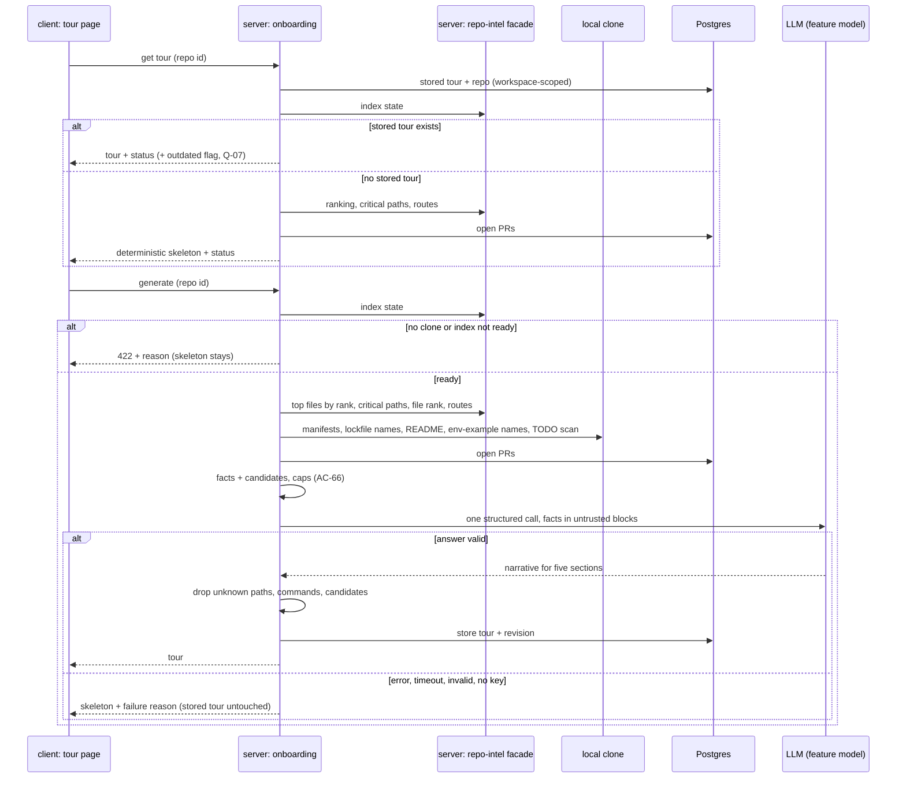

# L05 — Onboarding Generator · requirements

**Status:** Approved — the user answered Q-01…Q-08 on 2026-10-31 (all with the
recommended option, relayed by the coordinator) and accepted UX-01…UX-10. No open
questions remain.
**Goal:** a developer who is new to a repository opens one page and gets a tour of
it: how it is built, which files matter, how to run it, what to read first, and
what to work on first.
**Packages:** server · client · e2e · vendored `@devdigest/shared` (both copies).
`reviewer-core` is used as it is (structured LLM call, untrusted wrapping) and is
not expected to change.
**Designs:**
- the user's text description (task of 2026-10-31; quotes are marked «…»)
- `C:\Users\malin\GoITCourse\lab5.5-1.png` — page header, sidebar, "On this page",
  Architecture overview, Critical paths, the top of How to run locally
- `C:\Users\malin\GoITCourse\lab5.5-2.png` — How to run locally, Guided reading path
- "First tasks" has **no design**; it is specified from the user's decision (see `## Decisions`)
- the current code of this repository (`file:line` references below)

**Branch:** `lesson/L05-onboarding-generator`

**Requirement IDs.** Every requirement is an acceptance criterion with a stable ID
`AC-NN`. Plan tasks and tests cite these IDs. IDs are never renumbered; a dropped
one stays struck through with the reason.

## Context

**Problem.** A developer who joins a project, or opens an unfamiliar repository in
DevDigest, has no single place that explains the repository. DevDigest already
indexes every cloned repository (import graph, PageRank, endpoints), but nothing
turns that index into something a person reads. The user wants a tour in five parts:
«(1) architecture overview, (2) critical paths, (3) how to run locally, (4)
recommended file reading order (guided reading path), (5) first tasks», built by a
pipeline in which deterministic facts come first and the model only narrates them.

**How it works today (from the code):**

| What | Where | State |
|---|---|---|
| Storage | `server/src/db/schema/context.ts:120-126` | `onboarding` table exists and is empty: `repo_id` is the primary key (one row per repository), `json`, `generated_at`. No `workspace_id` column (scoping goes through the repository) and no column for the revision the tour was built from |
| Contract | `server/src/vendor/shared/contracts/knowledge.ts:28-47` (mirrored in `client/src/vendor/shared`) | `Onboarding = { sections: [{ kind, title, body, diagram?, links[] }] }` — generic sections; it cannot carry the rows the design needs (path + reason, numbered commands, path + why, tasks with a candidate reference) |
| System prompt | `server/src/prompts/onboarding.system.md:3-9`, `:11-12`, `:14-18`, `:42` | asks for `{{sections}}` with a mermaid diagram only in `architecture` and `routes_and_apis`; `routes_and_apis` is **not** one of the five parts. Already has the `<untrusted>` rule, strict grounding ("NEVER invent file paths, scripts, routes") and a `{{language}}` slot |
| Model choice | `server/src/vendor/shared/contracts/platform.ts:15-51`, `client/src/lib/feature-models.ts:15-17` | feature `onboarding` ("Onboarding Tour") exists in Settings → Feature Models, default `openrouter / deepseek/deepseek-v4-flash`; resolved through `container.featureModel(workspaceId, 'onboarding')` (`server/INSIGHTS.md:110-126`) |
| Structured call | `reviewer-core/src/llm/openrouter.ts:59-115`, `reviewer-core/src/llm/structured.ts:54-84` | one `completeStructured` call may send **up to 3 requests** (`maxRetries` default 2 schema-repair re-asks) plus SDK transport retries (`:55`, default 2). This matters for "one call, no more" — see Q-02 |
| Pattern to follow | `server/src/modules/conventions/service.ts:83-133` | deterministic samples → one structured call with `wrapUntrusted('repo', …)` → mechanical verification of every model claim; 422 with a fixable message when nothing can be sampled |
| Reading-path rank | `server/src/modules/repo-intel/service.ts:639-656` (`getTopFilesByRank`), `:713-733` (`isJunkPath`) | top-N files by `file_rank.rank`, minus tests, configs, `.d.ts`, migrations, fixtures |
| Rank formula | `server/src/modules/repo-intel/pipeline/rank.ts:4-7,49-52`, `server/src/db/schema/repo-intel.ts:95-98,105-121` | `rank = pagerank × (1 + hotness)` is the designed formula, but **`hotness` is always 0** (the clone is shallow), so today rank = PageRank. The requirement keeps the formula; no change to the indexer is needed |
| Critical paths | `service.ts:663-702`, `:706` | dependency chains: the 5 top-ranked roots, each followed greedily along the highest-ranked import for `BFS_DEPTH = 2` hops (`constants.ts:49`) → chains of 2–3 files. The design shows **one file per row**, not chains — see Q-04 |
| Other facade reads | `service.ts:189-205` (`getIndexState`, never throws; synthesises `degraded / no_data`), `:398-415` (`getRepoMap`), `:418-422` (`getFileRank`) | available |
| Routes facts | `server/src/db/schema/repo-intel.ts:75-88` (`file_facts.endpoints`, `crons`) | endpoints per file are already precomputed by the indexer |
| Stack / scripts facts | — | **do not exist** in `repo-intel`. Only `conventions` probes `package.json` by path (`conventions/constants.ts:16-33`). Collecting the stack, the scripts and the run commands is new work |
| Index scope | `repo-intel/constants.ts:14` (`.ts .tsx .js .jsx .mjs .cjs` only), `:42` (`MAX_INDEXED_FILES = 5000`), `pipeline/walk.ts:61-68` (first 5,000 by path, `stats.bounded` = the rest), `pipeline/full.ts:13-19` (soft budget → `partial`, rank skipped) | a repository like the design's "12,450 files" is indexed only partly; a non-JS/TS repository has no ranking at all |
| Index status | `repo-intel/types.ts:25-50` | `full · partial · degraded · failed`, plus `degradedReason` (`no_data`, `repo_too_large`, …) |
| Clone | `server/src/db/schema/repos.ts:16` (`clone_path` nullable) | a repository without a clone has no index (`full.ts:84-94` writes `degraded / no_clone`) |
| Open PRs | `server/src/db/schema/pulls.ts:5-34` | PRs known to DevDigest are in the DB; the list holds at most the 50 most recently updated PRs (`server/INSIGHTS.md:184-193`) |
| Client route | `client/src/app/onboarding/page.tsx:1-9` | `/onboarding` is the **add-repository** screen; e2e flow `e2e/specs/06-onboarding.flow.json:5-8` opens it and waits for "Add a repository" |
| Sidebar | `client/src/vendor/ui/nav.ts:33-40` (allowed hand-edit, `client/AGENTS.md`), `client/messages/en/shell.json:19` | WORKSPACE has Pull Requests and Project Context; the label `onboarding-tour` → "Onboarding Tour" already exists, the item does not |
| Active sidebar key | `client/src/components/app-shell/helpers.ts:29` | any path that **contains** `/onboarding` maps to `onboarding-tour` — today that includes the add-repository screen |
| Diagram rendering | — | the client has **no** mermaid (or any diagram) renderer — see Q-06 |
| GitHub links | `client/src/lib/github-urls.ts:24-37` (`githubBlobUrl`) | can build a link to a file at a revision |
| Untrusted markdown | `client/INSIGHTS.md:256` (L05 session note) | repo markdown is rendered through `UntrustedMarkdown`: no ``, inert relative links |

**`INSIGHTS.md` entries that became requirements or constraints:**
- a feature resolves its model through `container.featureModel`, never by importing `settings` (`server/INSIGHTS.md:110`) → AC-22.
- the PR list holds only the 50 most recently updated PRs (`server/INSIGHTS.md:184`) → the "open PR" task candidates are "open PRs known to DevDigest", AC-53.
- `src/vendor/shared` is a copy, not a link (`client/INSIGHTS.md:187`) → any contract change goes into both copies.
- stripping markdown emphasis mangles identifiers (`client/INSIGHTS.md:128`) → AC-31 keeps `_` intact in paths.

## Clarification categories

The user asked for six categories of clarification. Each is listed with how it was
resolved; all six are closed.

| # | Category | Resolution |
|---|---|---|
| C1 | **What "onboarding" means here** — audience, per repo vs per user, persisted or ephemeral, regenerate semantics | Audience: a developer new to the repository («a tour of an unfamiliar repository»; prompt "first-day tour", `onboarding.system.md:18`). **Per repository**, one tour shared by everyone in the workspace (the table's key is `repo_id`, `context.ts:121`). **Persisted** — opening the page never calls the model (AC-25). The first tour is generated only on a click (Q-01 → AC-26). **Regenerate** replaces the stored tour only on success; a failure keeps the old one (AC-24, AC-73). |
| C2 | **Very large repository** — budgets, caps, what is truncated | The index already caps at 5,000 JS/TS files and the header says so honestly (AC-13). Model input ≤ 40,000 chars with a fixed drop order; every list has a cap; the trimmed state is shown (Q-03 → AC-35, AC-48, AC-52, AC-53, AC-66…AC-69, AC-83). |
| C3 | **What to show without a full clone** | User decision: a deterministic skeleton from what the DB already has, with an honest status; generation needs a clone **and** an index; a `partial` index with a ranking may generate (AC-14…AC-16, AC-58). |
| C4 | **Staleness and refresh** | The header shows when the tour was generated (AC-12); an "Outdated" badge appears when the index revision moves; regeneration is manual only (Q-07 → AC-74). |
| C5 | **Security of untrusted repository text in the prompt and on the page** | From the package rules and existing code: all repo-derived text goes to the model inside `<untrusted>` blocks under the existing guard, with no keyword scanning (`reviewer-core/AGENTS.md`, invariant 3); every path, command, diagram component and task the model returns is checked against the facts; model text is rendered without HTML; env-file values never leave the clone (AC-33, AC-60…AC-65). |
| C6 | **Failure, partial states and LLM cost** | Missing key, timeout, provider error and invalid output all fall back to the deterministic skeleton with the reason (AC-70…AC-72), and a missing key is shown as soon as the page opens (AC-86); exactly one model call per generation, no schema re-ask or repair, adapter transport retries allowed (Q-02, REC-1 → AC-21); no model call on page open (AC-25); one generation per repository at a time, which survives leaving the page (AC-28, AC-29); the model and cost of the last generation are visible (AC-84). |

## Out of scope

- Per-user tours, progress tracking ("read" ticks), personalisation by role.
- Public sharing: no hosting, no tokens, no export. Share link = the app URL (user decision).
- Editing the tour by hand.
- Running any command from the tour; DevDigest only shows and copies them.
- Hotness in the rank: the formula is kept, but deepening the shallow clone to compute churn is not part of this feature.
- Indexing non-JS/TS languages; such a repository gets the skeleton with the reason (AC-15).
- An MCP tool for the tour.
- Languages other than English for the tour text (there is no language setting; the prompt's `{{language}}` is filled with English).
- The other design items: search bar, notifications, the SKILLS LAB / GLOBAL sidebar entries not built yet.

## Requirements

### Page and navigation

| ID | Pattern | Requirement | Verified by |
|---|---|---|---|
| AC-01 | Ubiquitous | The system shall show an "Onboarding Tour" item in the sidebar's WORKSPACE group, between "Pull Requests" and "Project Context", that opens the tour page of the active repository. | client + e2e |
| AC-02 | Ubiquitous | [decision: route] The system shall serve the tour page at `/repos/<repoId>/tour`. | client + e2e |
| AC-03 | Ubiquitous | The system shall keep `/onboarding` as the add-repository screen, unchanged, so that e2e flow `06-onboarding` passes without edits. | e2e |
| AC-04 | State-driven | WHILE the tour page is open, the system shall mark the "Onboarding Tour" sidebar item as active. | client |
| AC-05 | State-driven | WHILE the add-repository screen at `/onboarding` is open, the system shall not mark the "Onboarding Tour" sidebar item as active. | client |
| AC-06 | Ubiquitous | The system shall show the breadcrumb `<owner>/<name> › Onboarding Tour` and the heading "Onboarding for <name>", with `<name>` in the accent colour. | client |
| AC-07 | Ubiquitous | The system shall show the five sections in this order and with these titles: "Architecture overview", "Critical paths", "How to run locally", "Guided reading path", "First tasks" — in every state of the page (generated or skeleton). | client + e2e |
| AC-08 | Ubiquitous | The system shall show an "On this page" list with the five section titles in the same order. | client |
| AC-09 | Event-driven | WHEN the user activates an entry of "On this page", the system shall scroll to that section and move keyboard focus to its heading. | client |
| AC-10 | Event-driven | WHEN the user activates a section's collapse control, the system shall collapse or expand that section; every section is expanded when the page opens. | client |
| AC-11 | Ubiquitous | The system shall give every section's collapse control an accessible name containing the section title and an expanded/collapsed state readable by assistive technology. | client |
| AC-84 | State-driven | [accepted UX-06] WHILE a generated tour is shown, the system shall show, in a tooltip on the header line of AC-12, the provider and model that generated it and the cost of that generation in USD, or "cost unknown" when the provider reported none. | client + server-integration |
| AC-12 | State-driven | WHILE a generated tour is shown, the system shall show under the heading "Generated from index of N files · last refreshed <relative time>", where N is the number of files the index held when the tour was generated and the time is the moment the tour was generated. | client + server-integration |
| AC-13 | Unwanted | IF the index used for the tour covers fewer files than the repository holds (the 5,000-file cap or the indexing time budget was hit), THEN the system shall show in the header "N of M source files indexed" instead of "N files", so the tour never claims full coverage. | client + server-unit |
| AC-87 | Ubiquitous | [REC-4] The system shall show in the tour header coverage numbers N and M equal to the number of files actually present in the index and the number of source files found by the latest walk of the clone, after a full index and after any number of incremental refreshes, with no drift of N between refreshes. | server-integration |
| AC-17 | State-driven | WHILE the tour is being loaded, the system shall show a skeleton placeholder in place of the five sections. | client |
| AC-18 | Unwanted | IF the request for the tour fails, THEN the system shall show an error state with the reason and a "Retry" button. | client |
| AC-19 | Unwanted | IF the repository id in the URL is unknown or belongs to another workspace, THEN the system shall show the existing "repository not found" screen and the API shall answer 404. | client + server-integration |

### Status: clone, index and generation

| ID | Pattern | Requirement | Verified by |
|---|---|---|---|
| AC-14 | State-driven | [decision: no clone] WHILE the repository has no local clone, the system shall show the skeleton (AC-58) with the status "Not cloned — clone to generate" and a disabled "Generate" control whose tooltip states that a clone and an index are required. | client + server-integration |
| AC-15 | State-driven | [decision: degraded] WHILE the repository is cloned but its index is `degraded` or `failed` or has no file ranking (including a repository with no JS/TS source files), the system shall show the skeleton with the status "Index not ready — <reason>" and a disabled "Generate" control. | client + server-integration |
| AC-16 | State-driven | [accepted UX-09] WHILE the index is `partial` but has a file ranking, the system shall allow generation and show "partial index" next to the header line of AC-12. | client + server-unit |

### Generation pipeline

| ID | Pattern | Requirement | Verified by |
|---|---|---|---|
| AC-20 | Event-driven | WHEN generation starts, the system shall first collect, without any model call, the repository facts: the stack (languages by indexed file count, frameworks and runtime from dependency manifests), the top-level folder structure, the HTTP routes known to the index, the scripts declared in the manifests, the ranked reading path, the critical-path files and the first-task candidates. | server-unit + server-integration |
| AC-21 | Ubiquitous | [decision Q-02, REC-1] The system shall make exactly one model call per generation, which returns the text of all five sections at once: no section has a call of its own, and no schema re-ask or repair call follows an answer; the provider adapters' existing transport retries on a 429 or 5xx response, made before any usable answer, remain allowed, and the review engine package is not changed for this feature. | server-unit |
| AC-22 | Ubiquitous | The system shall use the provider and model selected for the "Onboarding Tour" feature in Settings → Feature Models. | server-integration |
| AC-23 | Ubiquitous | The system shall produce the same deterministic parts of the tour (reading-path order, critical-path files, run commands, first-task candidates) for the same index and clone revision, independent of the model's answer. | server-unit |
| AC-24 | Event-driven | WHEN a generation succeeds, the system shall store the tour for the repository together with the revision it was built from, replacing the previous tour. | server-integration |
| AC-25 | Event-driven | WHEN the user opens the tour page and a stored tour exists, the system shall show it without calling the model. | server-integration + client |
| AC-26 | Event-driven | [decision Q-01] WHEN the user opens the tour page of a cloned, indexed repository with no stored tour, the system shall show the skeleton built from the current facts and a "Generate tour" button, and shall not call the model until the button is pressed. | client + server-integration |
| AC-27 | Event-driven | WHEN the user clicks "Regenerate" (or "Generate tour"), the system shall run the generation of AC-20…AC-24 and show the new tour when it completes. | client + server-integration |
| AC-28 | State-driven | [accepted UX-01] WHILE a generation for the repository is running, the system shall show "Generating…" in place of the Regenerate label, keep the button disabled, and refuse a second generation request for the same repository with a 409 and the message "A tour is already being generated". | client + server-integration |
| AC-29 | Event-driven | [accepted UX-02] WHEN the user leaves the page while a generation is running, the system shall finish and store the generation, and show the result when the user returns. | server-integration |

### Architecture overview

| ID | Pattern | Requirement | Verified by |
|---|---|---|---|
| AC-30 | State-driven | WHILE a generated tour is shown, the system shall show in Architecture overview the model's prose describing the stack, the entry points and how requests flow through the main parts. | client |
| AC-31 | Ubiquitous | The system shall render file paths and identifiers in the prose as inline code, without altering underscores or other characters in them. | client |
| AC-32 | State-driven | [decision Q-06] WHILE a generated tour is shown, the system shall draw under the prose, without any diagram library, a diagram of boxes and arrows built from the components (label, kind) and connections (from, to) the model returned as structured data, with box colour by component kind. | client |
| AC-33 | Unwanted | [decision Q-06] [REC-2] IF a component returned by the model matches none of: an indexed file path, a top-level folder, or a dependency name declared in a manifest read under AC-68 (a "postgres" component passes through a `pg` or `postgres` dependency), THEN the system shall drop that component and every connection that names it. | server-unit |
| AC-85 | Unwanted | [decision Q-06] IF fewer than two components or no connection remain after AC-33, THEN the system shall show Architecture overview without a diagram and without an error message. | client + server-unit |
| AC-34 | State-driven | WHILE the skeleton is shown, the system shall show in Architecture overview the detected stack and the top-level folders with their indexed file counts, as a list, without prose. | client + server-unit |

### Critical paths

| ID | Pattern | Requirement | Verified by |
|---|---|---|---|
| AC-35 | Ubiquitous | [decision Q-04, Q-03] The system shall show Critical paths as at most 6 rows "<file path> — <reason>", one file per row, taken from the import-graph dependency chains that start at the highest-ranked files, in chain order, each file once. | client + server-unit |
| AC-36 | Ubiquitous | The system shall take each row's reason from the model when it supplied one for that path, and otherwise show the deterministic reason "imported by N files · top P% by rank". | server-unit + client |
| AC-37 | Event-driven | [decision Q-05] WHEN the user clicks "Open" on a row, the system shall open that file on GitHub at the revision the tour was built from, in a new tab. | client |
| AC-38 | Unwanted | IF the index has no import graph edges, THEN the system shall show in Critical paths "No critical paths — the import graph is empty". | client + server-unit |

### How to run locally

| ID | Pattern | Requirement | Verified by |
|---|---|---|---|
| AC-39 | Ubiquitous | The system shall show How to run locally as a numbered list of shell commands, each in a monospace row. | client |
| AC-40 | Ubiquitous | [REC-2, planner wording] The system shall show only commands derived deterministically from the clone: the install command of the package manager its lockfile identifies, a copy of an env-example file that exists, `docker compose up -d` when a compose file exists (detected by file name only; its content is not read), and invocations of manifest scripts whose names are on the allow-list `dev`, `start`, `serve`, `build`, `test`, `migrate`, `db:migrate`, `seed`, `db:seed`. | server-unit |
| AC-41 | Unwanted | IF the model returns a command that is not in the derived set of AC-40, THEN the system shall not show it; the model may only order the derived commands and add a one-line comment to each. | server-unit |
| AC-88 | Unwanted | [planner wording] IF the model's answer omits a command of the derived set of AC-40, THEN the system shall append that command after the commands the model ordered, in derivation order, without a comment. | server-unit |
| AC-42 | Event-driven | WHEN the user clicks the copy button of a command row, the system shall copy that row's command text (without the step number) to the clipboard. | client |
| AC-43 | Ubiquitous | The system shall give every copy button an accessible name "Copy command N", where N is the step number. | client |
| AC-44 | Ubiquitous | The system shall never execute a command shown in the tour. | server-unit |
| AC-45 | Unwanted | IF the clone has no recognised manifest or lockfile, THEN the system shall show in How to run locally "No run commands found in the repository's manifests". | client + server-unit |

### Guided reading path

| ID | Pattern | Requirement | Verified by |
|---|---|---|---|
| AC-46 | Ubiquitous | The system shall order the Guided reading path by file rank `pagerank × (1 + hotness)` from the index, highest first, ties broken by path ascending — not alphabetically and not by the model. | server-unit |
| AC-47 | Ubiquitous | The system shall exclude tests, configuration files, type-declaration files, migrations and fixtures from the reading path. | server-unit |
| AC-48 | Ubiquitous | [decision Q-03] The system shall show at most 8 files in the reading path, each as a numbered item with its path and a one-line "why". | client + server-unit |
| AC-49 | Ubiquitous | The system shall take each item's "why" from the model when it supplied one for that path, and otherwise show the deterministic line "imported by N files · top P% by rank". | server-unit + client |
| AC-50 | Unwanted | IF the model returns a reading-path entry for a path not in the ranked list, or in a different order, THEN the system shall ignore that entry and keep the ranked order and set. | server-unit |
| AC-51 | Unwanted | IF the index has no file ranking, THEN the system shall show in Guided reading path "No reading path — the repository has not been ranked yet" with the index reason. | client |

### First tasks

| ID | Pattern | Requirement | Verified by |
|---|---|---|---|
| AC-52 | Event-driven | [decision: first tasks] WHEN generation starts, the system shall collect first-task candidates deterministically, each with a stable id and a kind: `todo` (a TODO/FIXME/HACK comment in one of the 30 highest-ranked files, with path and line), `missing-tests` (a high-ranked source file with no matching test file), `open-pr` (an open PR of this repository known to DevDigest). | server-unit + server-integration |
| AC-53 | Ubiquitous | [decision Q-03] The system shall order the candidates by the rank of their file (highest first), then open PRs by most recent update, and keep at most 15 candidates. | server-unit |
| AC-54 | Ubiquitous | [decision: first tasks] The system shall show 3 to 5 tasks phrased by the model, each referencing exactly one candidate id. | server-unit + client |
| AC-55 | Unwanted | IF a task from the model references no candidate, an unknown candidate id, or a candidate already used by an earlier task, THEN the system shall drop that task. | server-unit |
| AC-56 | Unwanted | IF fewer than 3 valid model tasks remain, or the tour is a skeleton, THEN the system shall show up to 5 of the top candidates as tasks with a fixed title per kind: "Resolve the TODO in <path>:<line>", "Add tests for <path>", "Review PR #<n>: <title>". | server-unit + client |
| AC-57 | Ubiquitous | The system shall show each task with its title, a one-line reason, a kind tag ("TODO", "Missing tests", "Open PR") and a link to the referenced file (at its line) or PR. | client |
| AC-58 | State-driven | [decision: no clone] WHILE the repository has no clone, the system shall build the skeleton only from the DB (repository name and default branch, index status, open PRs) and show the open-PR candidates as tasks, with the other four sections showing what they need ("Needs a clone and an index"). | server-integration + client |
| AC-59 | Unwanted | IF there are no candidates, THEN the system shall show in First tasks "No starter tasks found in this repository". | client |

### Grounding and security of untrusted text

| ID | Pattern | Requirement | Verified by |
|---|---|---|---|
| AC-60 | Ubiquitous | The system shall send every repository-derived text to the model (README and manifest excerpts, file paths, TODO comment text, route strings, PR titles) inside untrusted blocks under the existing injection guard, without keyword scanning of that text. | server-unit |
| AC-61 | Ubiquitous | The system shall show in any section only file paths that exist in the index or the clone at the tour's revision; a model-supplied path that does not is removed together with its link. | server-unit |
| AC-62 | Ubiquitous | The system shall render the model's text as markdown without executing embedded HTML or scripts, without loading images, and with relative links inert. | client |
| AC-63 | Ubiquitous | The system shall render diagram labels as plain text, with no links, click handlers or scripts taken from the model's output. | client |
| AC-64 | Ubiquitous | The system shall send to the model and store in the tour only the variable **names** of an env-example file, never its values, and shall not read any `.env` file other than the example. | server-unit |
| AC-65 | Ubiquitous | The system shall return and regenerate a tour only for a repository of the caller's workspace. | server-integration |

### Large repositories and budgets

| ID | Pattern | Requirement | Verified by |
|---|---|---|---|
| AC-66 | Ubiquitous | [decision Q-03] The system shall cap the facts sent to the model at 40,000 characters (≈ 10,000 tokens by `ceil(chars/4)`), each README or manifest excerpt at 6,000 characters, the routes at 60 entries and the top-level folders at 30 entries. | server-unit |
| AC-67 | Unwanted | [decision Q-03] IF the collected facts exceed 40,000 characters, THEN the system shall drop them in this order until they fit: the README excerpt, then manifest excerpts other than the root one, then route entries from the end of the list, then folder entries from the end of the list; the reading path, critical-path files, commands and task candidates are never dropped. | server-unit |
| AC-68 | Ubiquitous | [decision Q-03] The system shall read file content during fact collection only from the root manifest and at most 4 manifests one directory level below it, lockfile names, the README, the env-example file and the files scanned for TODO candidates, each up to the 6,000-character excerpt cap, and never whole source files beyond that. | server-unit |
| AC-83 | Ubiquitous | [decision Q-03, amended 2026-11-01] The system shall request the model's answer with an output limit of 10,000 tokens, a limit that also covers a reasoning model's hidden reasoning tokens. | server-unit |
| AC-69 | State-driven | [accepted UX-10] WHILE the stored tour was built from facts trimmed under AC-67, the system shall show "built from a trimmed fact set" next to the header line. | client |

### Failure states and cost

| ID | Pattern | Requirement | Verified by |
|---|---|---|---|
| AC-86 | Event-driven | [REC-3] WHEN the user opens the tour page and no API key is stored for the provider the generation would use, the system shall show, before any click, the status "No API key for <provider>" with a link to Settings → API Keys, and shall keep "Generate tour" / "Regenerate" disabled. | client + server-integration |
| AC-70 | Unwanted | IF no API key is stored for the provider of the "Onboarding Tour" model, THEN the system shall not call the model, show the skeleton with the status "No API key for <provider>" and a link to Settings → API Keys. | client + server-integration |
| AC-71 | Unwanted | [decision Q-03] IF the model call fails or does not answer within 120 seconds, THEN the system shall show the skeleton with the status "Generation failed — <reason>" and store nothing. | server-integration + client |
| AC-72 | Unwanted | [decision Q-02] IF the model's answer does not match the expected structure, THEN the system shall treat it as the failure of AC-71 with the reason "the model returned invalid output", without a second model call (no schema re-ask or repair, AC-21). | server-unit |
| AC-73 | Unwanted | [accepted UX-03] IF a regeneration fails while a stored tour exists, THEN the system shall keep showing the stored tour and show a dismissible notice "Regeneration failed — <reason>". | client + server-integration |

### Staleness

| ID | Pattern | Requirement | Verified by |
|---|---|---|---|
| AC-74 | State-driven | [decision Q-07] WHILE the revision of the current index differs from the revision the stored tour was built from, the system shall show "Outdated — the repository has changed since this tour was generated" next to the Regenerate button, and shall not regenerate on its own. | client + server-integration |

### Share link

| ID | Pattern | Requirement | Verified by |
|---|---|---|---|
| AC-75 | Event-driven | [decision: share link] WHEN the user clicks "Share link", the system shall copy the absolute app URL of the tour page (`<origin>/repos/<repoId>/tour`) to the clipboard. | client |
| AC-76 | Event-driven | [accepted UX-04] WHEN a copy (Share link or a command) succeeds, the system shall show the confirmation "Copied" for 2 seconds next to the control that was used. | client |
| AC-77 | Unwanted | [accepted UX-05] IF writing to the clipboard fails, THEN the system shall show the text that was to be copied in a selectable field with the message "Copy it manually". | client |

### Layout and consistency

| ID | Pattern | Requirement | Verified by |
|---|---|---|---|
| AC-78 | Ubiquitous | The system shall truncate a long file path in the middle and show the full path in a tooltip, as on the Project Context page (`specs/L05-project-context.requirements.md` R-72). | client |
| AC-79 | Ubiquitous | The system shall give every "Open" button an accessible name containing the file path it opens. | client |
| AC-80 | State-driven | [accepted UX-07] WHILE the window is narrower than 1024 px, the system shall hide the "On this page" list and show the sections at full width. | client |
| AC-81 | State-driven | [accepted UX-08] WHILE the user scrolls the page, the system shall highlight in "On this page" the section whose heading is closest to the top of the viewport. | client |
| AC-82 | Event-driven | WHEN the e2e suite opens the seeded demo repository's tour from the sidebar, the system shall show the heading and the five section titles without any model call. | e2e |

## Design analysis

| Screen / action | Covered | Missing | → |
|---|---|---|---|
| Sidebar "Onboarding Tour" | item in WORKSPACE above Project Context | route; `/onboarding` is taken by add-repository; active-key helper matches any `/onboarding` | AC-01…AC-05 (route decided) |
| Header "Generated from index of 12,450 files" | present | the index holds at most 5,000 JS/TS files — the number would be false | AC-12, AC-13 |
| Header "last refreshed 2h ago" | present | refreshed = what? Outdated tour not marked | AC-12, AC-74 (Q-07) |
| Regenerate | present | first generation, double click, leave mid-run, failure with an older tour present | AC-26…AC-29, AC-73 (Q-01, Q-08) |
| Share link | present | what is shared (decided: app URL), confirmation, clipboard failure | AC-75…AC-77 |
| On this page | five entries, first highlighted | click behaviour, scroll highlight, narrow window | AC-08, AC-09, AC-80, AC-81 |
| Section chevrons | present | default state, accessibility | AC-10, AC-11 |
| Architecture prose | present, paths as inline code | skeleton content | AC-30, AC-31, AC-34 |
| Architecture diagram | boxes + arrows, coloured by kind | no renderer in the client; invalid diagram | AC-32, AC-33, AC-85 (Q-06 resolved) |
| Critical paths rows + Open | path — reason, Open | where Open goes; chains vs single files; no graph | AC-35…AC-38 (Q-04, Q-05) |
| How to run locally | numbered commands, copy icons | where commands come from; invented commands; icon-only buttons have no name; no manifest | AC-39…AC-45 |
| Guided reading path | numbered path + why | ordering rule, cap, model reordering, no ranking | AC-46…AC-51 (Q-03) |
| First tasks | **no design** | everything | AC-52…AC-59 (user decision) |
| All sections / states | happy path only | loading, error, not cloned, index not ready, missing key, LLM failure, unknown repo | AC-14…AC-19, AC-58, AC-70…AC-72 |
| All sections / very large repo | — | caps and budgets | AC-13, AC-66…AC-69 (Q-03) |
| All sections / untrusted text | — | prompt injection via README/TODO/PR titles; HTML in model output; env values | AC-60…AC-65 |

## Module interaction

| From → to | What is passed | On failure | Requirement |
|---|---|---|---|
| client → server/onboarding (get) | repository id | 404 → not-found screen; other → error state with Retry | AC-18, AC-19 |
| client → server/onboarding (generate) | repository id | 409 already running; 422 no clone / index not ready; model failure → skeleton with reason | AC-14, AC-15, AC-28, AC-70…AC-72 |
| server/onboarding → repo-intel | repository id | facade never throws; empty result → the section's empty state | AC-38, AC-51 |
| server/onboarding → local clone | repo-relative manifest/README/env-example paths, top-ranked files | file missing → that fact is absent | AC-45, AC-64, AC-68 |
| server/onboarding → DB | repository id | as today | AC-24, AC-58 |
| server/onboarding → LLM | facts (untrusted), candidate ids, ranked paths, derived commands | no key / error / timeout / invalid → skeleton, nothing stored | AC-21, AC-60, AC-70…AC-72 |
| client → GitHub | file link at the tour revision (new tab) | GitHub's own 404 | AC-37 (Q-05) |
| client → clipboard | page URL or command text | fallback field | AC-42, AC-75, AC-77 |

## UX improvements

All ten were accepted by the user on 2026-10-31 (Q-08).

| ID | Proposal | Why | Status |
|---|---|---|---|
| UX-01 | Disable Regenerate while a generation runs and refuse a parallel request for the same repository with 409. | A double click would pay for two model calls and race on the stored tour | accepted → AC-28 |
| UX-02 | A generation started from the page finishes and is stored even if the user leaves the page. | The call is already paid for; losing the result wastes it | accepted → AC-29 |
| UX-03 | A failed regeneration keeps the previous tour and shows a notice, instead of falling back to the skeleton. | The old tour is more useful than a skeleton; failure should not destroy work | accepted → AC-73 |
| UX-04 | Show "Copied" for 2 s next to the control after a successful copy. | Icon-only copy buttons give no feedback otherwise | accepted → AC-76 |
| UX-05 | If the clipboard write fails, show the text in a selectable field. | Clipboard access can be denied outside a secure context | accepted → AC-77 |
| UX-06 | Show the model name and the cost of the last generation in the header tooltip. | Makes the cost of Regenerate visible before clicking it | accepted → AC-84 |
| UX-07 | Below 1024 px hide "On this page" and give sections the full width. | The three-column design does not fit a narrow window | accepted → AC-80 |
| UX-08 | Highlight the section in view in "On this page". | The design shows a highlighted entry; this defines what it tracks | accepted → AC-81 |
| UX-09 | Allow generation on a `partial` index that has a ranking, with a "partial index" note. | A large repository often ends `partial`; refusing would block exactly the repos that need a tour most | accepted → AC-16 |
| UX-10 | Mark a tour built from trimmed facts in the header. | Honest status, same reason as AC-13 | accepted → AC-69 |

## Open questions

None. Q-01…Q-08 are resolved — see `## Decisions`.

## Decisions

| Question | Decision | Source |
|---|---|---|
| Share link | Copy the app URL of the tour page to the clipboard; local-first, no public hosting, no tokens | user, 2026-10-31 → AC-75 |
| No clone / degraded index | Show a deterministic skeleton from what the DB already has, with an honest status ("not cloned — clone to generate" / degraded). Generation proper needs a clone + index | user, 2026-10-31 → AC-14, AC-15, AC-58 |
| First tasks | Deterministic candidates first (TODO/FIXME in high-rank files, files without tests, open PRs); the model only phrases 3–5 tasks and may reference only those candidates | user, 2026-10-31 → AC-52…AC-59 |
| Spec language | English | user, 2026-10-31 |
| Pipeline shape | Deterministic facts from `repoIntel.*` (+ manifests) → reading path ranked by `pagerank × (1 + hotness)` → one structured narrative call → skeleton with honest status on degraded index or model failure | user, 2026-10-31 → AC-20, AC-21, AC-46, AC-70…AC-72 |
| Tour route | `/repos/<repoId>/tour`. `/onboarding` stays the add-repository screen (e2e flow 06 depends on it), and a tour path without the substring `/onboarding` keeps the two from sharing the active sidebar key (`app-shell/helpers.ts:29` matches by `includes`) | from the code (`client/src/app/onboarding/page.tsx`, `e2e/specs/06-onboarding.flow.json`, `helpers.ts:29`) → AC-02…AC-05 |
| Scope of a tour (C1) | One tour per repository, shared by the workspace, persisted; opening the page never calls the model | from the code (`context.ts:120-126`, PK `repo_id`) → AC-24, AC-25 |
| Rank formula | Keep `pagerank × (1 + hotness)`; today hotness is always 0, so the order equals PageRank order. No indexer change | from the code (`rank.ts:4-7`, `repo-intel.ts:95-98`) → AC-46 |
| Untrusted text (C5) | Repo-derived text goes to the model in `<untrusted>` blocks under the existing guard; no keyword scanning; model output is checked against the facts, never trusted | `reviewer-core/AGENTS.md` invariant 3; pattern of `conventions/service.ts:116-123` → AC-60…AC-64 |
| Tour language | English (there is no language setting; fill the prompt's `{{language}}` with English) | from the code (no `language` setting in `server/src`) |
| Section set | The five parts of the user's request replace the prompt's current section list (`routes_and_apis` is not a section; routes feed Architecture overview as facts) | user request vs `onboarding.system.md:3-9` |
| Q-01 First generation | Only when the user clicks "Generate tour"; until then the deterministic skeleton is shown and no model call is made | user (via coordinator), 2026-10-31 → AC-26 |
| Q-02 "One call" | Exactly one model request per generation, no schema-repair re-ask; invalid output → skeleton with the reason; a transport retry after a network error with no answer is allowed | user (via coordinator), 2026-10-31 → AC-21, AC-72 |
| Q-03 Budgets | Facts ≤ 40,000 chars; README/manifest excerpt ≤ 6,000 chars each; root manifest + up to 4 one level below; routes ≤ 60; top-level folders ≤ 30; critical-path rows ≤ 6; reading path 8 files; TODO scan over the top 30 ranked files; candidates ≤ 15; model output ≤ ~~4,000~~ 10,000 tokens (amended 2026-11-01, see "AC-83 output limit" below); timeout 120 s | user (via coordinator), 2026-10-31 → AC-35, AC-48, AC-52, AC-53, AC-66…AC-68, AC-71, AC-83 |
| Q-04 Critical-path row | One file per row, taken from the chains in chain order, each file once | user (via coordinator), 2026-10-31 → AC-35 |
| Q-05 "Open" | The file on GitHub at the tour's revision, in a new tab | user (via coordinator), 2026-10-31 → AC-37 |
| Q-06 Diagram | The model returns components (label, kind) and connections as structured data; components are validated against the facts; the app draws boxes and arrows itself; no new dependency | user (via coordinator), 2026-10-31 → AC-32, AC-33, AC-85 |
| Q-07 Staleness | "Outdated" badge when the index revision differs from the tour's revision; regenerate only on click | user (via coordinator), 2026-10-31 → AC-74 |
| Q-08 Edge-case set | UX-01…UX-10 all accepted | user (via coordinator), 2026-10-31 → AC-16, AC-28, AC-29, AC-69, AC-73, AC-76, AC-77, AC-80, AC-81, AC-84 |
| REC-1 (planner) "One call" precision | The onboarding module makes exactly one model call with no schema re-ask or repair; the adapters' existing transport retries on 429/5xx before a usable answer stay allowed; reviewer-core is not changed. Refines Q-02 | user (via coordinator), 2026-10-31 → AC-21, AC-72 |
| REC-2 (planner) Compose file | The compose file is not read. Diagram components are validated only against indexed paths, top-level folders and manifest dependency names; the compose run command is derived from the file's presence by name only. AC-68 unchanged | user (via coordinator), 2026-10-31 → AC-33, AC-40 |
| Planner wording for run commands | Script invocations come from a fixed allow-list of manifest script names; a derived command the model omits is appended | user (via coordinator), 2026-10-31 → AC-40, AC-88 |
| REC-3 (planner) Missing key on open | The missing-key status with the Settings link is shown when the page opens, before any click, and Generate is disabled | user (via coordinator), 2026-10-31 → AC-86 |
| REC-4 (planner) Coverage numbers | "N of M source files indexed" stays correct after incremental refreshes (no `filesIndexed` drift) | user (via coordinator), 2026-10-31 → AC-87 |
| AC-83 output limit | Raised from 4,000 to 10,000 tokens. Measured in a real run: the default onboarding model (OpenRouter `deepseek/deepseek-v4-flash`) is a reasoning model whose hidden reasoning tokens (2,600–4,000+) count against `max_tokens`; at 4,000, 1 of 3 runs ended `finish_reason: length` with truncated JSON (`invalid_output`). The answer itself is ~1,400 tokens; 10,000 at ~110 tok/s stays inside the 120 s timeout (AC-71). Still exactly one model call (AC-21) | user (via coordinator), 2026-11-01 → AC-83 |
| Failure diagnostics (deferred) | Logging the raw output, the Zod issues and `finish_reason` when generation fails needs a change to the LLM adapters (reviewer-core + server adapters); deferred to a separate change, not part of this spec | user (via coordinator), 2026-11-01 |
