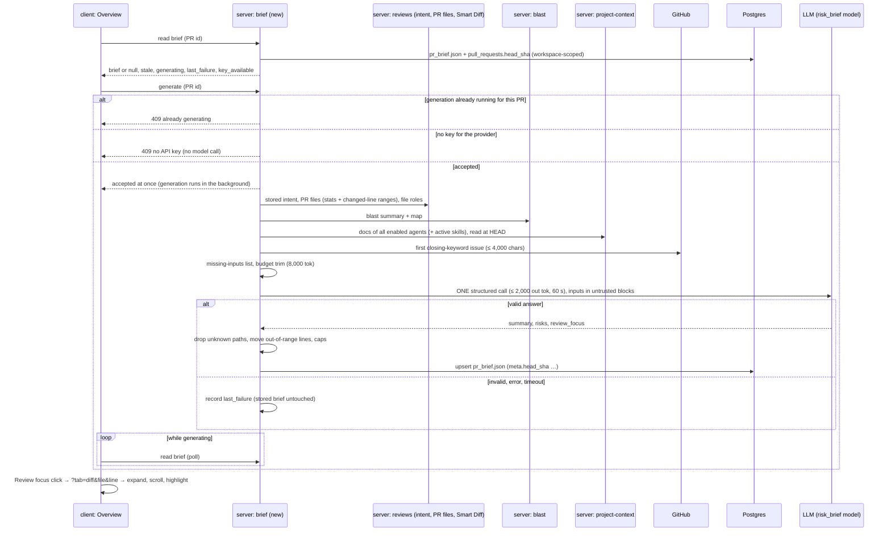

# L05 — PR Brief · requirements

**Status:** Approved by the user on 2026-11-01 (they asked to proceed to implementation-planner). Q-01…Q-11 were answered with the recommended options and UX-01…UX-06 were accepted (see `## Decisions`). R-34 (a blast-only file snaps to its nearest caller line) and R-56 (the message stays 4 s) keep the agent's defaults.
**Goal:** a reviewer who opens a PR "cold" sees one PR Brief card on Overview. It says what the PR does and why, what is risky in it (each risk tied to a file) and which lines to read first. Clicking a line opens it in Files changed.
**Packages:** server · client · vendored `@devdigest/shared` (both copies). `reviewer-core` is used as it is (the structured LLM call) and is not expected to change. No e2e or MCP work (see `## Non-goals`).
**Designs:**
- the user's text description: the L05 homework task, translated from Ukrainian, with user stories, the "suggested implementation" and acceptance criteria P1/P2/P3. Quotes are marked «…»
- `C:\Users\malin\GoITCourse\дз5-1.png`: Overview with the brief (verdict banner, Intent, Blast radius, Risk areas, the top of Review focus)
- `C:\Users\malin\GoITCourse\дз5-2.png` (= `дз5-4.png`, identical): Risk areas and Review focus highlighted
- `C:\Users\malin\GoITCourse\дз5-3.png` (= `дз5-6.png`, identical): Files changed after a Review focus click. `src/api/public/webhooks.ts` is expanded and outlined, with lines 61–74 in view
- the current code of this repository (`file:line` references below)

«Exact look is not required; a plain list is acceptable.»

**Branch:** `lesson/L05-lab-homework` (the current branch)

**Requirement IDs.** Every requirement has a stable ID `R-NN`. Plan tasks and tests cite these IDs. IDs are never renumbered; a dropped one stays struck through with the reason.

## Context

**Problem.** «A reviewer often opens someone else's PR "cold": they don't know why the change exists, what's risky in it, or which file to start with.» Intent (L03), Smart Diff (L03/L04) and Blast Radius (L04) each answer part of that, on separate cards. Nothing combines them, and nothing says *where the risk is* or *where to start reading*. The brief adds two model-written parts, Risk areas and Review focus, from one model call over facts that are already computed. «It does **not** read diff code.»

**How it works today (from the code):**

| What | Where | State |
|---|---|---|
| Cache table | `server/src/db/schema/reviews.ts:106-111` | `pr_brief (pr_id PK → pull_requests, json jsonb)` exists and is **empty**. It has no SHA, timestamp or workspace column; workspace scoping goes through the PR row. Per the task, the SHA goes **inside** `json` |
| Contract | `server/src/vendor/shared/contracts/brief.ts:130-142` (`Risk`, `Risks`), `:211-217` (`PrBrief`); identical copy in `client/src/vendor/shared/contracts/brief.ts` | `Risk = { kind, title, explanation, severity: high\|medium\|low, file_refs: string[] }`. `PrBrief = { intent, blast, risks, history }` with **every field required**, and no `summary` or `review_focus`. The only client use of `PrBrief` is a type re-export (`client/src/lib/types.ts:35`) |
| Intent (input) | table `pr_intent` (`server/src/db/schema/reviews.ts:73-104`, `head_sha` at `:96`). Read by `ReviewRepository.getIntent(prId)` (`server/src/modules/reviews/repository.ts:175-177` → `repository/pull.repo.ts:167-194`); the no-model read is `IntentService.getStored` (`reviews/intent/service.ts:93-101`) | Derived **only** on demand (`POST …/intent/refresh`) or by a review run. A PR can have no row. The record carries `intent`, `in_scope`, `out_of_scope`, `risk_areas`, `kind`, `confidence`, `sources[]` (refs and statuses only) and `head_sha` |
| Blast radius (input) | `BlastService.forPull(workspaceId, prId)` (`server/src/modules/blast/service.ts:16-49`), served at `GET /pulls/:id/blast` (`blast/routes.ts:25`); shape `BlastRadius` (`brief.ts:109-123`) | Read-only over the repo-intel index, no model. It returns `summary`, `counts`, `changed_symbols[].file` and `downstream[].callers[{name, file, line}]`. With no or a partial index it returns `degraded: true` and a `reason` (`brief.ts:87-93`) |
| Diff stats (input) | table `pr_files` (`server/src/db/schema/pulls.ts:36-45`), read by `ReviewRepository.getPrFiles(prId)` (`reviews/repository.ts:40-42`) | Per file: `path`, `additions`, `deletions` and `patch` (the hunk text, which must **not** reach the model). Rows are written by the PR-detail refresh (`pulls/routes.ts:238-249`) and can be missing for a PR whose detail never loaded (`reviews/intent/service.ts:237-259` falls back to GitHub for that case) |
| File roles (input) | `ReviewService.smartDiffForPull` (`server/src/modules/reviews/service.ts:182`), `GET /pulls/:id/smart-diff` | Smart Diff role per file (`core · tests · wiring · docs · boilerplate`, `brief.ts:172`) |
| PR title (input) | `pull_requests.title` (`server/src/db/schema/pulls.ts:16`, `notNull`), on the `PullRow` from `ReviewRepository.getPull` (`reviews/repository.ts:32-34`) | Always present. Untrusted author text; never trimmed (R-09, R-37; amendment REC-3) |
| PR description (input) | `pull_requests.body` (`server/src/db/schema/pulls.ts:26`), on the `PullRow` from `ReviewRepository.getPull` (`reviews/repository.ts:32-34`) | Nullable. Untrusted author text |
| Linked issue (input) | **not stored anywhere.** `IntentService` fetches it live from GitHub on each derive: the first same-repo issue named with a closing keyword (`reviews/intent/service.ts:177-199`, `gh.getIssue`), capped at 4,000 chars (`reviews/intent/constants.ts:26`). Only the ref (`#12`) and its status survive in `pr_intent.sources` | Decided (Q-02): the brief fetches it the same way at generation time, capped at 4,000 chars (R-64) |
| Attached specs (input) | `ProjectContextService.resolveForPrompt(repo, { agent, skills })` (`server/src/modules/project-context/service.ts:158-198`), reached as `container.projectContext` (`platform/container.ts:149-156`); each document cut at 32,000 chars (`project-context/constants.ts:2`) | Attachments belong to an **agent** or a **skill** (`agent_context_docs`, `skill_context_docs`). A review collects them per agent (`reviews/run-executor.ts:239-246`). Decided (Q-01): the brief uses the union over all enabled agents, read at the clone's HEAD (R-65) |
| Head SHA (staleness) | `pull_requests.head_sha` (`server/src/db/schema/pulls.ts:20`) | Updated by the PR-list sync (`pulls/routes.ts:68,80`) and by polling (`polling/routes.ts:42,53`). The PR-detail refresh returns GitHub's live `head_sha` to the page but does **not** persist it (`pulls/routes.ts:262-272`). Decided (Q-04): the detail refresh will also persist it (R-66), and staleness is judged against the DB value (R-45) |
| Model choice | `FEATURE_MODELS` entry `risk_brief` "Risk Brief", default `openai / gpt-4.1` (`server/src/vendor/shared/contracts/platform.ts:60-66`). Resolved by `container.featureModel(workspaceId, 'risk_brief')` (`platform/container.ts:280-282` → `settings/feature-models.ts:56-62`) | No caller yet. The default provider is **OpenAI**, so a workspace that has only an OpenRouter key has no key for this feature until the user picks another model |
| Key check without a call | `container.hasLlmKey(provider)` (`platform/container.ts:233-236`) | Available |
| Structured call | `llm.completeStructured({ model, schema, schemaName, messages, maxRetries, timeoutMs, maxTokens })`. The OpenRouter adapter re-asks up to `maxRetries` (default 2) on invalid JSON (`reviewer-core/src/llm/openrouter.ts:61-68`), and its SDK client also retries transport errors (`:55`, default 2) | "Exactly one call" needs `maxRetries: 0`; transport retries stay allowed (Q-10, R-12) |
| Prompt log | `logPromptAssembly` (`server/src/platform/prompt-log.ts:35-84`) logs one `prompt.assembled` line per call: sizes and fingerprints, never text. `kind` is `'review' \| 'intent'` (`:25`) | Proof of the one call can be this line plus a completion line |
| Overview tab | `client/src/app/repos/[repoId]/pulls/[number]/_components/OverviewTab/OverviewTab.tsx:17-31` | Renders `IntentCard` and `BlastRadiusCard` in a grid, then the PR description. There is no brief block |
| Intent card | `…/_components/IntentCard/IntentCard.tsx:158-168` | Already shows a **"Risk areas"** list, built from `intent.risk_areas` (plain strings, no files). The design puts the brief's file-linked Risk areas in that same spot (`дз5-1.png`). Decided (Q-05): with a brief, the brief's list replaces it (R-63, R-67) |
| Tabs and URL | `…/pulls/[number]/page.tsx:67-75` | The tab is `?tab=`. `setParam` uses `router.replace`, so a tab change adds **no** history entry |
| Files changed | `…/_components/DiffTab/DiffTab.tsx:136-156`, `client/src/components/diff-viewer/FileCard/FileCard.tsx:64-66`, `…/DiffTab/_components/SmartDiffGroup/SmartDiffGroup.tsx:29` | No deep link to a file or a line. Groups have their own open state. A file over 200 changed lines (`diff-viewer/constants.ts:5`) starts **collapsed**. A skeleton stands in until Smart Diff settles (`DiffTab.tsx:136-141`) |
| Labels | `client/messages/en/brief.json:2-12` | `block.intent`, `block.blast`, `block.risks` ("Risks"), `block.history`, `noRisks`, `unavailable`, `unavailableHint` exist. Nothing yet for Summary, Review focus, Generate or stale |
| Verdict banner | `…/_components/VerdictBanner/VerdictBanner.tsx` | Exists and is used on Agent runs. Deferred for the brief (non-goal) |

**Constraints from `INSIGHTS.md` and the package rules.** These are inputs for the planner, not requirement text:
- A feature module resolves its model through `container.featureModel`, never by importing `settings` (`server/INSIGHTS.md:116-132`). The same `no-cross-module` rule means the brief cannot import the `blast`, `reviews` or `project-context` folders. Those reads have to reach it through the container.
- `@devdigest/shared` is two physical copies (`INSIGHTS.md:129-136`, `client/INSIGHTS.md:193-199`), so the contract change goes into both copies in one commit (R-40).
- The client imports **types only** from `@devdigest/shared` (`server/INSIGHTS.md:60-75`).
- A `JobRunner` handler that throws is retried, which would make a second model call (`server/INSIGHTS.md:14-18`). If the planner puts generation on the runner, the handler must never throw (R-17).
- Never mount a full diff behind a "still loading" branch (`client/INSIGHTS.md:34-48`). The scroll to a line must wait for the Smart Diff grouping to settle (R-53).
- Pass an explicit `now` to `relativeTime` (`client/INSIGHTS.md:203-207`). This applies to the "generated … ago" line.
- Model text is rendered with links inert (`client/INSIGHTS.md:22-26`, `UntrustedMarkdown inertLinks`). See R-36.
- One API process per database (`server/INSIGHTS.md:105-112`), so an in-process per-PR lock is enough (R-15).

## Goals

1. One PR Brief block on Overview: summary (what and why), Risk areas, Review focus, with Intent and Blast radius beside them.
2. Exactly one model call per generation, over computed facts only, within an 8,000-token input budget, with the model taken from the `risk_brief` setting.
3. No invented paths: every file shown is in the PR or in the blast-radius map.
4. Cached per PR and bound to the head SHA. A reload shows the brief with no model call. A new commit marks it stale.
5. Navigation from a Review focus item, or a risk, to Files changed at the file, scrolled to the line.
6. P3 items in scope: a skeleton while generating, labels from `brief.json`, expandable risk explanations, risks open their file, and "File not in this PR's diff".

**Process deliverables (P1/P2 of the task; these are not system behaviour, so they have no R-IDs):** this requirements file and the plan are committed before feature code. The PR description carries a cross-model review note. The final `plan-verifier` report is attached to the PR with no open requirement. The PR contains the spec and the plan.

## Non-goals

- **The VerdictBanner / PR-score banner** at the top of the brief (`дз5-1.png`, red frame). P3, deferred by the user.
- **The workflow-retro result and the cost report attached to the PR.** P3, deferred by the user.
- Deriving the intent, recomputing the blast radius, or fetching prior PRs as part of a brief. The brief reads what exists; the one call is the brief's own (R-12).
- "Prior PRs touching these files" as a brief input. It stays where it is now, inside the Blast radius card (`PriorPrs`).
- Automatic regeneration on a new commit or on a review run (decision 3).
- Sending any diff text to the model: no hunk bodies (decision 2) and no hunk headers (R-09).
- An MCP tool for the brief, and an e2e flow. A real model call cannot be made deterministic in e2e, and the course asks for neither.
- Languages other than English for the brief text.

## Requirements

### Overview block and states

| ID | Pattern | Requirement | Verified by |
|---|---|---|---|
| R-01 | Ubiquitous | The system shall show on the PR's Overview tab a block titled "PR Brief", above the Intent and Blast radius cards. | client |
| R-02 | State-driven | WHILE no brief is stored for the PR, the system shall show in the PR Brief block the text "No brief yet" and a "Generate brief" button. | client + server-integration |
| R-03 | Event-driven | WHEN the user opens the Overview tab and a brief is stored for the PR, the system shall show it without calling the model. | client + server-integration |
| R-04 | State-driven | WHILE the stored brief is being loaded, the system shall show a skeleton in place of the PR Brief block. | client |
| R-05 | State-driven | WHILE a generation for the PR is running, the system shall show a skeleton of the summary, Risk areas and Review focus in the PR Brief block, and show the generate/regenerate control disabled with the label "Generating…". | client |
| R-06 | Unwanted | IF reading the stored brief fails (any answer other than a brief or "no brief yet"), THEN the system shall show in the PR Brief block an error with the reason and a "Retry" button, and keep the rest of the Overview tab working. | client |
| R-07 | Ubiquitous | The system shall take every label of the PR Brief block from the `brief` message namespace (`client/messages/en/brief.json`), with no user-facing string written into the component. | client |
| R-08 | State-driven | WHILE a brief is shown, the system shall show under the block title "Generated <relative time> for <short head SHA> · <provider>/<model>". | client + server-integration |
| R-68 | State-driven | [accepted UX-01] WHILE no API key is stored for the provider of the "Risk Brief" model, the system shall show in the PR Brief block, as soon as Overview opens and before any click, "No API key for <provider>" with a link to Settings → API Keys, and keep "Generate brief" and the regenerate control disabled; the read answer reports key availability from a key check that makes no model call, and `<provider>` is taken from the read answer's `feature_model` (R-43). | client + server-integration |
| R-69 | State-driven | [accepted UX-02, decision Q-09] WHILE a generation for the PR is running, the system shall report "generating" in the answer to the brief read, so that a reload or a return to the page during the generation shows the state of R-05. | client + server-integration |
| R-70 | State-driven | [decision Q-09] WHILE the brief read reports "generating", the client shall poll the read until it reports a finished brief or a failure, and then show that result without a reload. | client |
| R-71 | Event-driven | [accepted UX-04] WHEN the user hovers or focuses the header line of R-08, the system shall show a tooltip with the cost of that generation in USD, or "cost unknown" when the provider reported none. | client + server-integration |
| R-72 | Ubiquitous | [accepted UX-05] The system shall truncate a long file path in Risk areas and Review focus in the middle, keeping the file name and line visible, and show the full path in a tooltip. | client |

### Generation: inputs and the one call

| ID | Pattern | Requirement | Verified by |
|---|---|---|---|
| R-09 | Event-driven | [amended 2026-11-01: REC-3, AP-3] WHEN the user clicks "Generate brief" or the regenerate control, the system shall collect, with no model call, these inputs: the PR title, the stored intent, the blast-radius summary and caller list (name, file, line), the diff stats (path, additions, deletions, Smart Diff role and the changed-line ranges per changed file), the PR description, the linked issue (R-64) and the attached specs (R-65). A changed-line range is a run of consecutive **added** lines on the new side of the patch, sent as numbers only (e.g. `12-18, 40-52`); a file with only deletions has no ranges. No text from any file's patch shall be included, neither hunk bodies nor hunk headers; only the line numbers derived from it. The PR title is never trimmed (R-20…R-24). | server-unit + server-integration |
| R-64 | Ubiquitous | [decision Q-02] The system shall take the linked issue at generation time from GitHub: the first same-repository issue named in the PR description with a closing keyword, using the same rule as the intent, with the issue title and the body cut to 4,000 characters. | server-unit + server-integration |
| R-65 | Ubiquitous | [decision Q-01] The system shall take as the attached specs the union of the documents attached to every enabled agent of the workspace, directly or through the agent's active skills, each document once, ordered by path ascending, read at the clone's current HEAD with the existing per-document cut. | server-unit + server-integration |
| R-10 | Ubiquitous | The system shall take the intent only from the record already stored for the PR, the blast radius only from the existing blast-radius read, and the diff stats only from the PR's stored changed files. Generating a brief shall never trigger an intent derive, an index rebuild or a GitHub PR-detail sync. | server-unit |
| R-11 | Ubiquitous | The system shall use for the brief the provider and model selected for "Risk Brief" in Settings → Feature Models, or that feature's registry default when the workspace has not picked one; no provider or model is hard-coded in the brief module. | server-integration |
| R-12 | Ubiquitous | [decision 4, decision Q-10] The system shall make exactly one model call per generation, expecting an answer of the shape `{ summary, risks[], review_focus[] }`; no schema re-ask or repair request shall follow an answer. The provider adapters' existing transport retries on a network error or a 429/5xx response, made before any usable answer, remain allowed, and the review engine package is not changed for this feature. | server-unit |
| R-73 | Ubiquitous | [decision Q-06, amended 2026-11-01: REC-5] The system shall request the model's answer with an output limit of 2,000 tokens and a timeout of 60 seconds. WHERE the resolved "Risk Brief" model is a reasoning model, the output limit shall be 10,000 tokens (it also covers hidden reasoning tokens, as in Onboarding AC-83) and the timeout 120 seconds. A model counts as a reasoning model when its id, compared case-insensitively after removing everything up to and including the last `/` (`a/b/o3` → `o3`) [amended 2026-11-01: F-23], starts with `o1`, `o3` or `o4`, or contains `gpt-5`, `deepseek-r1`, `deepseek-v4`, `qwq`, `reasoning` or `thinking`; this list is a fixed constant of the brief module. | server-unit |
| R-13 | Event-driven | WHEN a generation sends its model request, the system shall write one log line with the event `prompt.assembled`, kind `brief`, the PR id, provider, model, total characters and the `ceil(chars/4)` token estimate. | server-unit |
| R-14 | Event-driven | WHEN a generation finishes (success or failure), the system shall write one log line with the PR id, the outcome, provider, model, input and output tokens, cost in USD (or "unknown"), duration, the trim record (R-23) and the counts of dropped risks, risk file references and focus items (R-30). | server-unit |
| R-15 | State-driven | WHILE a generation for a PR is running, the system shall refuse a second generation request for the same PR with HTTP 409 and the message "A brief is already being generated for this PR", without a model call. | server-integration |
| R-74 | Event-driven | [decision Q-09] WHEN the system accepts a generation request, it shall answer at once (before the model call) and run the generation in the background, so that the generation finishes and its result is stored even if the user leaves the page. | server-integration |
| R-16 | Event-driven | WHEN a generation succeeds, the system shall store the brief for the PR, replacing any previous one, together with the head SHA it was generated for (R-41). | server-integration |
| R-17 | Ubiquitous | The system shall not repeat the model request when any later step of the same generation fails (validation, storing, a job-runner retry). | server-unit |
| R-18 | Ubiquitous | The system shall return and generate a brief only for a PR of the caller's workspace; any other PR id gets HTTP 404. | server-integration |

### Input budget and trimming

| ID | Pattern | Requirement | Verified by |
|---|---|---|---|
| R-19 | Ubiquitous | [decision 2] The system shall keep the input of the model request (system prompt plus user message) at or below 8,000 tokens, estimated as `ceil(total characters / 4)`, which is 32,000 characters. | server-unit |
| R-20 | Unwanted | [decision 2] IF the collected input exceeds the budget, THEN the system shall first remove attached spec documents one at a time, starting with the last in input order, until the input fits or no spec is left. | server-unit |
| R-21 | Unwanted | [decision 2] IF the input still exceeds the budget after R-20, THEN the system shall cut the PR description to the remaining budget, with the marker "[truncated]", or drop it entirely when no room is left. | server-unit |
| R-22 | Unwanted | [decision 2] IF the input still exceeds the budget after R-21, THEN the system shall remove blast-radius caller entries one at a time, starting with the last in the caller list, until the input fits. | server-unit |
| R-23 | Ubiquitous | [decision 2, amended 2026-11-01: AP-7] The system shall store with the brief a trim record listing the spec paths removed (including the documents the project-context section budget of 128,000 characters skipped with the reason `budget`, which count as trimmed, not missing), whether the description was truncated or dropped, the number of caller entries removed, whether the issue body was truncated or dropped and the number of diff-stat rows removed (R-24), the number of Review focus lines moved (R-34), and the final input token estimate. | server-unit + server-integration |
| R-24 | Unwanted | [decision Q-03] IF the input still exceeds the budget after R-22, THEN the system shall cut the linked issue's body to the remaining budget with the marker "[truncated]" (or drop it when no room is left), and if it still exceeds the budget, remove diff-stat rows one at a time, starting with the smallest change (fewest additions + deletions; ties by path descending), until the input fits; each cut is added to the trim record, and the generation never fails for size. | server-unit |
| R-25 | State-driven | [amended 2026-11-01: AP-8] WHILE the shown brief has a non-empty trim record (anything removed or cut under R-20…R-24, or at least one Review focus line moved under R-34), the system shall show next to the header line of R-08 the note "Built from trimmed inputs" with a tooltip listing what was removed or cut and how many focus lines were moved. | client |
| R-26 | Ubiquitous | The system shall produce the same model input, byte for byte, for the same PR title, stored intent, blast radius, PR files, description, issue and specs. | server-unit |

### Missing inputs

| ID | Pattern | Requirement | Verified by |
|---|---|---|---|
| R-27 | Unwanted | [amended 2026-11-01: AP-6, AP-7] IF any input of R-09 is unavailable, THEN the system shall still generate the brief, tell the model which inputs are missing, and store a missing-inputs list with one entry per missing input and its reason. Each entry is one of: intent `not_derived`; blast `no_index`, `degraded:<reason>`, or `degraded:error` when the blast-radius read throws; diff stats `no_files`; description `empty`; issue `none_linked`, `github_unavailable` or `fetch_failed`; specs `none_attached`, `not_cloned` or `read_error`. A spec skipped by the project-context section budget is not a missing input; it is recorded as trimmed (R-23). | server-unit + server-integration |
| R-28 | State-driven | WHILE the shown brief has a non-empty missing-inputs list, the system shall show at the top of the PR Brief block the line "Generated without: <input> (<reason>), …", using readable labels from `brief.json`. | client |
| R-29 | Ubiquitous | The system shall not treat a blast radius with zero callers, served from a full index, as missing. | server-unit |

### Validating the model's answer

| ID | Pattern | Requirement | Verified by |
|---|---|---|---|
| R-30 | Ubiquitous | The system shall keep a risk file reference or a Review focus item only if its path exactly equals a path in the PR's changed files or a file in the blast-radius map (a changed-symbol file or a caller file). Every other reference or item is dropped, and the number dropped is recorded with the brief. | server-unit |
| R-31 | Unwanted | IF a risk has no file reference left after R-30, THEN the system shall drop that risk. | server-unit |
| R-32 | Ubiquitous | The system shall accept a risk file reference only in the form `<path>`, `<path>:<line>` or `<path>:<start>-<end>`, with positive integer lines and `start ≤ end`; any other form is treated as an unknown path under R-30. | server-unit |
| R-33 | Ubiquitous | The system shall accept a Review focus item only with a non-empty `file`, an integer `line ≥ 1` and a non-empty `reason`; any other item fails validation of the whole answer (R-38). | server-unit |
| R-34 | Unwanted | [decision Q-11, amended 2026-11-01: AP-3] IF a Review focus item's line lies outside every changed-line range (R-09) of its file (for a PR file) and is not a caller line of that file (for a blast file), THEN the system shall set the line to the start of that file's nearest changed-line range (for a blast file: its nearest caller line; ties go to the earlier line) and count the move in the trim record (R-23). An item whose file has neither changed-line ranges nor caller lines keeps its line and is not counted as moved. | server-unit |
| R-35 | Ubiquitous | [decision Q-06] The system shall keep at most 5 risks and at most 6 Review focus items, the first ones in the model's order, and cut the summary to 600 characters. | server-unit |
| R-36 | Ubiquitous | The system shall render the summary, risk titles, explanations and focus reasons as text, without executing HTML or scripts, without loading images, and with any link inert. | client |
| R-37 | Ubiquitous | [amended 2026-11-01: REC-3] The system shall send the PR title, the PR description, issue text, spec text, intent text and file paths to the model inside untrusted blocks under the existing injection guard, without keyword scanning. | server-unit |

### Failures

| ID | Pattern | Requirement | Verified by |
|---|---|---|---|
| R-38 | Unwanted | IF the model's answer does not match the expected structure, THEN the system shall end the generation with the reason "The model returned invalid output", make no second request, and store nothing. | server-unit |
| R-39 | Unwanted | IF no API key is stored for the provider of the "Risk Brief" model, THEN the system shall not call the model and shall answer the generation request with HTTP 409 and the message "No API key for <provider> — add one in Settings → API Keys or pick another model for Risk Brief"; the client shall show that message with a link to Settings. | server-integration + client |
| R-60 | Unwanted | IF the model request fails or does not answer within the timeout of R-73 (60 s, or 120 s for a reasoning model), THEN the system shall end the generation with the provider's reason or "timed out", and store nothing. | server-unit + server-integration |
| R-61 | Unwanted | IF a generation fails while a brief is stored, THEN the system shall keep showing the stored brief and show above it a dismissible notice "Regeneration failed — <reason>". | client + server-integration |
| R-62 | Unwanted | IF a generation fails while no brief is stored, THEN the system shall show "Generation failed — <reason>" with the "Generate brief" button enabled again. | client |
| R-75 | Unwanted | [decision Q-09] IF the last background generation for the PR failed, THEN the brief read shall report that failure and its reason until the next generation starts, so that R-61 and R-62 show it after polling or a reload. | server-integration + client |

### Contract and cached shape

| ID | Pattern | Requirement | Verified by |
|---|---|---|---|
| R-40 | Ubiquitous | The system shall extend `PrBrief` in **both** `brief.ts` copies, byte-identical, with `summary: string` and `review_focus: { file: string, line: int ≥ 1, reason: string }[]`. | server typecheck + client typecheck |
| R-41 | Ubiquitous | The system shall store in the `pr_brief.json` of a PR one object that parses as the extended `PrBrief`. Besides the content fields it carries `meta`: `head_sha`, `generated_at`, `provider`, `model`, `tokens_in`, `tokens_out`, `cost_usd`, `missing_inputs[]` (R-27), `trim` (R-23, R-24, R-34) and `dropped { risks, risk_refs, review_focus }` (R-30, R-31), where `risk_refs` counts the risk file references dropped under R-30. [amended 2026-11-01: AP-2] | server-integration |
| R-42 | Ubiquitous | The system shall make `PrBrief.intent`, `PrBrief.blast` and `PrBrief.history` nullable. The stored brief holds the intent and blast radius it was built from, or null when missing, and `history` is always null for a generated brief. | server-unit |
| R-43 | Ubiquitous | [amended 2026-11-01: AP-1] The system shall answer the brief read with `{ brief (or null), stale, current_head_sha, generating, last_failure (or null), key_available, feature_model { provider, model } }`, where `feature_model` is the currently resolved "Risk Brief" choice (so R-68 can name the provider before any brief exists), and `stale`, `generating`, `last_failure`, `key_available` and `feature_model` are computed at read time and never stored in the json (R-68, R-69, R-75). | server-integration |
| R-44 | Unwanted | IF the stored json does not parse as the current `PrBrief`, THEN the system shall answer as if no brief were stored. | server-unit |

### Staleness

| ID | Pattern | Requirement | Verified by |
|---|---|---|---|
| R-66 | Event-driven | [decision Q-04] WHEN the PR detail is refreshed from GitHub (opening the PR page), the system shall also save the PR's current head SHA, so that the stored head SHA matches the one shown in the PR header. | server-integration |
| R-45 | State-driven | [decision 3, decision Q-04] WHILE the head SHA stored for the PR differs from the `head_sha` stored in the brief, the system shall return the stored brief with `stale: true`. | server-integration |
| R-46 | State-driven | [decision 3] WHILE the shown brief is stale, the system shall show the badge "Brief is for an older commit (<short SHA>)" next to the header line and keep the regenerate control enabled. | client |
| R-47 | Ubiquitous | [decision 3] The system shall never regenerate a brief without the user's click. | server-integration + client |

### Summary, Risk areas, Review focus

| ID | Pattern | Requirement | Verified by |
|---|---|---|---|
| R-48 | State-driven | WHILE a brief is shown, the system shall show its summary under the block header. | client |
| R-49 | State-driven | WHILE a brief is shown, the system shall show Risk areas as a list in which each risk shows its title, a severity indicator (high, medium, low) and its first file reference as `<path>[:<lines>]` in monospace. | client |
| R-50 | Event-driven | [P3] WHEN the user activates a risk's expand control, the system shall show or hide that risk's explanation and all its file references; the control exposes its expanded state to assistive technology. | client |
| R-51 | State-driven | WHILE a brief is shown, the system shall show Review focus with the heading "Review focus — read these first", a count badge, and one row per item `<file>:<line> — <reason>`, in the model's order. | client |
| R-52 | Unwanted | IF the brief has no risks or no Review focus items after validation, THEN the system shall show in the empty section "No notable risks flagged." or "No review focus items." respectively. | client |
| R-63 | State-driven | [decision Q-05] WHILE a brief is shown, the system shall show the Intent and Blast radius cards side by side, with the brief's Risk areas (R-49) inside the Intent card in place of the intent's own risk-area list. | client |
| R-67 | State-driven | [decision Q-05] WHILE no brief is stored for the PR, the system shall show in the Intent card the intent's own risk-area list, as today. | client |
| R-76 | State-driven | [accepted UX-06] WHILE a brief is shown, the system shall mark every Review focus item and risk file reference whose file is not in the PR's changed files with the tag "via blast radius". | client |

### Navigation to Files changed

| ID | Pattern | Requirement | Verified by |
|---|---|---|---|
| R-53 | Event-driven | WHEN the user activates a Review focus item whose file is in the PR's changed files, the system shall switch the page to `?tab=diff&file=<path>&line=<line>` and, once the file list has settled, expand the file's group and the file, and scroll so that the new-side line `<line>` is in view. | client |
| R-54 | Event-driven | WHEN the Files changed tab opens with `file` and `line` in the URL, the system shall highlight that line and move keyboard focus to it. | client |
| R-55 | Event-driven | [P3] WHEN the user activates a risk's file reference whose path is in the PR's changed files, the system shall navigate as in R-53, using the reference's first line (or the top of the file when it has none). | client |
| R-56 | Unwanted | [P3] IF the activated Review focus item or risk reference names a file that is not in the PR's changed files (a blast-map file), THEN the system shall stay on Overview and show, inline next to that item, the message "File not in this PR's diff" for 4 seconds or until the user activates another item. | client |
| R-57 | Unwanted | [decision Q-07] IF the target line is not rendered in the file's diff (outside every hunk, or the file has no patch text), THEN the system shall expand the file, scroll to the file's header, move focus to it, and show at the top of the file "Line <n> is not in the changed lines of this file", instead of the line highlight of R-54. | client |
| R-77 | Event-driven | [accepted UX-03] WHEN the user navigates from a Review focus item or a risk reference to Files changed, the system shall add a browser history entry, so that Back returns to Overview at the scroll position it had before the click. | client |
| R-58 | Ubiquitous | The system shall render every Review focus item and risk file reference as a keyboard-reachable control whose accessible name contains the file path and line. | client |
| R-59 | Event-driven | WHEN the Files changed tab is opened by a reload of a URL carrying `file` and `line`, the system shall behave as in R-53 and R-54. | client |

## Design analysis

| Screen / action | Covered | Missing | → |
|---|---|---|---|
| Overview / PR BRIEF header, verdict banner, score, cost | banner with verdict, findings, score 61, `$0.014` | banner deferred by the user | Non-goals |
| Overview / no brief yet | not shown | Generate button, empty state, missing key before the click | R-02, R-68 |
| Overview / generating | not shown | skeleton, disabled control, double click, reload or leaving mid-run | R-05, R-15, R-69, R-70, R-74 |
| Overview / refresh icon | icon top-right of the banner | accessible name, what it does with no brief, failure | R-05, R-61, R-62 (label "Regenerate brief") |
| Overview / summary | the banner's text is the review verdict, not a brief summary | where the brief summary sits | R-48 (under the block header) |
| Intent card with "Risk areas" inside | intent text, in/out of scope, Risk areas with `path:12-18` | the Intent card already lists intent `risk_areas` with no files; two lists would share one heading | R-63, R-67 |
| Risk row | icon, title, `path:lines`, chevron | what the chevron shows; click target; severity is not visible; line ranges | R-32, R-49, R-50, R-55 |
| Blast radius card | symbols, callers, endpoints, cron, tree/graph, Prior PRs | none; reused as is | R-63 |
| Review focus | count badge 4, `file:line — reason` rows | click behaviour, empty, invented paths, line outside diff, file outside diff | R-30, R-34, R-51…R-58, R-76 |
| Files changed after click (`дз5-3.png`) | target file expanded and outlined, lines in view | group collapsed, file over 200 lines collapsed, still loading, line not rendered, reload, back | R-53, R-54, R-57, R-59, R-77 |
| All / data extremes | 3 risks, 4 focus items | caps, very long paths, 0 items | R-35, R-52, R-72 |
| All / failure | — | no key (default is OpenAI), timeout, invalid output, regeneration failure | R-38, R-39, R-60…R-62 |
| All / staleness | — | new commit after generation | R-45…R-47 |
| All / missing inputs | — | intent not derived, no index, no files, no issue, no specs | R-27, R-28 |

## Module interaction

| From → to | What is passed | On failure | Requirement |
|---|---|---|---|
| client → server/brief (read, also polled while generating) | PR id | 404 foreign PR; "no brief yet" → Generate button; `last_failure` → failure message; other → error + Retry | R-02, R-06, R-18, R-43, R-69, R-70, R-75 |
| client → server/brief (generate) | PR id | 409 running; 409 no key; accepted → background; invalid output, provider error or timeout → `last_failure`, nothing stored | R-15, R-38, R-39, R-60…R-62, R-74 |
| client → server/pulls (PR detail) | PR id | GitHub unavailable → persisted detail, head SHA unchanged | R-66 |
| server/brief → reviews (through the container) | PR id | intent row missing → `not_derived`; no `pr_files` rows → `no_files` | R-10, R-27 |
| server/brief → blast (through the container) | workspace, PR id | degraded index → `degraded:<reason>`; facade never throws | R-27, R-29 |
| server/brief → project-context (through the container) | repo, doc paths of all enabled agents and their active skills | not cloned or read error → missing input; per-doc skip recorded | R-27, R-65 |
| server/brief → GitHub | repo, issue number | no token or fetch error → missing input `github_unavailable` / `fetch_failed` | R-27, R-64 |
| server/brief → LLM | facts only, in untrusted blocks, ≤ 8,000 tok | as above; no re-ask | R-12, R-19, R-37, R-38 |
| server/brief → DB | brief json with meta | write error → generation fails, old brief kept | R-16, R-17, R-61 |
| client Overview → client Files changed | URL `tab`, `file`, `line` | file not in diff → inline message, no switch; line not rendered → file header + message | R-53…R-59, R-77 |

## UX improvements

| ID | Proposal | Why | Status |
|---|---|---|---|
| UX-01 | Show "No API key for <provider>" with a Settings link as soon as Overview opens, and disable "Generate brief" until a key exists. The read answer would carry a key-available flag, from a key check that makes no model call. | The default Risk Brief model is OpenAI. Many local setups only have OpenRouter, so the first click would fail | accepted → R-68 |
| UX-02 | A generation started from the page finishes and is stored even if the user leaves. A reload during it shows "Generating…" (the read reports a running generation). | The call is paid for, and a reload otherwise looks like nothing happened | accepted → R-69, R-70, R-74 |
| UX-03 | Navigating from a Review focus item pushes a history entry, so browser Back returns to Overview at the same scroll position. Today `setParam` uses `router.replace`. | A reviewer clicks several focus items in turn; Back is the natural way to return | accepted → R-77 |
| UX-04 | Show the cost of the last generation in the header line's tooltip (R-08). | Makes the cost of Regenerate visible before the click, as on the Onboarding Tour | accepted → R-71 |
| UX-05 | Truncate a long path in the middle, with the full path in a tooltip, in Risk areas and Review focus. | Same pattern as Project Context R-72 and Onboarding AC-78 | accepted → R-72 |
| UX-06 | Show a "via blast radius" tag on a Review focus item or risk whose file is not in the diff, before any click. | The reader knows in advance that it leads outside the diff | accepted → R-76 |

## Open questions

None. Q-01…Q-11 were answered by the user on 2026-11-01, each with option A (Recommended); see `## Decisions`. The table below is kept as asked, for traceability only.

| ID | Question | Options | Blocks | Who answers |
|---|---|---|---|---|
| Q-01 | **Which documents are "the attached specs"?** Attachments belong to agents and skills (`run-executor.ts:239-246`); the brief has no agent. | **A (Recommended):** the union of documents attached to every *enabled* agent of the workspace, directly or through its active skills, de-duplicated, ordered by path, read at the clone's HEAD through `projectContext.resolveForPrompt`. · B: the spec files linked from the PR description or issue (the intent's `spec` sources, read at the PR head). · C: both, A first. · D: none (specs are always "missing") | R-09, R-20, R-27 | user |
| Q-02 | **Where does the linked-issue text come from?** It is not stored anywhere (`intent/service.ts:177-199` fetches it live). | **A (Recommended):** fetch the first closing-keyword issue from GitHub at generation time with the same rule as the intent, body capped at 4,000 chars; no token or error → missing input. · B: pass only the ref (`#12`) and its status from `pr_intent.sources`, with no text. · C: leave the issue out | R-09, R-27 | user |
| Q-03 | **What if the input still exceeds 8,000 tokens after the three decided steps?** Possible on a PR with hundreds of files or a long issue. | **A (Recommended):** fourth step, cut the issue body; fifth step, drop diff-stat rows from the end of the list sorted by churn (additions + deletions, descending), recording the count. Never fail. · B: fail with 422 "input too large", no model call | R-24 | user |
| Q-04 | **Which head SHA decides staleness?** `pull_requests.head_sha` changes only on the PR-list sync or polling; the detail refresh shows GitHub's live SHA but does not persist it (`pulls/routes.ts:262-272`). | **A (Recommended):** the server compares with `pull_requests.head_sha`, and the PR-detail refresh also persists `head_sha` (a one-field change in the pulls route), so opening the PR updates it. · B: the server compares with the DB value only; accept the lag. · C: the client compares the brief's SHA with the page's `head_sha` | R-45 | user |
| Q-05 | **The Intent card already has a "Risk areas" list** (intent `risk_areas`, no files, `IntentCard.tsx:158-168`). The design shows the brief's file-linked Risk areas in that place. | **A (Recommended):** while a brief exists, the Intent card hides its own list and the brief's Risk areas render in its place, as in `дз5-1.png`; with no brief, the intent's list stays. · B: keep both, renaming the intent's list "Intent risk notes". · C: the brief's Risk areas as a separate block below both cards | R-63 | user |
| Q-06 | **Caps and limits.** | **A (Recommended):** ≤ 5 risks, ≤ 6 Review focus items, summary ≤ 600 chars, output limit 2,000 tokens (raise if `risk_brief` is set to a reasoning model, see the onboarding AC-83 lesson), timeout 60 s. · B: other numbers | R-35, R-60 | user |
| Q-07 | **A focus line not rendered in the diff** (outside every hunk, or a file with no patch text). | **A (Recommended):** open and expand the file, scroll to its header, and show "Line <n> is not in the changed lines of this file". · B: scroll to the nearest rendered line | R-57 | user |
| Q-08 | **Where does "File not in this PR's diff" appear?** | **A (Recommended):** inline next to the clicked item on Overview, staying on Overview, for 4 s or until the next click. · B: switch to Files changed and show it at the top | R-56 | user |
| Q-09 | **Should the generate request block until done, or return at once and be polled?** This is a user-visible difference (reload during generation, UX-02). | **A (Recommended):** return at once, run in the background, and let the read report "generating" (needed for UX-02). · B: one blocking request up to the timeout | R-05, UX-02 | user |
| Q-10 | **Does "exactly one call" allow the adapter's transport retries** (429/5xx before any usable answer, `openrouter.ts:55`)? | **A (Recommended):** yes, as decided for the Onboarding Tour (REC-1): no schema re-ask or repair, transport retries allowed, `reviewer-core` unchanged. · B: no retries at all, which needs a `reviewer-core` change | R-12 | user |
| Q-11 | **How does the model know line numbers without diff text?** With stats only it can only guess lines, and P2 requires scrolling "to exactly the right line". | **A (Recommended):** the server sends, per changed file, its new-side changed-line ranges as numbers only (e.g. `12-18, 40-52`, computed from the patch; no code, no hunk headers), plus caller lines from the blast map. A focus line outside them is moved to the start of the nearest range of that file and the move is counted. · B: same input, but drop such items. · C: no line input; the server sets the line to the file's first changed line | R-09, R-34 | user |

## Decisions

| Question | Decision | Source |
|---|---|---|
| Scope | P1 + P2 + cheap P3: skeleton while generating, labels from `brief.json`, expandable risk explanation, a risk click opens its file, "File not in this PR's diff". VerdictBanner/PR score and workflow-retro/cost report are non-goals (deferred) | user (via coordinator), 2026-11-01 → R-05, R-07, R-50, R-55, R-56, Non-goals |
| Input budget | 8,000 tokens by `chars/4` for the single `risk_brief` call. Over budget, trim deterministically: specs first, then PR description, then the blast caller list. Record what was trimmed. Diff hunk bodies never go in | user (via coordinator), 2026-11-01 → R-19…R-23 |
| Stale cache | Head SHA ≠ the SHA in the cached json → GET returns the cached brief with a stale flag; the UI shows "brief is for an older commit" plus Regenerate; nothing auto-regenerates | user (via coordinator), 2026-11-01 → R-43, R-45…R-47 |
| One call | Exactly one model call per generation, visible in the log, model from `resolveFeatureModel(…, 'risk_brief')` through `container.featureModel` | user (via coordinator), 2026-11-01 → R-11…R-14 |
| Where SHA, stale flag, missing inputs and trim record live | SHA, missing inputs, trim record, dropped counts, model and cost in `pr_brief.json.meta` (no migration). `stale`, `current_head_sha`, `generating`, `last_failure` and `key_available` only in the read response, computed at read time | spec-creator, from the task («store the commit SHA … INSIDE the json») and decision 3 → R-41, R-43. *Assumption*: confirm with the plan review |
| `PrBrief.intent/blast/history` nullable | Required today, but P1 says the brief must generate when they are missing; `history` is not a brief input | spec-creator, from P1 and the current contract (`brief.ts:211-217`) → R-42. *Assumption* |
| No hunk headers either | Stats plus numeric changed-line ranges (Q-11); no text from the patch | spec-creator, from «It does not read diff code» → R-09. *Assumption* |
| Q-01 Attached specs | Union of the documents attached to enabled agents, directly or through their active skills, de-duplicated, ordered by path, read at the clone's HEAD | user, 2026-11-01 → R-65, R-09, R-27 |
| Q-02 Linked issue | Fetch the first closing-keyword issue from GitHub at generation time, capped at 4,000 chars; no token or fetch failure → missing input | user, 2026-11-01 → R-64, R-27 |
| Q-03 Still over budget | After the three agreed trims, cut the issue body, then drop diff-stat rows starting with the smallest change; record each cut; never fail | user, 2026-11-01 → R-24, R-23 |
| Q-04 Stale reference | Staleness is decided from the DB head SHA, and the PR-detail refresh also saves `head_sha` (one-field change in the pulls route) | user, 2026-11-01 → R-45, R-66 |
| Q-05 Duplicate "Risk areas" | While a brief exists, the Intent card hides its own risk list and the brief's file-linked Risk areas render in that spot; with no brief, the intent's list stays | user, 2026-11-01 → R-63, R-67 |
| Q-06 Caps and limits | ≤ 5 risks, ≤ 6 focus items, summary ≤ 600 chars, output limit 2,000 tokens, timeout 60 s | user, 2026-11-01 → R-35, R-73, R-60 |
| Q-07 Line not rendered | Open the file, scroll to its header, show "Line N is not in the changed lines of this file" | user, 2026-11-01 → R-57 |
| Q-08 "File not in this PR's diff" placement | Inline on Overview next to the clicked item, no tab switch | user, 2026-11-01 → R-56 |
| Q-09 Blocking vs background | POST returns at once, generation runs in the background, GET reports "generating", the client polls | user, 2026-11-01 → R-69, R-70, R-74, R-75 |
| Q-10 Transport retries | Adapter retries on a network error or 429/5xx with no answer are allowed; never a second request to fix a bad answer; `reviewer-core` unchanged | user, 2026-11-01 → R-12 |
| Q-11 Line numbers | Send each file's changed-line ranges as numbers only, plus the blast caller lines; move an out-of-range line to the start of the nearest range and count the move | user, 2026-11-01 → R-09, R-34, R-23 |
| UX-01…UX-06 | All accepted (UX-02 also follows from Q-09) | user, 2026-11-01 → R-68, R-69, R-70, R-74, R-77, R-71, R-72, R-76 |
| URL for navigation | `?tab=diff&file=<path>&line=<n>`, which survives a reload | spec-creator, from «switches the page to `?tab=diff`» → R-53, R-59 |
| Spec language | English | coordinator, 2026-11-01 |

### Amendments 2026-11-01 (from planning, user-approved)

Raised by `implementation-planner` while planning, approved by the user and relayed by the coordinator. Status stays Approved; requirement IDs are unchanged.

| Item | Change | Requirements |
|---|---|---|
| REC-3 | The PR title (`pull_requests.title`) becomes a model input, sent in an untrusted block and never trimmed | R-09, R-26, R-37, Context (provenance row) |
| AP-1 (A) | The read response gains `feature_model { provider, model }`, so the missing-key message can name the provider before any brief exists | R-43, R-68 |
| AP-2 (A) | `meta.dropped` gains `risk_refs`, the count of risk file references dropped under R-30 | R-41, R-14 |
| AP-3 (A) | "Changed-line ranges" are runs of **added** lines on the new side; a focus item in a file with no ranges and no caller lines keeps its line and is not counted as moved | R-09, R-34 |
| AP-6 (A) | A blast-radius read that throws is the missing-input reason `degraded:error` | R-27 |
| AP-7 (A) | Specs skipped by project-context's own 128,000-char section budget count as trimmed, not missing | R-23, R-27 |
| AP-8 (A) | A trim record that holds only moved focus lines is non-empty, so "Built from trimmed inputs" shows | R-25 |
| REC-5 | Reasoning-model output cap. Rule chosen by spec-creator: a model id (case-insensitive, any `<vendor>/` prefix removed) that starts with `o1`/`o3`/`o4` or contains `gpt-5`, `deepseek-r1`, `deepseek-v4`, `qwq`, `reasoning` or `thinking` gets 10,000 output tokens (the onboarding AC-83 value) and a 120 s timeout. Every other model keeps 2,000 tokens and 60 s. The timeout is raised as well because 10,000 tokens at ~110 tok/s (measured for onboarding) does not fit in 60 s | R-73 (and R-60 by reference) |
| F-23 | The reasoning-model id rule removes everything up to and including the **last** `/` (`a/b/o3` → `o3`), not just a single `<vendor>/` prefix. Found by `test-writer`: R-73 and the plan's D-38 disagreed | R-73 |
