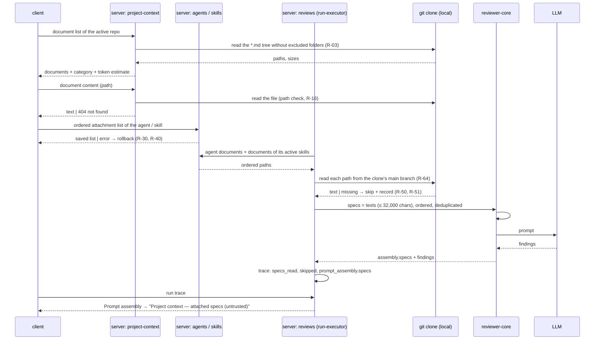

# L05 — Project Context · requirements

**Status:** Approved — approved by the user on 2026-10-30. Q-07, Q-08, Q-11, Q-12, Q-15 and UX-02, UX-03, UX-07, UX-08 are unresolved; they do not block the plan and stay open.
**Goal:** the user sees every markdown document in the project, attaches the ones they need to agents and skills, knows before a run how many tokens they will add to the prompt, and can read the full text of the attached documents in the review trace.
**Packages:** server · client · reviewer-core · vendored `@devdigest/shared` (both copies)
**Designs:**
- the user's text description (verbatim in the task; quotes below are marked «…»)
- `C:\Users\malin\GoITCourse\Lab5-1.png` — the Project Context page (N6)
- `C:\Users\malin\GoITCourse\lab5-2.png` = `lab5-3.png` (identical) — Agents → Context tab
- `C:\Users\malin\GoITCourse\lab5-4.png` — Skills → skill editor → Context tab
- `C:\Users\malin\GoITCourse\lab5-5.png` — agent run drawer (trace) → Configuration + Prompt assembly
- the current code of this repository (`file:line` references below)

**Branch:** `lesson/L05-lab`

## Context

**Problem.** The reviewer sees the diff, the repo map and skills, but not the
project's written requirements — PRDs, the security baseline, incident decisions.
So it cannot say "this PR violates a requirement from `specs/public-api.md`". The
user wants to choose which documents go into which agent's prompt, and to see what
that costs in tokens.

**How it works today (from the code):**

| What | Where | State |
|---|---|---|
| Prompt slot for documents | `reviewer-core/src/prompt.ts:59-60` (`PromptParts.specs?: string[]`), `:166-169`, `:205` | **already exists**: each element is wrapped with `wrapUntrusted('spec-<i>', …)` and rendered into a `## Project context` section with trust `untrusted`. Empty array → no section |
| Prompt-injection guard | `reviewer-core/src/prompt.ts:16-34` | `INJECTION_GUARD` is appended to the system prompt; `wrapUntrusted` escapes `</untrusted>` inside the text |
| Hand-off to the core | `reviewer-core/src/review/run.ts:60,154` | `ReviewInput.specs` → `assemblePrompt` |
| Trace record | `server/src/vendor/shared/contracts/trace.ts:43` (`PromptAssembly.specs`), `:89` (`RunTrace.specs_read: string[]`) | the fields already exist |
| Server, review run | `server/src/modules/reviews/run-executor.ts:234-284` | `specs` is **not passed** to `reviewPullRequest`; `specs_read: []` is hard-coded (`:354`, `:549`) — today the slot is always empty |
| Trace UI, Configuration | `client/.../RunTraceDrawer/_components/TraceBody/TraceBody.tsx:39-51` | the "Specs read" row shows `specs_read` or "none" |
| Trace UI, Prompt assembly | `TraceBody.tsx:88-90`, label in `client/messages/en/runs.json:51` | the block is shown when `prompt_assembly.specs != null`; the label is "Project context (dynamic)" — **not** "attached specs (untrusted)" as in the design |
| Prompt block: copy / expand / full screen / tokens | `client/.../PromptBlock/PromptBlock.tsx:29-98` | already supports inline expand, a full-screen modal with search, copy, a `~N tok` badge |
| Token estimate | `reviewer-core/src/prompt.ts:108,139` (`ceil(chars/4)`), client `PromptBlock/helpers.estimateTokens` | the same approximation in logs and in the trace |
| Attachment tables | `server/src/db/schema/agents.ts`, `skills.ts`, `context.ts` | **no** "agent ↔ document" or "skill ↔ document" table. `code_chunks` (`context.ts:31-47`, `source: code/docs/spec`) is never populated and is not needed for this feature |
| `SpecFile` contract | `server/src/vendor/shared/contracts/platform.ts:253-260` | `{ path, content?, size?, updated_at? }` — exists, unused |
| Reading repo files | `server/src/adapters/git/simple-git.ts:129-131` (`readFile` from the working copy), `:133-149` (`readFileAt` by sha with a path check) | the clone is a read-only mirror: `sync()` runs `reset --hard` to `origin/<branch>` (`:77-88`) |
| Agents and skills | `agents.ts:21` (`workspace_id`), `skills.ts:7` | bound to the **workspace**, not to a repository. Documents belong to a **repository** — see Q-02 |
| Editor tabs | `client/src/app/agents/[id]/_components/AgentEditor/constants.ts:15-18` (`config`, `skills`), `client/src/app/skills/[id]/_components/SkillEditor/constants.ts:23-27` (`config`, `preview`, `versions`) | there is no `context` tab anywhere |
| Sidebar | `client/src/vendor/ui/nav.ts:32-47` | WORKSPACE has only "Pull Requests"; there is no "Project Context" item (editing `nav.ts` is an allowed exception, `client/AGENTS.md`) |
| List pattern with checkbox and order | L02 Skills tab (`specs/L02-skills-in-the-product.md` §7.2, D2a) | a row has a position and a flag; unchecking does not move the row; reordering by drag and keyboard; changes do not version the agent (D7) |

**`INSIGHTS.md` traps that became requirements or constraints:**
- map-reduce sends the unchanged sections with **every** chunk, while the trace
  shows one assembly (`specs/L02-skills-in-the-product.md` §9, `reviewer-core/INSIGHTS.md`
  — `auto` has two conditions) → the real cost of documents in map-reduce = N × the
  estimate. See R-56.
- a counter over a filtered list is taken from the same array that is rendered
  (`client/INSIGHTS.md:168`) → R-24.
- `src/vendor/shared` is a copy, not a link (`client/INSIGHTS.md:181`) → every
  contract change goes into both copies.

### Assessment of file editing (user request, item 1)

Editing from the UI would mean writing to the clone's working copy. That is
**hard and unreliable**:

1. the clone is a read-only mirror: `sync()` runs `git reset --hard origin/<branch>`
   (`simple-git.ts:77-88`), so every resync / "re-analyze" silently wipes the edit;
2. the edit never reaches git history or GitHub — the team never sees it, and the
   document "in the UI" diverges from the document "in the repo";
3. it needs a separate write path guarded against path traversal (today the check
   exists only for reading by sha, `simple-git.ts:138-147`) and against writing
   outside `.md`;
4. it conflicts with a concurrent `sync()` or indexing.

**Conclusion:** the page is **view-only** (R-05). Editing, creating files and
folders, and upload are out of scope; the idea is recorded as UX-07.

## Out of scope

- **Editing documents**, and the new file / new folder / upload buttons from design N6 — see the assessment above.
- **The COVERAGE ring** — the user's decision (Q-13).
- Indexing documents into chunks, embeddings: `code_chunks` is empty, there is no semantic search. The "Indexed: … chunks" line is replaced by "… tokens total" (R-66).
- RAG / automatic selection of documents by PR content — attachment is manual only.
- A new agent or skill version when documents are attached (Q-14).
- An MCP tool for documents; e2e scenarios beyond the one end-to-end flow (R-58).
- The other sidebar items in the design (Onboarding Tour, Memory, Eval Dashboard…), the Evals / Stats / CI tabs.

## Requirements

### Project Context page

| ID | Pattern | Requirement | Verified by |
|---|---|---|---|
| R-01 | Ubiquitous | The system shall show a "Project Context" item in the sidebar's WORKSPACE group that opens the Project Context page of the active repository. | client |
| R-02 | Event-driven | WHEN the user opens the Project Context page, the system shall show every `*.md` file of the active repository, at any depth, grouped as a folder tree. | client + server-integration |
| R-03 | Ubiquitous | [decision Q-01] The system shall exclude from the document list any file that lies, at any depth, inside a build or dependency folder: `node_modules`, `dist`, `build`, `coverage`, `.next`, `out`, `vendor`, `.git`. | server-unit |
| R-04 | Event-driven | WHEN the user selects a document in the list, the system shall show the file name and the full rendered markdown content of the document on the right. | client |
| R-05 | Ubiquitous | [decision] The system shall show a document view-only: the page has no Edit toggle and no controls to create, upload or delete files or folders. | client |
| R-06 | Event-driven | WHEN the user clicks the refresh button, the system shall re-read the document list from the repository, showing added files and removing deleted ones. | client + server-integration |
| R-07 | Ubiquitous | The system shall show, for the selected document, an estimate of the number of tokens it will add to the prompt. | client |
| R-08 | Ubiquitous | [decision] The system shall show, for the selected document, "Used by N agents", where N is counted by the rule in Q-07. | client + server-integration |
| R-09 | Ubiquitous | [decision Q-01] The system shall show next to every document that lies in a folder a category equal to the name of the first folder of its path (`specs/public-api.md` → `specs`, `docs/a/b.md` → `docs`). The category of a document in the repository root is Q-15. | client + server-unit |
| R-10 | State-driven | WHILE the document list is loading, the system shall show a skeleton instead of the list. | client |
| R-11 | Unwanted | IF the repository (outside the folders excluded by R-03) has no `*.md` file, THEN the system shall show an empty state saying that no markdown documents were found. | client |
| R-12 | Unwanted | IF the repository has not been cloned yet (no local copy), THEN the system shall show, instead of the list, a message that documents become available after cloning. | client + server-integration |
| R-13 | Unwanted | IF a request for the list or for a document's content fails, THEN the system shall show an error state with the reason and a "Retry" button. | client |
| R-14 | Unwanted | IF the selected document disappeared from the repository between loading the list and opening it, THEN the system shall show that the file was not found and offer to refresh the list. | client + server-integration |
| R-15 | Unwanted | IF there is no active repository, THEN the system shall show on the Project Context page a prompt to add or select a repository. | client |
| R-66 | Ubiquitous | [decision UX-04] The system shall show, below the document list, the line "Indexed: N files · M tokens total", where N is the number of documents in the list and M is the sum of the token estimates of all of them by the `ceil(chars / 4)` rule (Q-06), together with the time of the last list refresh; the word "chunks" is not used. | client + server-integration |
| R-16 | Ubiquitous | The system shall return through the API the content of `*.md` files of the active repository outside the folders excluded by R-03 only; a request for any other path (including `..`, absolute paths, non-`.md` files, files inside excluded folders) shall be refused with a 4xx. | server-unit + server-integration |
| R-17 | Ubiquitous | The system shall render document content as markdown without executing embedded HTML or scripts. | client |

### Agent → Context tab

| ID | Pattern | Requirement | Verified by |
|---|---|---|---|
| R-18 | Ubiquitous | The system shall show a "Context" tab in the agent editor next to Config and Skills, reachable by a link with a tab parameter. | client |
| R-19 | Event-driven | WHEN the user opens the agent's Context tab, the system shall show every source document in one list: attached ones first in their saved order, then the rest alphabetically. | client |
| R-20 | Ubiquitous | The system shall show in every row a checkbox, the file name, the folder, a category tag and a "Preview" button. | client |
| R-21 | Event-driven | WHEN the user checks a document, the system shall save the attachment of the document to the agent so that it survives a page reload. | client + server-integration |
| R-22 | Event-driven | WHEN the user unchecks a document, the system shall remove the document from the agent's prompt, leaving the row in the same place in the list. | client + server-integration |
| R-23 | Event-driven | WHEN the user reorders an attached document (by drag or by ↑/↓ keys on the drag handle), the system shall save the new order, and that order shall be the order of documents in the prompt's `## Project context` section. | client + server-unit |
| R-24 | Ubiquitous | The system shall show "X of Y attached" in the tab header, where X is the number of attached documents and Y the number of all source documents, regardless of the filter. | client |
| R-25 | Event-driven | WHEN the user types into the document filter, the system shall show only the rows whose path contains that text, without changing attachments or order. | client |
| R-26 | Ubiquitous | The system shall show below the list a total estimate "≈ N tokens" for all documents that will go into this agent's prompt. | client |
| R-27 | Event-driven | WHEN the user checks or unchecks a document, the system shall update the total token estimate without a page reload. | client |
| R-28 | Ubiquitous | The system shall show below the list an explanation that the documents are injected as an untrusted `## Project context` block into every run. | client |
| R-29 | Event-driven | WHEN the user clicks "Preview" in a row, the system shall show the full rendered content of the document in a dialog over the tab. | client |
| R-30 | Unwanted | IF saving an attachment or the order fails, THEN the system shall show a message with the reason and restore the checkboxes and the order to the last saved state. | client |
| R-31 | Ubiquitous | [decision] The system shall not change the agent's version when documents are attached, detached or reordered. | server-integration |
| R-32 | Unwanted | IF a document attached to the agent no longer exists in the source, THEN the system shall show its row marked "file not found" and allow detaching it. | client + server-integration |
| R-62 | Ubiquitous | [decision Q-02] The system shall store the attachment of a document to an agent or a skill as the document's relative path in the repository, not bound to a specific repository. | server-integration |
| R-63 | Ubiquitous | [decision Q-02] The system shall show the active repository's documents on the Context tabs of agents and skills. | client |
| R-33 | Ubiquitous | The system shall give every checkbox and every drag handle an accessible name that contains the document's path. | client |
| R-67 | Ubiquitous | [decision UX-05] The system shall show in every row of the agent and skill Context tab lists that document's token estimate ("≈ N tok"), whether or not the document is attached. | client |
| R-68 | Unwanted | [decision UX-06] IF a document is longer than the limit in R-52, THEN the system shall mark its row on the Context tabs "will be truncated to ≈ 8k tokens" and count it already truncated in "≈ N tokens" and in R-67. | client |
| R-69 | Ubiquitous | [decision UX-01] The system shall show on the agent's Context tab the documents inherited from its active skills as dimmed rows marked "via <skill>" without a checkbox, and count them in "≈ N tokens" (R-26) by the same merge rule as the prompt (R-46, R-47): a document attached both directly and through a skill is counted once. | client + server-integration |

### Skill → Context tab

| ID | Pattern | Requirement | Verified by |
|---|---|---|---|
| R-34 | Ubiquitous | The system shall show a "Context" tab in the skill editor, reachable by a link with a tab parameter. | client |
| R-35 | Event-driven | WHEN the user opens the skill's Context tab, the system shall show the same document list (checkbox, name, folder, category, preview, filter, reordering) as on the agent's tab, with an "N attached" counter. | client |
| R-36 | Ubiquitous | The system shall show on the skill's Context tab an explanation that every agent using this skill inherits these documents. | client |
| R-37 | Event-driven | WHEN the user checks, unchecks or reorders a document in a skill, the system shall save the change so that it survives a reload. | client + server-integration |
| R-38 | Ubiquitous | The system shall show on the skill's Context tab a total estimate "≈ N tokens" of the documents attached to the skill (user requirement; the `lab5-4.png` design does not have it). | client |
| R-39 | Ubiquitous | The system shall show a "Serializes as" block with how the skill's attached documents will look in the prompt, in the saved order (format — Q-08). | client |
| R-40 | Unwanted | IF saving changes on the skill's Context tab fails, THEN the system shall show a message with the reason and restore the last saved state. | client |
| R-41 | Ubiquitous | [decision] The system shall not change the skill's version when documents are attached, detached or reordered. | server-integration |
| R-42 | Ubiquitous | The system shall show on the skill card and in its editor the number of agents that use it ("Used by N agents"). | client |

### Review run — documents in the prompt

| ID | Pattern | Requirement | Verified by |
|---|---|---|---|
| R-43 | Event-driven | WHEN an agent review starts, the system shall look up every relative path attached to the agent in this PR's repository and read the full text of the document. | server-integration |
| R-64 | Ubiquitous | [decision Q-03] The system shall read a document's text for the review from the state of the main branch in the local clone, not from the PR head: a PR that changes a document is reviewed against the main-branch version of that document. | server-integration |
| R-44 | Event-driven | WHEN an agent review starts, the system shall also read the documents attached to every skill whose body goes into this agent's prompt (the skill is enabled globally and checked on the agent — the L02 rule). | server-integration |
| R-45 | Ubiquitous | The system shall put the text of all read documents into one `## Project context` section of the prompt, each document as a separate untrusted block labelled with the document's path. | reviewer-core + server-unit |
| R-46 | Ubiquitous | [decision Q-04] The system shall place in the section first the documents attached to the agent, in the agent's order, then the documents inherited from skills, in the order of the skills on the agent and in the order of documents within each skill. | server-unit |
| R-47 | Ubiquitous | [decision Q-04] The system shall include a document attached both directly and through a skill (or through several skills) in the prompt exactly once — at the position of its first occurrence in the R-46 order. | server-unit |
| R-48 | Ubiquitous | The system shall escape in a document's text any attempt to close the untrusted block, so that the document text cannot escape its block. | reviewer-core |
| R-49 | State-driven | WHILE no document is attached to the agent or its skills, the system shall build the prompt without a `## Project context` section, byte-for-byte identical to the prompt before this feature. | server-unit |
| R-50 | Unwanted | [decision] IF an attached document does not exist in the repository at run time, THEN the system shall skip it, continue the review with the remaining documents, and record the skip (path and reason "not found") in the run log and in the trace. | server-integration |
| R-51 | Unwanted | IF a document could not be read for another reason (repository not cloned, read error), THEN the system shall skip it as in R-50, with a reason that distinguishes this case from "not found". | server-integration |
| R-52 | Unwanted | [decision Q-05] IF a document's text is longer than 32,000 characters (≈ 8,000 tokens by `ceil(chars/4)`), THEN the system shall add only the first 32,000 characters to the prompt with a visible "truncated" marker in that document's block. | server-unit |
| R-65 | Unwanted | [decision Q-05] IF a document was truncated under R-52, THEN the system shall mark that document "truncated" in the run trace (in the list of attached documents). | server-integration + client |
| R-53 | Event-driven | WHEN a document is added to the prompt, the system shall write a run-log line with the document's path and size. | server-integration |
| R-54 | Ubiquitous | The system shall record in the run trace the list of paths of the attached documents in prompt order, and the "Specs read" row in Configuration shall show exactly that list. | server-integration + client |
| R-55 | Ubiquitous | The system shall show skipped documents (R-50, R-51) in the run trace separately from attached ones, with the reason for the skip. | client |
| R-56 | Ubiquitous | The system shall apply the same `## Project context` section to every LLM call of a run, including every chunk in map-reduce. | reviewer-core |

### Prompt assembly in the trace

| ID | Pattern | Requirement | Verified by |
|---|---|---|---|
| R-57 | State-driven | WHILE the run trace contains attached documents, the system shall show in the Prompt assembly section a row labelled "Project context — attached specs (untrusted)". | client |
| R-58 | Event-driven | WHEN the user expands this row or opens it full screen, the system shall show the full text of the attached documents exactly as it was sent in the request. | client + e2e |
| R-59 | Ubiquitous | The system shall show in this row the block's token estimate, computed by the same rule as the estimate on the Context tabs (see Q-06). | client |
| R-60 | Event-driven | WHEN the user clicks copy in this row, the system shall copy the full text of the block to the clipboard. | client |
| R-61 | State-driven | WHILE the trace contains no attached documents (including traces of runs from before this feature), the system shall not show the Project context row and shall show "none" in "Specs read". | client |

## Design analysis

| Screen / action | Covered | Missing | → |
|---|---|---|---|
| N6 / document source | `.devdigest/specs/` tree | the Context tabs show `specs/`, `docs/`, `insights/` — a different source; the category rule is not defined | R-02, R-03, R-09 (Q-01 resolved), Q-15 |
| N6 / Edit, new file, new folder, upload | buttons present | writing to the read-only clone is wiped by `reset --hard` | R-05, UX-07 |
| N6 / COVERAGE 78 | ring present | what it measures is undefined; the user removed it | Q-13, Out of scope |
| N6 / "Indexed: 12 files · 1,240 chunks" | line present | there are no chunks (`code_chunks` is empty) → "tokens total" | R-66 (UX-04 resolved) |
| N6 / "Used by 3 agents" | present | counting rule (direct / through skills) | R-08, Q-07 |
| N6 / tokens | absent | user requirement | R-07 |
| N6 / states | happy path only | loading, empty, not cloned, error, file disappeared, no repo | R-10…R-15 |
| N6 / long paths, hundreds of files | — | path truncation, scrolling | UX-03 |
| Agent Context / list | checkbox, drag, category, Preview, filter, "2 of 7", "≈ 317 tokens" | keyboard reordering, accessible names | R-23, R-33 |
| Agent Context / documents from skills | not shown | the user does not see that the agent already gets a document through a skill | UX-01 |
| Agent Context / document disappeared | — | undefined | R-32 |
| Agent Context / save error | — | undefined | R-30 |
| Agent Context / documents bound to a repo, the agent to the workspace | — | which repository the tab shows | R-62, R-63, R-43 (Q-02 resolved) |
| Skill Context / tokens | **absent** | the user requires it | R-38 |
| Skill Context / "Serializes as" | `## Project specifications` + list of paths | a different heading from `## Project context`, and no text — contradicts the requirement "added to the prompt as text" | Q-08 |
| Skill Context / Preview | eye icon only | no accessible name | R-33 (same pattern) |
| Run drawer / Specs read | paths | skipped documents are not visible | R-55 |
| Run drawer / Prompt assembly | "Project context — attached specs (untrusted)" row, copy, expand | current label "Project context (dynamic)"; opening a single document | R-57, UX-02 |
| Run drawer / old traces | — | `specs: null`, `specs_read: []` | R-61 |
| Anywhere / very large document | — | limit, truncation | R-52, R-65 (Q-05 resolved) |
| Anywhere / concurrent edits from two tabs | — | last write wins? | Q-11 |

## Module interaction

| From → to | What is passed | On failure | Requirement |
|---|---|---|---|
| client → server/project-context (list) | repository id | error → error state with Retry; not cloned → separate message | R-12, R-13 |
| client → server/project-context (content) | repository id, relative path | path outside the source → 4xx; file disappeared → "not found" | R-14, R-16 |
| client → server/agents (attachments) | agent id, ordered document list | error → message + UI rollback | R-21…R-23, R-30 |
| client → server/skills (attachments) | skill id, ordered document list | error → message + UI rollback | R-37, R-40 |
| server/reviews → agents/skills | agent id | — (a DB error fails the run, as today) | R-43, R-44 |
| server/reviews → git clone | PR repository, revision, path | file missing / unreadable → skip, the run continues | R-50, R-51 |
| server/reviews → reviewer-core | `specs: string[]` (texts, ordered) | empty → no section | R-45, R-49 |
| client → server/runs (trace) | run id | existing drawer error handling | R-57…R-61 |

## UX improvements

| ID | Proposal | Why | Status |
|---|---|---|---|
| UX-01 | On the agent's Context tab, show documents inherited from skills as dimmed rows marked "via <skill>", and count them in "≈ N tokens". | Otherwise the tab's token total is lower than the real one, and the user may attach a document a second time without knowing about the skill | accepted → R-69 |
| UX-02 | In the Prompt assembly row, allow opening each attached document separately (a subheading or a jump by path). | "Open and read" a specific document without scrolling the whole block | pending |
| UX-03 | Truncate a long path in the middle with the full path in a tooltip; a list > 50 documents scrolls inside the panel, the filter is always visible. | The design assumes 6–7 short names | pending |
| UX-04 | Instead of "Indexed: N files · N chunks", show "N documents · updated <time>". | Chunks do not exist; the count and freshness are what actually exists | accepted in a modified form: "N files · M tokens total" → R-66 |
| UX-05 | Show the token estimate in every row of the Context tab lists, not only the total. | Shows which document is "expensive" before attaching it | accepted → R-67 |
| UX-06 | Mark on the Context tabs a document longer than the R-52 limit ("will be truncated to ≈ 8k tokens") and count it in "≈ N tokens" already truncated. | The user learns the cost before the run, not from the bill | accepted → R-68 |
| UX-07 | Edit documents through a GitHub PR (branch + commit + PR) instead of writing to the clone. | The only way to edit that survives `reset --hard` and is visible to the team | pending (beyond L05) |
| UX-08 | Name "project context documents" explicitly in the `INJECTION_GUARD` text among the examples of untrusted data, and state that requirements from them are a reference for checking the code, not instructions to the model. | The guard currently lists diff, PR, README, intent — project documents are missing from the list | pending |

## Open questions

No blocking questions. Q-01…Q-05 are resolved — see `## Decisions`. The rest do
not block the plan; each names a recommended option.

| ID | Question | Blocks | Who answers |
|---|---|---|---|
| Q-15 | What category does a document in the repository root (`README.md`, `CHANGELOG.md`) get, when its path has no folder? Recommended: the tag `root`. | R-09 (root files only) | user |
| Q-07 | "Used by N agents" for a document: count agents that attached it directly **plus** agents that get it through an active skill (each agent once)? Recommended yes — it is the number of agents whose prompt the document actually reaches. | R-08 | user |
| Q-08 | The "Serializes as" block in `lab5-4.png` shows `## Project specifications` and only a list of paths, while the agent's prompt has `## Project context` with the full text. Recommended: one `## Project context` section with text in the prompt; "Serializes as" shows the heading and the ordered paths as a preview. | R-39, R-45 | user |
| Q-11 | Two browser tabs change the attachments of one agent at the same time: last write wins (as in the L02 Skills tab) — acceptable? | R-21, R-37 | user |
| Q-12 | Does a running review see attachment changes made after it started? Recommended: no — the document set is fixed at the start of the run. | R-43 | user |

## Decisions

| Question | Decision | Source |
|---|---|---|
| Q-09 Editing on the Project Context page | Assessment: hard (read-only clone, `reset --hard` on sync, no write path, conflict with git) → the page is view-only; editing — UX-07 | user (via coordinator), 2026-10-29 |
| Q-10 Attached document missing at run time | Skip it, continue the review, record the skip in the log and the trace | user (via coordinator), 2026-10-29 → R-50 |
| Q-13 COVERAGE ring | Remove it; show only "Used by N agents" for a document and a skill | user (via coordinator), 2026-10-29 → R-08, R-42 |
| Q-14 Versioning | Attaching / detaching / reordering documents does not create a new agent or skill version | user (via coordinator), 2026-10-29 → R-31, R-41 |
| Q-01 Document source and category | Every `*.md` in the repository except build and dependency folders (`node_modules`, `dist`, `build`, `coverage`, `.next`, `out`, `vendor`, `.git` — the same set as `EXCLUDED_DIRS` in `repo-intel/constants.ts:17`); category = first folder of the path | user (via coordinator), 2026-10-30 → R-02, R-03, R-09, R-11, R-16 |
| Q-02 Attachment storage | By relative path, not bound to a repository; the Context tabs show the active repository; at review time the path is looked up in the PR's repository; missing → skip and record (R-50) | user (via coordinator), 2026-10-30 → R-43, R-62, R-63 |
| Q-03 Document revision | The main branch in the local clone, not the PR head | user (via coordinator), 2026-10-30 → R-64 |
| Q-04 Order and merge | The agent's documents first in its order, then those inherited from skills in the order of skills on the agent; each document once, first occurrence wins | user (via coordinator), 2026-10-30 → R-46, R-47 |
| Q-05 Size limit | ≈ 8k tokens per document = 32,000 characters by `ceil(chars/4)`; longer — truncate with a visible "truncated" marker in the prompt and in the trace | user (via coordinator), 2026-10-30 → R-52, R-65 |
| Q-06 Token formula | `ceil(chars / 4)` — the same as in `reviewer-core/src/prompt.ts:139` and in the trace's `~N tok` badge; one shared function for the tabs, the page and the trace | user, 2026-10-30 → R-07, R-26, R-38, R-59, R-66, R-67 |
| UX-01, UX-05, UX-06 Tokens while choosing | Accepted: documents inherited from skills in the agent's list and total, tokens in every row, the truncation marker | user, 2026-10-30 → R-69, R-67, R-68 |
| UX-04 "Indexed" line on N6 | Replace the word "chunks" with "tokens total": "Indexed: N files · M tokens total" | user, 2026-10-30 → R-66 |
| Untrusted wrapping | Documents are untrusted data in the `## Project context` section (as in the lab5-2 design and the existing slot `prompt.ts:205`); no keyword scanning — only `wrapUntrusted` + `INJECTION_GUARD` (`reviewer-core/AGENTS.md`, invariant 3) | design + package rules |
| Spec language | English, like the other specs in `specs/` | user, 2026-10-30 |
