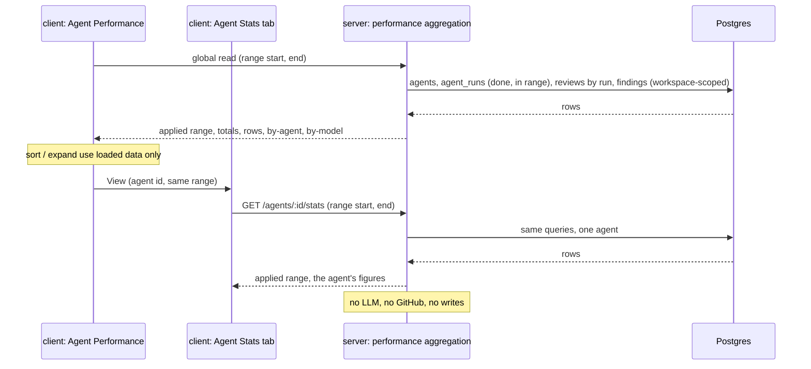

# L08 — Agent Performance · requirements

**Status:** Approved by the user on 2026-11-05; UX/Q decisions recorded 2026-11-05. BQ-1…BQ-8, UX-01…UX-10 and Q-01…Q-10 were decided by the user on 2026-11-05 (see `## Decisions`); accepted UX items are R-90…R-105. Q-11 was decided the same day (R-106…R-112). No question is open.
**Goal:** a workspace owner opens one screen and sees, for a chosen period, how much each review agent ran, what it cost (as a DevDigest estimate), how long it took and how often its findings were accepted. The same numbers appear on that agent's own Stats tab.
**Packages:** server · client · vendored `@devdigest/shared` (both copies). `reviewer-core`, `mcp` and `e2e` are not touched.
**Designs:**
- the user's text: the L08 homework assignment and acceptance criteria, translated from Ukrainian, plus binding user decisions — `.devdigest/cache/sdd/L08-agent-performance/brief.md`. Quotes are marked «…»
- `C:\Users\malin\GoITCourse\dz8-1.jpg`: the Agent Performance screen (header with a "30 days" control, four KPI cards, an agents table, a Cost breakdown section with "By agent" and "By model" donuts, a GLOBAL sidebar group)
- the current code of this repository (`file:line` references below)

**Branch:** `lesson/L08-homework` (the current branch)

**Requirement IDs.** Every requirement has a stable ID `R-NN`. Plan tasks and tests cite these IDs. IDs are never renumbered; a dropped one stays struck through with the reason.

## Blocking questions

None open. BQ-1…BQ-8 were answered by the user on 2026-11-05 (option A for each) and are recorded under `## Decisions`; the requirements they settle carry `[decision BQ-n]`.

## Context

**Problem.** The assignment: «Add a global Agent Performance screen. The Stats tab of a specific agent already has per-agent metrics; the new dashboard aggregates the same stored data across all agents.» In this repository the Stats tab does **not** exist yet, so both screens are built here on one aggregation (user decision 1).

**How it works today (from the code):**

| What | Where | State |
|---|---|---|
| Run rows | `server/src/db/schema/runs.ts:17-53` (`agent_runs`) | Per run: `workspace_id`, `agent_id` (nullable, `set null` on agent delete, `:24`), `ran_at` (timestamptz, `:26`), `provider`, `model`, `duration_ms`, `tokens_in/out`, `cost_usd` (null when the price is unknown, never 0, `:32-33`), `status` (free text, `:34`), `source` `local \| ci` (`:37`). Index on `(workspace_id, pr_id, ran_at)` and on `status` only (`:49-51`) |
| Run lifecycle | `server/src/modules/reviews/repository/run.repo.ts:117-177` | Created `running`, `source: 'local'` (`:135-136`); completed as `done`, `failed` or `cancelled` (`:146`). Boot reaper sets stale `running` → `failed` without duration (`:105-112`). A run deleted from the timeline deletes its review and findings (`:78-91`) |
| Run cost on failure | `server/src/modules/reviews/run-executor.ts:408-418`, `:83-96` | Failed/cancelled runs store `cost_usd: null`, `tokens 0`, even after a model call. Successful run: `:349-360` |
| CI runs | grep of `server/src` | No code writes `source = 'ci'` today; every stored run is `local` |
| Review ↔ run | `server/src/db/schema/reviews.ts:18-44` | `reviews.run_id` (no FK) and `reviews.agent_id` (no FK) link a review to its run; only a `done` run writes a review (`run-executor.ts:324-334`) |
| Finding decisions | `reviews.ts:46-71`; `server/src/modules/reviews/repository/review.repo.ts:156-173` | `accepted_at` / `dismissed_at`; accepting clears dismissed and vice versa, so a finding is accepted, dismissed or pending (neither). Finding kinds: `finding`, `secret_leak`, `lethal_trifecta`, `phantom`, `hook` (`contracts/findings.ts:17-23`) |
| Per-agent contract | `server/src/vendor/shared/contracts/observability.ts:88-119` (`AgentStats`), mirrored in `client/src/vendor/shared/` | Declared for `GET /agents/:id/stats`; fields `runs`, `accepted`, `dismissed`, `pending`, `accept_rate`, `total_cost_usd`, `avg_cost_usd`, `avg_latency_ms`, `findings_by_severity`, `trend`. No range, no unpriced-run count, no last run. No route serves it |
| Global contract | `server/src/vendor/shared/contracts/productionize.ts:134-186` (`AgentPerfRow`, `PerfCostSegment`, `AgentPerf`, commented `GET /agents/performance`), mirrored in the client | Has `summary { runs, total_cost_usd, avg_accept_rate, most_active_agent }`, `agents[]` (with `last_run_at`, `trend`), `cost_by_agent[]`, `cost_by_model[]`. Its comment defines accept rate as `accepted / (accepted + dismissed)`. No range, no unpriced-run count, no decided count. No route serves it |
| Agents routes | `server/src/modules/agents/routes.ts:20-224` | `GET /agents`, `GET /agents/:id` (uuid params, 404 outside the workspace, `:104-109`) … no stats route |
| Module registry | `server/src/modules/index.ts:31-47` | No observability/performance module |
| Agent editor tabs | `client/src/app/agents/[id]/_components/AgentEditor/AgentEditor.tsx:1-5,27-33`, `…/AgentEditor/constants.ts:15-20`, `client/src/app/agents/[id]/page.tsx:19,35-40` | Tabs `config`, `skills`, `context`; tab in `?tab=` via `router.replace`; "Stats … tabs belong to a later lesson and are not built" |
| Sidebar | `client/src/vendor/ui/nav.ts:35-52` | Groups WORKSPACE and SKILLS LAB only; no GLOBAL group. The file is the one allowed hand-edit in `src/vendor/ui` (`client/AGENTS.md`, "Do not touch") |
| Cost format | `client/src/lib/format-cost.ts:19-24` | One rule for every run cost: `null` → "—", `<$0.01` → 4 decimals, else 3 decimals (`$0.040`, `$8.740`). The header comment says screen-specific precision from mockups was deliberately not followed |
| Seed data | `server/src/db/seed.ts:91-104` | One seeded run: `done`, `cost_usd: null`. A fresh demo workspace therefore shows "1 run without a price" and an unknown total cost |
| Reconciled billing | whole schema | Does not exist (brief, "Repo reality") |

**Constraints from `INSIGHTS.md` and package rules** (inputs for the planner, not requirement text):
- `@devdigest/shared` is two physical copies; any contract change goes into both in one commit (`client/INSIGHTS.md:205-211`, root `AGENTS.md`).
- The client imports **types only** from `@devdigest/shared` (`server/INSIGHTS.md:72-87`).
- New server logic goes in `service.ts` + `repository.ts`, never queries in `routes.ts` (`server/INSIGHTS.md:160-172`); a module cannot import another module's folder (`no-cross-module`, `server/INSIGHTS.md:128-144`).
- A test touching Postgres is `*.it.test.ts`; read the skipped count of an integration run (`server/INSIGHTS.md:90-115`, `:289-311`).
- Pass an explicit `now` to `relativeTime` (Last run) (`client/INSIGHTS.md:221-225`).
- Run `pnpm exec next lint --dir src` / `pnpm build` (with `next dev` stopped) — verify does not run eslint (`client/INSIGHTS.md:28-32`, `:62-81`).
- Duplicate accessible names (e.g. several "View" links) need `getAllByRole` in tests (`client/INSIGHTS.md:84-102`).

## Out of scope

- Reconciled billing data from any provider. Every cost is a DevDigest estimate (user decision 2).
- ~~The mockup's sparkline, cost delta ("-$1.20"), accept-rate trend arrows, accept ring and accept-rate colour bands — listed as proposals UX-01…UX-05, not built unless accepted.~~ Accepted by the user on 2026-11-05 → R-90…R-101 on the dashboard. The cost delta, trend arrow and colour band also appear on the Stats tab (Q-11 → R-106…R-112).
- Failed/cancelled run counts (UX-06), findings by severity on the Stats tab (UX-07) and a `g` shortcut for Agent Performance (UX-09): deferred by the user on 2026-11-05.
- The mockup's other sidebar items (Memory, Multi-Agent Review, CI Runs, Eval Dashboard) and the top bar (search, refresh, notifications): not part of this assignment.
- Evals and CI tabs of the agent editor.
- Any new stored table, column or migration: everything is computed at read time from existing rows.
- An MCP tool and an e2e flow (the assignment asks for neither).
- Per-repository filtering: the dashboard is workspace-wide.

## Requirements

### Aggregation rules (shared by both endpoints)

| ID | Pattern | Requirement | Verified by |
|---|---|---|---|
| R-01 | Ubiquitous | The system shall compute the per-agent stats and every per-agent row of the dashboard with one set of aggregation rules, so that for any agent and any range the dashboard row and that agent's stats report identical values for runs, total cost, average cost, runs without a price, average duration, accepted, dismissed, pending, accept rate and last run. | server-integration (same fixture, both reads, field-by-field equality) |
| R-02 | Ubiquitous | [decision BQ-1] The system shall count a run only when it belongs to the caller's workspace, its status is `done`, and its run time lies in the selected range; `running`, `failed` and `cancelled` runs are never counted. | server-integration |
| R-03 | Ubiquitous | [decision Q-01] The system shall count runs of source `local` and `ci` alike. | server-integration |
| R-04 | Ubiquitous | The system shall treat the range as start-inclusive and end-exclusive: a run whose run time equals the start is counted, one whose run time equals the end is not. | server-integration |
| R-05 | Ubiquitous | The system shall report as an agent's runs the number of its counted runs. | server-integration |
| R-06 | Ubiquitous | The system shall report as total cost the sum of the stored cost of the counted runs that have a cost, and report the counted runs without a stored cost separately as "runs without a price", never adding them into any cost figure. | server-integration |
| R-07 | Unwanted | IF none of the counted runs has a stored cost, THEN the system shall report the total cost and the average cost as unknown (null), never as 0. | server-integration |
| R-08 | Ubiquitous | The system shall report as average cost the total cost divided by the number of counted runs that have a cost. | server-integration |
| R-09 | Ubiquitous | [decision BQ-1] The system shall report as average duration the mean stored duration of the counted runs that have one, or unknown (null) when none has. | server-integration |
| R-10 | Ubiquitous | [decision BQ-2] The system shall take as an agent's findings for a range the findings of the reviews produced by its counted runs, each classified by its state at request time as accepted, dismissed or pending (neither). | server-integration |
| R-11 | Ubiquitous | The system shall report the accept rate as accepted ÷ (accepted + dismissed), excluding pending findings, together with that denominator ("decided"), and as unknown (null) when the denominator is 0. | server-unit + server-integration |
| R-12 | Ubiquitous | [decision Q-04] The system shall count findings of every kind (`finding`, `secret_leak`, `lethal_trifecta`, `phantom`, `hook`) in accepted, dismissed and pending. | server-integration |
| R-13 | Ubiquitous | [decision BQ-1, Q-03] The system shall report as last run the latest run time among the agent's counted runs in the range, or none when it has no counted run. | server-integration |
| R-14 | Ubiquitous | The system shall return, with every stats and dashboard answer, the exact range start and end it applied. | server-integration |

### Dashboard totals and breakdowns

| ID | Pattern | Requirement | Verified by |
|---|---|---|---|
| R-15 | Ubiquitous | The system shall report as Total runs the sum of the runs of all rows of the dashboard table (R-24, R-21). | server-integration |
| R-16 | Ubiquitous | The system shall report a Total cost equal to the sum of the counted priced runs, and equal (to within 1e-9 USD before rounding) both to the sum of the by-agent segments and to the sum of the by-model segments. | server-unit + server-integration |
| R-17 | Ubiquitous | The system shall report as the dashboard's runs without a price the sum of the rows' runs without a price. | server-integration |
| R-18 | Ubiquitous | [decision BQ-3] The system shall report the Avg accept rate as the sum of accepted findings over all rows divided by the sum of decided findings over all rows, together with both sums, and as unknown when no finding is decided. | server-unit + server-integration |
| R-19 | Ubiquitous | [decision Q-02] The system shall report as Most-active agent the existing agent with the most counted runs in the range; a tie goes to the agent with the later last run, then to the agent whose name sorts first. | server-unit |
| R-20 | Unwanted | IF no agent has a counted run in the range, THEN the system shall report no Most-active agent. | server-unit |
| R-21 | Ubiquitous | [decision BQ-6] The system shall aggregate the counted runs whose agent was deleted into one row and one by-agent segment labelled "Deleted agents", include them in every total, and never report that row as the Most-active agent. | server-integration |
| R-22 | Ubiquitous | The system shall group the by-model breakdown by the provider and model stored on each counted priced run, with runs that have no stored model in one segment labelled "Unknown model". | server-integration |
| R-23 | Ubiquitous | The system shall include in the by-agent and by-model breakdowns only counted runs with a stored cost, one segment per agent or model with at least one such run. | server-integration |
| R-24 | Ubiquitous | [decision BQ-7] The system shall return one dashboard row for every agent of the caller's workspace, enabled or disabled, including agents with no counted run in the range. | server-integration |

### API

| ID | Pattern | Requirement | Verified by |
|---|---|---|---|
| R-25 | Event-driven | WHEN a client requests `GET /agents/:id/stats` with a range, the system shall return that agent's figures of R-05…R-14 for the range. | server-integration |
| R-26 | Event-driven | WHEN a client requests the global performance read with a range, the system shall return the totals of R-15…R-20, one row per R-24 (plus R-21), and the two breakdowns. | server-integration |
| R-27 | Unwanted | IF the agent id does not exist or belongs to another workspace, THEN the system shall answer the per-agent stats request with HTTP 404. | server-integration |
| R-28 | Unwanted | IF the range is missing, unparseable, or its start is not before its end, THEN the system shall answer either read with HTTP 422 before computing anything. | server-integration |
| R-29 | Ubiquitous | The system shall answer both reads using stored rows only: no model call, no GitHub request, no review run started, and no row created, changed or deleted. | server-integration (LLM and GitHub mocks record zero calls; row counts and finding states unchanged) |
| R-30 | Ubiquitous | The system shall never count a run, review or finding of another workspace. | server-integration |
| R-31 | Ubiquitous | The system shall define both response shapes in `@devdigest/shared`, byte-identical in the server and client copies, carrying at least: the applied range, runs, total cost, average cost, runs without a price, average duration, accepted, dismissed, pending, decided, accept rate and last run per agent, and for the dashboard the totals and both breakdowns. | server typecheck + client typecheck |

### Range control (dashboard and Stats tab)

| ID | Pattern | Requirement | Verified by |
|---|---|---|---|
| R-32 | Ubiquitous | The system shall offer on the dashboard and on the Stats tab a range control with the choices "1 day", "30 days" and "Custom range". | client |
| R-33 | State-driven | WHILE the page address carries no range, the system shall use "30 days". | client |
| R-34 | Ubiquitous | [decision BQ-5] The system shall resolve "1 day" to the 24 hours and "30 days" to the 30 × 24 hours ending at the moment the range is applied (page load or selection). | client |
| R-35 | Ubiquitous | [decision BQ-5, Q-05, Q-10] The system shall resolve a custom range of a start date and an end date to the period from 00:00 of the start date to 00:00 of the day after the end date, in the browser's time zone. | client |
| R-36 | Unwanted | IF the chosen end date is before the start date, THEN the system shall show "End date must be on or after the start date" and send no request. | client |
| R-37 | Unwanted | [decision BQ-5] IF a chosen date is after today, THEN the system shall show "Dates after today are not available" and send no request. | client |
| R-38 | Event-driven | WHEN the user applies a range, the system shall store it in the page address, so that a reload or a shared link shows the same range. | client |
| R-39 | Unwanted | IF the range in the page address is unrecognised or invalid, THEN the system shall use "30 days" and show no error. | client |
| R-40 | Ubiquitous | The system shall name the applied range in the KPI card titles and the Runs column header: "(1D)", "(30D)", or "(<start> – <end>)" for a custom range. | client |
| R-41 | Event-driven | WHEN the range changes while an earlier request is still pending, the system shall show only the result of the latest range and never figures of an earlier range under the new range's label. | client |

### Dashboard: navigation, KPIs, cost labelling

| ID | Pattern | Requirement | Verified by |
|---|---|---|---|
| R-42 | Ubiquitous | The system shall show in the sidebar a group "GLOBAL" with the item "Agent Performance", reachable with or without an active repository, and highlighted while the dashboard is open. | client |
| R-43 | Ubiquitous | The system shall show the title "Agent Performance" and the subtitle "Which agents earn their keep — accept rate is the quality signal". | client |
| R-44 | State-driven | WHILE dashboard data is shown, the system shall show four KPI cards: Total runs, Total cost, Avg accept rate and Most-active agent. | client |
| R-45 | Ubiquitous | The system shall label every cost figure on the dashboard and the Stats tab (Total cost, Avg cost, the breakdowns) as "DevDigest estimate". | client |
| R-46 | Ubiquitous | The system shall show on the dashboard and on the Stats tab the note "Reconciled billing is not connected — costs are DevDigest estimates from token counts and model prices." | client |
| R-47 | State-driven | WHILE the runs without a price in the range are more than 0, the system shall show "<N> runs without a price — not included" in the Total cost card. | client |
| R-48 | Unwanted | IF the total cost is unknown (R-07), THEN the system shall show "—" in the Total cost card, never "$0". | client |
| R-49 | State-driven | [decision BQ-3] WHILE dashboard data is shown, the system shall show the Avg accept rate as a whole percentage with "<accepted>/<decided> decisions" under it, or "—" with "No decided findings" when nothing is decided. | client |
| R-50 | State-driven | WHILE a Most-active agent exists, the system shall show its name and "<runs> runs · <rate>% accept" (or "<runs> runs · no decisions"). | client |
| R-51 | Ubiquitous | The system shall format every cost with the existing per-run cost format used elsewhere in the studio (unknown → "—"). | client |

### Dashboard: agents table

| ID | Pattern | Requirement | Verified by |
|---|---|---|---|
| R-52 | State-driven | WHILE dashboard data is shown, the system shall show a table with the columns Agent, Runs, Avg cost, Avg duration, Accept rate, Last run and View. | client |
| R-53 | Ubiquitous | The system shall show each row's accept rate as a whole percentage followed by its denominator "<accepted>/<decided>", or "—" with "0 decisions" when nothing is decided. | client |
| R-54 | Ubiquitous | The system shall show average duration in seconds with one decimal ("6.2s"), or "—" when unknown. | client |
| R-55 | Ubiquitous | The system shall show Last run as a relative time ("4m ago") with the absolute date and time on hover and focus, or "—" when none. | client |
| R-56 | Event-driven | WHEN the user activates a row's View link, the system shall open that agent's Stats tab with the same applied range (same start and end). | client |
| R-57 | State-driven | [decision BQ-7] WHILE an agent has no counted run in the range, the system shall show its row with Runs "0" and "—" in Avg cost, Avg duration, Accept rate and Last run. | client |
| R-58 | State-driven | [decision BQ-6] WHILE the dashboard has a "Deleted agents" row, the system shall show it labelled "Deleted agents", without a View link. | client |
| R-59 | Ubiquitous | The system shall show the table sorted by accept rate, highest first, when the page opens. | client |
| R-60 | Event-driven | WHEN the user activates the header of the Agent, Runs, Avg cost, Avg duration, Accept rate or Last run column, the system shall sort by that column, toggling between descending and ascending, and expose the current order to assistive technology. | client |
| R-61 | State-driven | [decision BQ-4] WHILE an agent has fewer than 5 decided findings (the small-sample threshold T = 5), the system shall show next to its accept rate the text badge "Small sample". | client |
| R-62 | Event-driven | [decision BQ-4] WHEN the table is sorted by accept rate in either direction, the system shall place all rows with fewer than 5 decided findings after all rows with 5 or more, order the rows with fewer than 5 by decided findings descending, and place rows with no decided finding last. | client |
| R-63 | Event-driven | WHEN the table is sorted, the system shall reorder the rows already loaded without sending any request. | client |
| R-64 | Event-driven | [decision BQ-8] WHEN the user activates a row's expand control, the system shall show under the row its accepted, dismissed and pending counts, its runs without a price and its cost per model, from data already loaded and without sending any request. | client |
| R-65 | Ubiquitous | The system shall truncate a long agent name with an ellipsis and show the full name on hover and focus. | client |

### Dashboard: cost breakdown

| ID | Pattern | Requirement | Verified by |
|---|---|---|---|
| R-66 | State-driven | WHILE dashboard data is shown and at least one counted run has a cost, the system shall show a "Cost breakdown" section with a "By agent" and a "By model" chart, each with a legend listing every segment's name and amount. | client |
| R-67 | Ubiquitous | The system shall order each legend by amount, highest first. | client |
| R-68 | Unwanted | IF no counted run in the range has a cost, THEN the system shall show "No priced runs in this period" in place of both charts. | client |
| R-69 | Ubiquitous | The system shall convey each segment through its legend text (name and amount), so that no value is carried by colour alone. | client |

### Dashboard: states

| ID | Pattern | Requirement | Verified by |
|---|---|---|---|
| R-70 | State-driven | WHILE dashboard data is loading, the system shall show skeletons in place of the KPI values, table rows and charts, and no number, "0" or "$0". | client |
| R-71 | Unwanted | IF the dashboard read fails, THEN the system shall show an error with the reason and a "Retry" button, and no KPI value, table row or chart. | client |
| R-72 | State-driven | WHILE the workspace has no agents, the system shall show "No agents yet" with a link to the Agents page instead of KPIs, table and charts. | client |
| R-73 | State-driven | WHILE the workspace has agents but no counted run in the range (deleted agents included), the system shall show "No agent runs in <range>" with the range control still available and the hint "Pick a longer range or run a review", instead of KPI cards, table and charts. | client |
| R-74 | Event-driven | WHEN the dashboard loads, reloads, changes range, sorts or expands a row, the client shall send only read requests, never a review-run, generation or other write request. | client |

### Agent Stats tab

| ID | Pattern | Requirement | Verified by |
|---|---|---|---|
| R-75 | Ubiquitous | The system shall show a "Stats" tab in the agent editor, addressable as `?tab=stats`. | client |
| R-76 | State-driven | WHILE stats are shown, the system shall show the range control (R-32) and: Runs, Total cost, Avg cost, Runs without a price, Avg duration, Accept rate with "<accepted>/<decided>", Accepted, Dismissed, Pending and Last run. | client |
| R-77 | Ubiquitous | The system shall format every Stats tab value with the same rules as the dashboard (R-51, R-53, R-54, R-55), so that the same figures read identically on both screens. | client |
| R-78 | State-driven | WHILE the stats are loading, the system shall show skeletons and no number, "0" or "$0". | client |
| R-79 | Unwanted | IF the stats read fails, THEN the system shall show an error with the reason and a "Retry" button, and no figure. | client |
| R-80 | State-driven | WHILE the agent has no counted run in the range, the system shall show "No runs of <agent name> in <range>" with the range control, instead of figures. | client |
| R-81 | State-driven | [decision BQ-4] WHILE the agent has fewer than 5 decided findings, the system shall show "Small sample" next to its accept rate. | client |
| R-82 | Unwanted | IF the total cost is unknown, THEN the Stats tab shall show "—" for Total cost and Avg cost and show "<N> runs without a price — not included". | client |
| R-83 | Event-driven | WHEN the Stats tab loads, reloads or changes range, the client shall send only read requests. | client |
| R-84 | Event-driven | WHEN the user changes the range on the Stats tab, the system shall keep the agent and the tab and store the range in the page address (R-38). | client |

### Accessibility, layout, labels

| ID | Pattern | Requirement | Verified by |
|---|---|---|---|
| R-85 | Ubiquitous | The system shall make the range control, the custom date inputs, the sortable headers, the expand controls and the View links reachable and operable with the keyboard alone. | client |
| R-86 | Ubiquitous | The system shall give each View link the accessible name "View stats for <agent name>" and each expand control "Details for <agent name>" with its expanded state exposed. | client |
| R-87 | Ubiquitous | The system shall give each chart an accessible name ("Cost by agent", "Cost by model"). | client |
| R-88 | State-driven | WHILE the viewport is narrower than the four KPI cards in one row, the system shall wrap the cards onto further rows and let the table scroll horizontally, hiding no column. | client |
| R-89 | Ubiquitous | The system shall take every user-facing label of the dashboard and the Stats tab from the client's message files, with none written into a component. | client |

### Trends, colour and empty-state link (accepted UX, 2026-11-05)

These are dashboard elements. The Stats tab also gets the cost delta, the trend arrow and the colour band, but not the sparkline (decision Q-11, R-106…R-112). Every figure here comes from stored rows under R-29 and follows the counting rules R-02…R-13. The loading and error states R-70 and R-71 cover these elements too: while loading, or after a failed read, none of them is shown.

| ID | Pattern | Requirement | Verified by |
|---|---|---|---|
| R-90 | Ubiquitous | [accepted UX-01] The system shall show in the Total runs card a sparkline with one point per calendar day of the browser's time zone that the applied range touches, oldest to newest, each point being the number of counted runs in that day's part of the range; for "1 day" the points are per hour instead of per day. | client + server-integration |
| R-91 | Ubiquitous | [accepted UX-01] The system shall make the points of the sparkline add up to Total runs, with a bucket that has no counted run shown as 0. | server-unit + client |
| R-92 | Ubiquitous | [accepted UX-01] The system shall give the sparkline the accessible name "Runs per day" ("Runs per hour" for "1 day"). | client |
| R-93 | Ubiquitous | [accepted UX-02] The system shall compute the previous window as the period of the same length that ends at the applied range's start, using the same counting rules as the applied range. | server-unit + server-integration |
| R-94 | State-driven | [accepted UX-02] WHILE the total cost of both the applied range and the previous window is known, the system shall show in the Total cost card the signed difference (current − previous) in the house cost format (e.g. "−$1.200", "+$0.120"), labelled "estimate difference vs previous period". | client + server-integration |
| R-95 | Unwanted | [accepted UX-02] IF the total cost of the previous window or of the applied range is unknown, THEN the system shall show no cost difference, never "$0" and never a difference computed against 0. | client + server-integration |
| R-96 | State-driven | [accepted UX-03] WHILE a row's accept rate and its accept rate in the previous window are both known, the system shall show an up arrow when the whole-percent current rate is higher than the whole-percent previous rate, a down arrow when it is lower, and no arrow when they are equal, with the accessible text "up from 
%" or "down from 
%". | client + server-integration |
| R-97 | Unwanted | [accepted UX-03] IF a row's accept rate in the applied range or in the previous window is unknown, THEN the system shall show no trend arrow for that row. | client |
| R-98 | State-driven | [accepted UX-04] WHILE the Avg accept rate is known, the system shall show beside its value a ring filled to that percentage, hidden from assistive technology because the value is already given as text. | client |
| R-99 | Unwanted | [accepted UX-04] IF the Avg accept rate is unknown, THEN the system shall show no ring, not even an empty one. | client |
| R-100 | Ubiquitous | [accepted UX-05] The system shall colour every displayed accept-rate percentage (KPI card, Most-active card, table rows) by its whole-percent value: green at 70 % or above, amber from 50 % to 69 %, red below 50 %, always alongside the percentage text, which stays the primary carrier of the value. | client |
| R-101 | State-driven | [accepted UX-05] WHILE an accept rate rests on fewer than 5 decided findings, or is unknown ("—"), the system shall show it in the neutral text colour, without a band colour. | client |
| R-102 | Ubiquitous | [accepted UX-08] The system shall give each agent a colour derived only from its agent id, the same on every load, and use it both for the agent's marker in its table row and for its by-agent segment and legend entry. | client |
| R-103 | Ubiquitous | [accepted UX-08] The system shall show the "Deleted agents" row marker and by-agent segment in a neutral colour that is never derived for an existing agent. | client |
| R-104 | State-driven | [accepted UX-10] WHILE the empty dashboard (R-73) is shown and a repository is active, the system shall show in it a link "Go to Pull Requests" to that repository's Pull Requests page. | client |
| R-105 | State-driven | [accepted UX-10] WHILE the empty dashboard (R-73) is shown and no repository is active, the system shall show no Pull Requests link. | client |

### Stats tab: cost delta, trend arrow, colour band (decision Q-11, 2026-11-05)

| ID | Pattern | Requirement | Verified by |
|---|---|---|---|
| R-106 | Ubiquitous | [decision Q-11] The system shall report, both in the per-agent stats and in that agent's dashboard row, the agent's total cost and accept rate for the previous window (R-93), computed with the same rules, so that the equality of R-01 also covers these two previous-window values. | server-integration (same fixture, both reads, field-by-field equality) |
| R-107 | State-driven | [decision Q-11] WHILE the Stats tab shows figures and the agent's total cost is known for both the applied range and the previous window, the system shall show next to Total cost the signed difference (current − previous) in the house cost format, labelled "estimate difference vs previous period", as R-94 does on the dashboard. | client |
| R-108 | Unwanted | [decision Q-11] IF the agent's total cost for the applied range or for the previous window is unknown, THEN the Stats tab shall show no cost difference, never "$0" and never a difference computed against 0. | client |
| R-109 | State-driven | [decision Q-11] WHILE the Stats tab shows the agent's accept rate and its previous-window accept rate is known, the system shall show the same trend arrow (or none) with the same accessible text as R-96 gives that agent's dashboard row for the same range. | client |
| R-110 | Unwanted | [decision Q-11] IF the agent's accept rate for the applied range or for the previous window is unknown, THEN the Stats tab shall show no trend arrow. | client |
| R-111 | Ubiquitous | [decision Q-11] The system shall colour the accept rate on the Stats tab with the bands of R-100 and the neutral rule of R-101, so that it gets the same colour as the agent's dashboard row for the same range. | client |
| R-112 | Ubiquitous | [decision Q-11] The system shall show no runs sparkline on the Stats tab; the sparkline (R-90…R-92) is dashboard-only. | client |

## Design analysis

| Screen / element (`dz8-1.jpg`) | Covered | Missing / conflict | → |
|---|---|---|---|
| Sidebar GLOBAL → Agent Performance | item, active highlight | no GLOBAL group exists (`nav.ts:35-52`); Memory, Multi-Agent Review, CI Runs do not exist | R-42; others out of scope; shortcut → UX-09 |
| "30 days" button | one preset | 1 day and custom range; semantics; time zone; validation; URL | BQ-5 → R-32…R-41 |
| TOTAL RUNS (30D) 253 + sparkline | count = 142+87+24 ✓ | which runs count; the sparkline is not in the assignment and has no data rule | BQ-1 → R-02, R-15; sparkline → UX-01 |
| TOTAL COST $8.74 "-$1.20" | total | delta vs what period? not in the assignment; no estimate label; unpriced runs; unknown total | R-45…R-48; delta → UX-02 |
| AVG ACCEPT RATE 61% + ring | value | 61 = mean(78, 64, 41) — unweighted; no denominator (assignment requires it); ring duplicates the number | BQ-3 → R-18, R-49; ring → UX-04 |
| MOST-ACTIVE "Security Reviewer · 142 runs · 78% accept" | by runs ✓ | ties; no runs; deleted agents | R-19, R-20, R-21, R-50 |
| Table columns | Agent, Runs 30D, Avg cost, Avg dur., Accept ↓, Last run, View | no accept denominator, no small-sample mark; "ACCEPT ↓" implies default sort; other columns' sorting not shown | R-52…R-63, BQ-4 |
| Accept "78% ↑ / 64% ↓" arrows, green/amber colours | — | trend baseline undefined; colour thresholds undefined; colour-only meaning | UX-03, UX-05; R-69 principle |
| Avg cost "$0.04", total "$8.74" | — | house format gives `$0.040`, `$8.740` (`format-cost.ts:19-24`, deliberate single rule) | R-51 (house format); Q-07 |
| Agent icons (shield, bolt, bulb) with colours | — | agents have no icon/colour field | UX-08 |
| Row expansion | not drawn | acceptance criterion mentions it | BQ-8 → R-64 |
| COST BREAKDOWN by agent $5.68 + $4.35 + $0.72 | legend | **sums to $10.75, not the $8.74 total**; by model sums to $8.74 — exactly the criterion the assignment sets | R-16, R-23 |
| By model gpt-4.1 / gpt-4o / gpt-4o-mini | legend | runs with no model; same model id under two providers; many models | R-22; Q-06 |
| Loading / empty / error | not drawn | all three; agent with no runs vs empty dashboard | R-70…R-73, R-57, R-78…R-80 |
| Deleted agents | not drawn | runs with `agent_id = null` | BQ-6 → R-21, R-58 |
| "View" | text link | target, range carry-over, accessible name | R-56, R-86 |
| Stats tab | not drawn | does not exist (`AgentEditor.tsx:3`) | R-75…R-84; extras → UX-07 |
| Narrow window | not drawn | 4 cards + 7 columns at 1440px | R-88 |

## Module interaction

| From → to | What is passed | On failure | Requirement |
|---|---|---|---|
| client dashboard → server global read | range start and end (instants) | 422 bad range → not reachable from a valid control (R-36, R-37); 5xx/network → error + Retry, no figures | R-26, R-28, R-71 |
| client Stats tab → server per-agent read | agent id, range start and end | 404 → the editor's existing "agent not found" state; 5xx → error + Retry | R-25, R-27, R-79 |
| server → Postgres | workspace id, range, agent id (per-agent) | DB error → 5xx through the global error handler, no partial answer | R-29, R-30 |
| dashboard → Stats tab (navigation) | agent id, applied range in the address | — | R-56 |

## UX improvements

| ID | Proposal | Why | Status |
|---|---|---|---|
| UX-01 | Runs-per-day sparkline in the Total runs card (as drawn) | in the mockup; needs a bucket rule (per day / per hour for "1 day") | accepted 2026-11-05 → R-90, R-91, R-92 |
| UX-02 | Cost delta vs the previous period of equal length ("-$1.20") | in the mockup; needs a second aggregation and a rule for unknown previous cost | accepted 2026-11-05 → R-93, R-94, R-95 |
| UX-03 | Accept-rate trend arrow per row vs the previous equal period | in the mockup; same baseline question as UX-02; must not use colour alone | accepted 2026-11-05 → R-96, R-97 |
| UX-04 | Ring gauge in the Avg accept rate card | in the mockup; decorative duplicate of the number | accepted 2026-11-05 → R-98, R-99 |
| UX-05 | Colour bands for accept rate (green / amber / red) | in the mockup (78%, 64% green; 41% amber); thresholds not given — a number is needed from the user | accepted 2026-11-05 (≥ 70 % / 50–69 % / < 50 %) → R-100, R-101 |
| UX-06 | Show "<N> failed · <M> cancelled" next to Runs (if BQ-1 A) | failed runs may have cost money that DevDigest never recorded (`run-executor.ts:408-418`); hiding them entirely understates spend | deferred 2026-11-05 |
| UX-07 | Findings by severity and findings per run on the Stats tab | already in the `AgentStats` contract (`observability.ts:107-115`) | deferred 2026-11-05 |
| UX-08 | Agent icon/colour consistent between the table row and its donut segment | the mockup uses one colour per agent across both | accepted 2026-11-05, colour only (no icon) → R-102, R-103 |
| UX-09 | Keyboard shortcut `g` then a key for Agent Performance | existing nav items have `g` shortcuts (`nav.ts:39-49`) | deferred 2026-11-05 |
| UX-10 | Empty dashboard links to Pull Requests to run a review | shortens the way out of R-73 | accepted 2026-11-05 (active repo only) → R-104, R-105 |

## Open questions

None open. Q-01…Q-08, Q-10 and Q-11 were decided on 2026-11-05 and moved to `## Decisions`; Q-09 was moot.

| ID | Question | Blocks | Who answers |
|---|---|---|---|
| ~~Q-01~~ … ~~Q-08~~, ~~Q-10~~ | decided → `## Decisions` | — | — |
| ~~Q-09~~ | ~~Small-sample threshold value T (BQ-4) applies to both screens; confirm the same T for the dashboard KPI note if BQ-3 C is chosen.~~ Moot: BQ-3 A (pooled) was chosen and BQ-4 set T = 5 for both screens. | — | — |
| ~~Q-11~~ | ~~Should the Stats tab also get any of the accepted dashboard elements?~~ Decided → `## Decisions`. | — | — |

## Decisions

| Question | Decision | Source |
|---|---|---|
| Scope | One server-side aggregation with a date range, exposed as `GET /agents/:id/stats` and a global endpoint on the same rules; Stats tab in AgentEditor and the Agent Performance screen. The "matches Stats" criterion is proven by a test (R-01). | user, 2026-11-05 (brief, decision 1) |
| Cost source | Every cost is labelled "DevDigest estimate", with an explicit note that reconciled billing is not connected (R-45, R-46). Runs with a null cost are counted separately ("N runs without a price") and are not added into Total cost (R-06, R-47). | user, 2026-11-05 (brief, decision 2) |
| Language and slug | English; slug `L08-agent-performance`. | user, 2026-11-05 (brief, decision 3) |
| BQ-1 Which runs count? | Only runs with status `done`, for runs, cost, duration, last run and accept rate; `running`, `failed` and `cancelled` are never counted (R-02, R-09, R-13). Rejected: B (done + failed + cancelled), C (every status). | user, 2026-11-05 |
| BQ-2 Which findings feed the accept rate? | The findings of the reviews produced by the counted runs (run `ran_at` in range), in their accept/dismiss state at request time (R-10, R-11). Rejected: B (decisions made within the range). | user, 2026-11-05 |
| BQ-3 Avg accept rate KPI | Pooled: total accepted ÷ total decided (accepted + dismissed) across all rows, shown with its denominator (R-18, R-49). Rejected: B (unweighted mean of per-agent rates, which the mockup's 61% uses), C (mean over agents at or above the threshold). | user, 2026-11-05 |
| BQ-4 Small-sample threshold | T = 5 decided findings. Below T the rate stays visible with a "Small sample" badge, and when sorting by accept rate those rows always come after rows with 5 or more decided findings (R-61, R-62, R-81). Rejected: T = 10, T = 20, hiding the rate. | user, 2026-11-05 |
| BQ-5 Range semantics | Presets are rolling windows ending when the range is applied (24 h; 30 × 24 h). A custom range is whole days in the browser's time zone, inclusive, ending no later than today (R-34, R-35, R-37). Rejected: B (calendar-day presets). | user, 2026-11-05 |
| BQ-6 Deleted agents' runs | Included in every total, shown as one "Deleted agents" row and by-agent segment, with no View link, never Most-active (R-21, R-58). Rejected: B (exclude). | user, 2026-11-05 |
| BQ-7 Agents with no runs in the period | Listed (enabled or disabled) with Runs `0` and "—" in the other value columns, sorted last (R-24, R-57). Rejected: B (hide). | user, 2026-11-05 |
| BQ-8 Row expansion | An inline panel built only from data already loaded, with no request: accepted / dismissed / pending, runs without a price, cost per model (R-64). Rejected: B (no expansion), C (expansion fetches per-agent stats). | user, 2026-11-05 |
| UX-01 Runs sparkline | Accepted: per-day buckets in the browser's time zone, per-hour buckets for "1 day" (R-90…R-92). | user, 2026-11-05 |
| UX-02 Cost delta | Accepted: difference vs the previous window of equal length, labelled as an estimate difference; when the previous cost is unknown there is no delta, never 0 (R-93…R-95). | user, 2026-11-05 |
| UX-03 Accept-rate trend arrows | Accepted: compared against the same previous window; when either rate is unknown there is no arrow (R-96, R-97). | user, 2026-11-05 |
| UX-04 Accept ring | Accepted; hidden when the rate is unknown (R-98, R-99). | user, 2026-11-05 |
| UX-05 Accept-rate colour bands | Accepted: ≥ 70 % green, 50–69 % amber, < 50 % red. The text stays the primary carrier; small-sample and unknown values are not banded (R-100, R-101). | user, 2026-11-05 |
| UX-08 Agent colour | Accepted: derived from the agent id, the same in the table and the donut; "Deleted agents" is neutral (R-102, R-103). | user, 2026-11-05 |
| UX-10 Empty-state link | Accepted: links to the active repository's Pull Requests, hidden when no repository is active (R-104, R-105). | user, 2026-11-05 |
| UX-06, UX-07, UX-09 | Deferred: failed/cancelled counts, findings by severity on the Stats tab, `g` shortcut. | user, 2026-11-05 |
| Q-01 Run source | `ci` and `local` runs count alike (R-03). | user, 2026-11-05 |
| Q-02 Most-active tie-break | Later last run, then name (R-19). | user, 2026-11-05 |
| Q-03 Last run | The latest counted run within the applied range (R-13, R-55). | user, 2026-11-05 |
| Q-04 Finding kinds | All kinds count (R-12). | user, 2026-11-05 |
| Q-05 Custom range length | No cap (R-35). | user, 2026-11-05 |
| Q-06 Chart grouping | No "Other" grouping; every agent and model gets its own segment (R-66). | user, 2026-11-05 |
| Q-07 Cost precision | House cost format (`$0.040`, `$8.740`), not the mockup's two decimals (R-51). | user, 2026-11-05 |
| Q-08 Contracts and route | Left to `implementation-planner`: new routes and a new contract file (both `@devdigest/shared` copies) rather than extending `AgentStats` / `AgentPerf` (R-26, R-31). | user, 2026-11-05 |
| Q-10 Time zone | The browser's time zone (R-35, R-90). | user, 2026-11-05 |
| Q-11 Stats tab extras | Yes: the Stats tab shows the same cost delta, trend arrow and accept-rate colour band as the agent's dashboard row for the same agent and window. The previous-window values are covered by the R-01 equality. The sparkline stays dashboard-only (R-106…R-112). My recommendation (no) was not taken. | user, 2026-11-05 |
