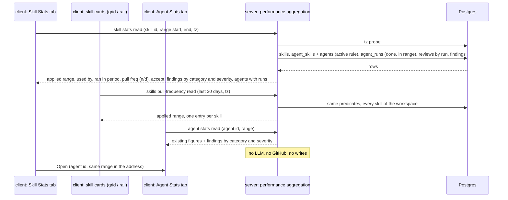

# L08 follow-up — Skill Stats tab + shared Findings widget · requirements

**Status:** Approved by the user on 2026-11-05. BQ-1…BQ-8 and G-01…G-18 were all answered with option A, and the requirements they settle carry `[decision BQ-n]` / `[decision G-nn]`. UX-01…UX-03 were accepted and became R-79…R-83. UX-04…UX-06 were deferred and are out of scope. No question is open. See `## Decisions`.
**Goal:** a workspace owner opens a skill's Stats tab and sees, for a chosen period, how many agents use the skill, on what share of reviewed PRs those agents ran, how their findings were judged and what kinds of findings they produced. The same Findings widget appears on the agent Stats tab, and every skill card shows "N agents · X% pull freq".
**Packages:** server · client · vendored `@devdigest/shared` (both copies). `reviewer-core`, `mcp` and `e2e` are not touched.
**Designs:**
- the user's brief with the binding decisions 1–6 of 2026-11-05: `.devdigest/cache/sdd/L08-skill-stats/brief.md`. Quotes are marked «…»
- `C:\Users\malin\Pictures\Screenshots\Screenshot 2026-11-05 103743.png`: the Skill editor → Stats tab (`/skills/:id?tab=stats`) with the tabs Config / Preview / Stats / Versions / Context / Evals, a range caption "1 day · Oct 11 00:00 – now" and a "1 day" button, four KPI cards (USED BY "2 agents" / "2 ran in period"; PULL FREQUENCY "100% (2/2 PRs)" / "local runs"; ACCEPT RATE "—" / "based on 2 local findings"; FINDINGS "2"), an "AGENTS USING THIS SKILL" list (Security Reviewer, Test Quality Reviewer, each with "Open"), a "FINDINGS BY CATEGORY" donut (centre "2"; legend security 1 · 50 %, bug 1 · 50 %, perf / style / test 0 · 0 %; a "small sample" badge), and a left rail of skill cards with "2 agents · 100% pull freq", "1 agent · 50% pull freq", "1 agent · 0% pull freq"
- the predecessor, whose counting rules this feature reuses: `specs/L08-agent-performance.requirements.md` (cited below as **AP R-nn**), its `## Decisions`, and the shipped code in `server/src/modules/agent-performance/`, `client/src/components/perf-range-control/` and `client/src/app/agents/[id]/_components/AgentEditor/_components/StatsTab/`
- the current code of this repository (`file:line` references below)

**Branch:** `lesson/L08-homework` (the current branch). Per the brief, decision 1: a separate SDD cycle that starts after the L08 agent-performance PR gate closes.

**Requirement IDs.** Every requirement has a stable ID `R-NN`. Plan tasks and tests cite these IDs. IDs are never renumbered. A dropped requirement stays in its table, struck through, with the reason. `AP R-nn` means requirement R-nn of `specs/L08-agent-performance.requirements.md`.

## Blocking questions

None open. BQ-1…BQ-8 were answered by the user on 2026-11-05, option A for each. They are recorded under `## Decisions`.

| ID | Question | Answer | Requirements it settles |
|---|---|---|---|
| BQ-1 | Which agents "have the skill"? | A: checked on the agent **and** the skill switched on globally (the rule behind today's "N agents", `server/src/db/skill-gates.ts:22-28`) | R-01, R-05, R-06, R-48 |
| BQ-2 | What does the widget's "small sample" badge count? | A: the widget's findings; the badge shows while the total is below 5 | R-64 |
| BQ-3 | Which findings count in the Findings KPI and the widget? | A: every finding of the counted runs, all kinds, accepted, dismissed and pending alike | R-12, R-14, R-15, R-26, R-68 |
| BQ-4 | How does the widget show severity? | A: a row under the donut with CRITICAL / WARNING / SUGGESTION, count and %, in the house severity colours and icons | R-63 |
| BQ-5 | What does the skill Stats tab show when no using agent has a counted run in the range? | A: keep the KPI cards and the agents list; the widget area reads "No findings in <range>" | R-49, R-65 |
| BQ-6 | Which window does the card's "X% pull freq" use? | A: always the last 30 days, ending when the page loads | R-73, R-78 |
| BQ-7 | Where does "Open" go? | A: that agent's Stats tab, with the same applied range | R-43 |
| BQ-8 | Does the Agent Performance dashboard show the window caption too? | A: yes | R-32 |

## Context

**Problem.** In the user's words: «Add a Stats tab to skills». Its reference shows usage, pull frequency, accept rate and a findings-by-category donut for one skill. The skill cards show «N agents · X% pull freq». Decision 6 revives the predecessor's deferred UX-07: one shared **Findings widget**, a donut by category plus severity with a small-sample badge, on **both** the agent Stats tab and the skill Stats tab.

**How it works today (from the code):**

| What | Where | State |
|---|---|---|
| Skill ↔ agent attachment | `server/src/db/schema/agents.ts:69-86` (`agent_skills`) | One row per (agent, skill): `order`, `enabled`. **No timestamp and no history.** A row's existence means "has a position", and `enabled` means "checked" |
| Attachment writes | `server/src/modules/agents/repository.ts:291-321` (`setSkills`), `:268-283` | The whole list is deleted and re-inserted in one transaction. The comment at `:304-310` says «links are deliberately not versioned». Changing skills does not bump `agents.version` (`:338-342`, `server/src/modules/skills/repository.ts:215-223`) |
| Agent config snapshots | `server/src/modules/agents/repository.ts:170-199`; contract `server/src/vendor/shared/contracts/knowledge.ts:481-495` | `agent_versions.config_json.skills` = the checked skill ids **at the moment of the last config save**: «not a history of the skill set … context on it, nothing stronger» (`:173-178`). An attach or detach after that save leaves the snapshot stale |
| Run rows | `server/src/db/schema/runs.ts:17-53` | `agent_runs` has `agent_id`, `pr_id` (nullable, `set null` on PR delete, `:25`) and `ran_at`, but **no agent version and no skill ids** |
| Run trace | `server/src/modules/reviews/run-executor.ts:362-395`; `server/src/vendor/shared/contracts/trace.ts:39-55,75-103` | `config.version` (agent version, a string). `prompt_assembly.skills` = the skill **bodies** joined into one text (`reviewer-core/src/prompt.ts:220-221,289`). The log has lines «skill: <name> (v<version>) → prompt» (`run-executor.ts:224`): the skill **name**, not its id |
| "Used by N" today | `server/src/db/skill-gates.ts:22-28` (`activeSkillOnAgent`); `server/src/modules/skills/repository.ts:175-192` (`agentCountsFor`) | Checked on the agent **and** `skills.enabled` **and** same workspace. Exposed as `Skill.agent_count` (`knowledge.ts:261-271`) |
| Finding category and severity | `server/src/db/schema/reviews.ts:56-57` | Both are free `text` columns. Written from the model's output validated against `Severity` = CRITICAL / WARNING / SUGGESTION and `FindingCategory` = bug / security / perf / style / test (`contracts/findings.ts:11-15`) via `reviews/repository/review.repo.ts:44`. Read back with a cast (`reviews/helpers.ts:38`). Nothing in the DDL stops another value |
| Review ↔ run | `server/src/db/schema/reviews.ts:28-30`; `run-executor.ts:324-335` | `reviews.run_id` links a review to its run, and only a `done` run writes a review. So "findings of counted runs" is the predecessor's join (`agent-performance/repository.ts:86-102`) |
| Counting rules (predecessor) | `server/src/modules/agent-performance/repository.ts:31-39`, `:86-102`; `helpers.ts:43-46,78-117`; `service.ts:25-50` | Counted run = workspace + `status = 'done'` + `from <= ran_at < to`, any source. Findings are classified by their current accept/dismiss state. Accept rate = accepted ÷ decided, null at 0. The tz is probed before any read (`repository.ts:134-136`) |
| Range contract | `server/src/vendor/shared/contracts/agent-performance.ts:13-41` | `PerfRangeQuery`: ISO instants, `from < to`, the IANA tz shape plus an `Intl` check, and the previous window not before 1970-01-01 (`:37-40`) |
| Agent stats contract | `agent-performance.ts:95-103` (`AgentStatsReport`) | `figures`, `comparison`, `cost_by_model`. **No findings by category or severity** |
| Agent Stats tab | `client/src/app/agents/[id]/_components/AgentEditor/_components/StatsTab/StatsTab.tsx:25-107` | Range control in the header (`:33-36`), ten tiles, estimate note. "No runs" replaces the figures (`:52-53`). No caption, no findings widget |
| Range control / address | `client/src/components/perf-range-control/RangeControl.tsx:28-141`, `usePerfRange.ts:53-83` | 1 day / 30 days / Custom range. `apply` rewrites only the range keys and keeps `tab` (`:72-80`). `useRangeLabels` gives "(1D)"-style short labels and sentence labels (`:93-106`) |
| Skill editor tabs | `client/src/app/skills/[id]/_components/SkillEditor/constants.ts:18-29`; `SkillEditor.tsx:30-42`; `client/src/app/skills/[id]/page.tsx:21,36-42` | Tabs config / preview / versions / context. The comment at `constants.ts:18-22` says the Stats tab «stays unbuilt … there is no per-skill usage data behind it yet». `?tab=` is validated against the list, and `setTab` keeps the other address keys |
| Skill rail navigation | `client/src/app/skills/[id]/page.tsx:105-118` | Clicking another skill pushes `/skills/<id>?tab=<tab>` and **drops every other key**, so the range is lost |
| Skill cards | `client/src/app/skills/_components/SkillCard/SkillCard.tsx:117-134`; used by `SkillsListView.tsx:87-97` (`/skills` grid) and `page.tsx:105-118` (editor rail) | Badges: type, version, "N agents" (`listItem.agentCount`), needs-vetting. No pull frequency |
| Existing visual pieces | `client/src/app/agent-performance/_components/CostBreakdown/_components/CostDonut/CostDonut.tsx:13-56`; `client/src/components/severity-chips/SeverityChips.tsx`; `client/src/vendor/ui/primitives/tokens.ts:10,16` | CostDonut is local to the dashboard feature and its legend prints money. SeverityChips and the `SEV` tokens give the severity colour and icon. `CAT` has an icon and label per category but **no colour** |

**What the code answers about decision 5 («at run time if the data allows, otherwise current attachment»).** The data does **not** reliably answer "did this agent have the skill when the run happened". Links have no history. The agent-version snapshot goes stale on every attach or detach without a config edit. `agent_runs` stores neither version nor skills. The trace's skill lines carry a renamable, non-unique **name**, and the assembly carries only concatenated bodies. So this spec uses the **current attachment** (R-01, R-02). Consequence: attaching a skill today attributes that agent's earlier runs in the range to the skill, and detaching it removes them. The tab says so (R-81, accepted UX-02). Recording skill ids on each run is deferred to its own cycle (UX-06).

**Constraints from `INSIGHTS.md` and package rules** (inputs for the planner, not requirement text):
- `@devdigest/shared` is two physical copies, so every contract change goes into both in one commit (root `AGENTS.md`). The client imports **types only** from it.
- Logic goes in `service.ts` + `repository.ts`, never in `routes.ts`. A module may not import a sibling module's folder (`no-cross-module`, `server/INSIGHTS.md:131,248`). The "active skill" predicate already lives outside modules for this reason (`server/src/db/skill-gates.ts:15-20`).
- A tz that Node accepts may be one Postgres rejects. Probe it before any read (`server/INSIGHTS.md:222-226`). A range that reaches before 1970 is a 422, not a 500 (`server/INSIGHTS.md:229-232`).
- Do not pair an urgent `setState` with `router.replace` on one query key (`client/INSIGHTS.md:22-26`). `usePerfRange` already handles this, so reuse it rather than writing a second range hook.
- Duplicate accessible names (several "Open" links) need `getAllByRole` in tests.

## Out of scope

- The Config, Preview, Versions, Context and Evals tabs of the skill editor (the Evals tab of the reference is not built).
- Cost, duration, cost delta and the sparkline on the skill Stats tab (the reference has none).
- Trend arrows on the skill's accept rate or pull frequency: deferred by the user on 2026-11-05 (UX-05).
- The Findings widget on the Agent Performance dashboard: deferred by the user on 2026-11-05 (UX-04). Decision 6 names only the two Stats tabs.
- Recording which skills a run used (a new column, trace field or migration): deferred by the user on 2026-11-05 to its own cycle (UX-06).
- Any new table, column or migration. Everything is computed at read time from existing rows.
- Per-repository filtering. Every figure is workspace-wide, like the dashboard (AP Out of scope).
- An MCP tool and an e2e flow.

## Requirements

### Attribution and counting (server)

| ID | Pattern | Requirement | Verified by |
|---|---|---|---|
| R-01 | Ubiquitous | [decision 5, BQ-1] The system shall treat an agent as using a skill when, at the moment of the request, the agent belongs to the caller's workspace, has the skill checked on its Skills tab, and the skill is switched on globally. This is the rule that produces the skill's existing agent count. | server-integration |
| R-02 | Ubiquitous | [decision 5] The system shall attribute to a skill the counted runs of the agents that use it at the moment of the request (R-01), including runs that happened before the skill was attached. | server-integration (attach after a run → the run counts; detach → it no longer counts) |
| R-03 | Ubiquitous | The system shall count a run for skill stats and pull frequency only when it is counted by the agent-performance rule: caller's workspace, status `done`, run time in the range start-inclusive and end-exclusive, source `local` or `ci` (AP R-02…R-04). | server-integration |
| R-04 | Ubiquitous | The system shall never attribute a counted run whose agent was deleted to any skill. | server-integration |
| R-05 | Ubiquitous | [decision BQ-1] The system shall report as a skill's "used by" the number of agents that use it (R-01), equal to the agent count shown on that skill's card. | server-integration |
| R-06 | Ubiquitous | [decision BQ-1] The system shall report as "ran in period" the number of agents using the skill that have at least one counted run in the range. | server-integration |
| R-07 | Ubiquitous | [decision 4] The system shall report as the pull-frequency denominator the number of distinct pull requests that have at least one counted run in the range, by any agent, deleted agents included. | server-integration |
| R-08 | Ubiquitous | [decision 4] The system shall report as a skill's pull-frequency numerator the number of distinct pull requests that have at least one counted run of an agent using the skill. | server-integration (two using agents on one PR → counted once) |
| R-09 | Ubiquitous | The system shall leave out of both the numerator and the denominator every counted run that no longer refers to a pull request. | server-integration |
| R-10 | Ubiquitous | The system shall report pull frequency as numerator ÷ denominator together with both counts, and as unknown (null) when the denominator is 0. | server-unit + server-integration |
| R-11 | Ubiquitous | The system shall take as a skill's findings for a range the findings of the reviews produced by the counted runs attributed to it (R-02), each classified by its state at request time as accepted, dismissed or pending, findings of every kind included (AP R-10, R-12). | server-integration |
| R-12 | Ubiquitous | [decision BQ-3] The system shall report as a skill's findings count the number of all its findings (R-11), whatever their state. | server-integration |
| R-13 | Ubiquitous | The system shall report a skill's accept rate as accepted ÷ (accepted + dismissed) over its findings, together with accepted and decided, and as unknown (null) when nothing is decided (AP R-11). | server-unit + server-integration |
| R-14 | Ubiquitous | [decision BQ-3, G-06] The system shall report the findings counted in R-12 per category (security, bug, perf, style, test), with any stored value outside these five counted under "other", so that the per-category counts add up to the findings count. | server-unit + server-integration |
| R-15 | Ubiquitous | [decision BQ-3, G-06] The system shall report the same findings per severity (CRITICAL, WARNING, SUGGESTION), with any stored value outside these three counted under "other", so that the per-severity counts add up to the findings count. | server-unit + server-integration |
| R-16 | Ubiquitous | The system shall report, for a skill used by exactly one agent, the same accepted, dismissed, pending, decided, accept rate, per-category and per-severity counts as that agent's stats for the same range. | server-integration (same fixture, both reads, field-by-field equality) |
| R-17 | Ubiquitous | The system shall return, with every skill stats answer and every skills pull-frequency answer, the exact range start, end and time zone it applied. | server-integration |
| R-18 | Ubiquitous | The system shall report, in the skills pull-frequency answer, for every skill of the caller's workspace the same pull frequency, numerator and denominator that the skill stats read gives for that skill and the same range. | server-integration (equality across both reads) |

### API

| ID | Pattern | Requirement | Verified by |
|---|---|---|---|
| R-19 | Event-driven | WHEN a client requests a skill's stats with a range, the system shall return that skill's figures of R-05…R-15 and the list of agents that use it, each with its id, name and enabled state. | server-integration |
| R-20 | Event-driven | WHEN a client requests the skills pull frequency with a range, the system shall return one entry per skill of the caller's workspace in a single response. | server-integration |
| R-21 | Unwanted | IF the skill id does not exist or belongs to another workspace, THEN the system shall answer the skill stats request with HTTP 404. | server-integration |
| R-22 | Unwanted | IF the range is missing or unparseable, its start is not before its end, or the window of equal length before it would start before 1970-01-01, THEN the system shall answer either skill read with HTTP 422 before computing anything (the rule of AP R-28 and its 1970 bound). | server-integration |
| R-23 | Unwanted | IF the time zone is one the database does not recognise, THEN the system shall answer either skill read with HTTP 422, also when the range holds no run. | server-integration |
| R-24 | Ubiquitous | The system shall answer the skill reads and the extended agent stats read from stored rows only: no model call, no GitHub request, no review run started, and no row created, changed or deleted. | server-integration (mocks record zero calls; row counts and finding states unchanged) |
| R-25 | Ubiquitous | The system shall never count an agent, link, run, review or finding of another workspace in any skill figure. | server-integration |
| R-26 | Event-driven | [decision 6, BQ-3] WHEN a client requests an agent's stats, the system shall also return that agent's findings for the range per category and per severity (rules of R-14, R-15), adding up to its accepted + dismissed + pending. | server-integration |
| R-27 | Ubiquitous | The system shall define the skill stats shape, the skills pull-frequency shape and the extension of the agent stats shape in `@devdigest/shared`, byte-identical in the server and client copies. | server typecheck + client typecheck |

### Range control and window caption

| ID | Pattern | Requirement | Verified by |
|---|---|---|---|
| R-28 | Ubiquitous | [decision 3] The system shall offer on the skill Stats tab the range control of the agent Stats tab, with the same choices, default "30 days", preset and custom-day resolution, validation messages and fallback for an invalid address (AP R-32…R-37, R-39). | client |
| R-29 | Event-driven | WHEN the user applies a range on the skill Stats tab, the system shall store it in the page address and keep the skill and the tab, so that a reload or a shared link shows the same range. | client |
| R-30 | Event-driven | WHEN the range changes while an earlier skill stats request is still pending, the system shall show only the result of the latest range. | client |
| R-31 | Ubiquitous | [decision 3, G-01, G-02] The system shall show next to the range control of the skill Stats tab a caption naming the choice and the applied window in the browser's time zone. For a preset, "<choice> · <start date and time> – <end date and time>" (e.g. "1 day · Nov 4, 10:37 – Nov 5, 10:37"). For a custom range, "<start date> – <end date>" with both days included. | client |
| R-32 | Ubiquitous | [decision 3, BQ-8] The system shall show the same caption, with the same format, next to the range control of the agent Stats tab and of the Agent Performance dashboard. | client |
| R-33 | Ubiquitous | The system shall take the caption's start and end from the range applied to the request whose figures are on screen, so that the caption never names a window other than the one the figures were computed for. | client |

### Skill Stats tab

| ID | Pattern | Requirement | Verified by |
|---|---|---|---|
| R-34 | Ubiquitous | [decision G-17] The system shall show a "Stats" tab in the skill editor between "Preview" and "Versions", addressable as `?tab=stats`. | client |
| R-35 | State-driven | WHILE skill stats are shown, the system shall show four KPI cards: Used by, Pull frequency, Accept rate and Findings. | client |
| R-36 | State-driven | WHILE skill stats are shown, the system shall show in the Used by card "<N> agents" (singular for 1) and under it "<M> ran in period". | client |
| R-37 | State-driven | [decision G-03] WHILE the pull frequency is known, the system shall show it as "
% (<n>/<d> PRs)" with a whole percentage and, under it, "PRs reviewed in the period". | client |
| R-38 | Unwanted | [decision G-05] IF the pull frequency is unknown (no reviewed PR in the range), THEN the system shall show "—" and "No reviewed PRs in <range>", never "0%". | client |
| R-39 | State-driven | [decision G-04] WHILE skill stats are shown, the system shall show the accept rate as a whole percentage with "<accepted>/<decided> decisions" under it, or "—" with "No decided findings" when nothing is decided, formatted as on the agent Stats tab (AP R-53). | client |
| R-40 | State-driven | WHILE the skill's decided findings are fewer than 5, the system shall show the text badge "Small sample" next to its accept rate (AP R-61). | client |
| R-41 | State-driven | WHILE skill stats are shown, the system shall show in the Findings card the findings count (R-12). | client |
| R-42 | State-driven | WHILE skill stats are shown, the system shall show a section "Agents using this skill" with one row per agent that uses the skill (R-01), sorted by name, whether or not the agent ran in the range. | client |
| R-43 | Event-driven | [decision BQ-7] WHEN the user activates a row's "Open" link, the system shall open that agent's Stats tab with the same applied range (same start and end). | client |
| R-44 | Ubiquitous | The system shall give each "Open" link the accessible name "Open <agent name>". | client |
| R-45 | State-driven | [decision G-10] WHILE an agent in the list is disabled, the system shall show a "Disabled" badge on its row. | client |
| R-46 | State-driven | [decision G-11] WHILE no agent uses the skill, the system shall show "No agent uses this skill" and "Attach it on an agent's Skills tab" in place of the agents list. | client |
| R-47 | State-driven | [decision 6] WHILE skill stats are shown, the system shall show the Findings widget (R-59…R-68) for the skill's findings. | client |
| R-48 | State-driven | [decision BQ-1, G-12] WHILE the skill is switched off globally, the system shall show above the KPI cards "This skill is off — no agent sends it, so no run is attributed to it". | client |
| R-49 | State-driven | [decision BQ-5] WHILE no agent using the skill has a counted run in the range, the system shall keep the four KPI cards and the agents list on screen, with Used by, "0 ran in period", the pull frequency of R-37/R-38, "—" accept rate and Findings "0". | client |
| R-50 | State-driven | WHILE skill stats are loading, the system shall show skeletons in place of the KPI values, the agents list and the widget, and no number, "0" or "0%". | client |
| R-51 | Unwanted | IF the skill stats read fails, THEN the system shall show an error with the reason and a "Retry" button, and no KPI value, agents list or widget. | client |
| R-52 | Event-driven | WHEN the skill Stats tab loads, reloads or changes range, the client shall send only read requests. | client |
| R-53 | Event-driven | [decision G-13] WHEN the user selects another skill in the editor's left rail while a range is in the page address, the system shall open that skill on the same tab with the same range. | client |
| R-54 | State-driven | WHILE the viewport is narrower than the four KPI cards in one row, the system shall wrap the cards and place the agents list and the widget one under the other, hiding no value. | client |
| R-55 | Ubiquitous | The system shall make the range control, the custom date inputs and the "Open" links of the skill Stats tab reachable and operable with the keyboard alone. | client |
| R-56 | Ubiquitous | The system shall take every user-facing label of the skill Stats tab, the Findings widget, the caption and the card's pull frequency from the client's message files, with none written into a component. | client |
| R-57 | Ubiquitous | The system shall leave every figure, label and state of the agent Stats tab and the Agent Performance dashboard as shipped, except for the caption (R-32) and the Findings widget (R-69). | client (existing suites stay green) |
| R-58 | Unwanted | IF the skill no longer exists when its stats are requested, THEN the system shall show the skill editor's existing "skill not found" state. | client |

### Findings widget (shared by both Stats tabs)

| ID | Pattern | Requirement | Verified by |
|---|---|---|---|
| R-59 | Ubiquitous | [decision 6] The system shall render the Findings widget on the agent Stats tab and on the skill Stats tab as one component with the same structure, labels, colours and rules. | client |
| R-60 | State-driven | WHILE the widget has at least one finding, the system shall show a donut by category with the total number of findings in its centre. | client |
| R-61 | State-driven | [decision G-08, G-06] WHILE the donut is shown, the system shall list in its legend security, bug, perf, style and test in that order, each with its count and percentage, also at 0, and an "other" entry only when its count is above 0. | client |
| R-62 | Ubiquitous | [decision G-07] The system shall show each percentage in the widget as a whole number computed as count ÷ total for that entry alone, so the shown percentages may add up to 99–101. | client |
| R-63 | State-driven | [decision 6, BQ-4, G-09] WHILE the donut is shown, the system shall show under it CRITICAL, WARNING and SUGGESTION, each with its count and percentage, also at 0, in the studio's existing severity colours and icons, and an "other" entry only when its count is above 0. | client |
| R-64 | State-driven | [decision 5, 6, BQ-2] WHILE the widget has between 1 and 4 findings, the system shall show the text badge "Small sample" in the widget. | client |
| R-65 | State-driven | [decision G-18, BQ-5] WHILE the widget has no finding, the system shall show "No findings in <range>" in place of the donut, the legend, the severity row and the badge. | client |
| R-66 | Ubiquitous | The system shall give the donut the accessible name "Findings by category" and carry every value in the legend and severity text, so that no value depends on colour alone. | client |
| R-67 | Ubiquitous | [decision G-16] The system shall give each category one fixed colour (security red, bug orange, perf purple, style blue, test green, other neutral), the same on both tabs and on every load. | client |
| R-68 | Ubiquitous | [decision BQ-3] The system shall make the widget's total equal the Findings card on the skill Stats tab, and equal accepted + dismissed + pending on the agent Stats tab. | client + server-integration |
| R-69 | State-driven | [decision 6, G-15] WHILE the agent Stats tab shows figures, the system shall show the Findings widget for that agent's findings below the figure tiles and above the estimate note. | client |
| R-70 | Ubiquitous | The system shall take the widget's figures from the same read as the rest of its tab, sending no extra request for the widget. | client |

### Skill cards

| ID | Pattern | Requirement | Verified by |
|---|---|---|---|
| R-71 | Ubiquitous | [decision 2] The system shall show on every skill card, in the `/skills` grid and in the skill editor's left rail, "<N> agents · 
% pull freq", where N is the existing agent count. | client |
| R-72 | Ubiquitous | [decision 2] The system shall compute the card's pull frequency with the rules of R-07…R-10. | server-integration |
| R-73 | Ubiquitous | [decision 2, BQ-6] The system shall compute the card's pull frequency for the 30 × 24 hours ending when the page loads, whatever range a Stats tab on the same page shows. | client |
| R-74 | Event-driven | WHEN a page with skill cards loads, the client shall request the pull frequency of all cards in one read, never one request per card. | client |
| R-75 | Unwanted | [decision G-05] IF the card's pull frequency is unknown (no reviewed PR in the 30 days), THEN the system shall show "— pull freq", never "0%". | client |
| R-76 | State-driven | [decision G-14] WHILE the pull frequency is loading, the system shall show the agent count at once and a placeholder in place of the percentage, with no "0%". | client |
| R-77 | Unwanted | [decision G-14] IF the pull-frequency read fails, THEN the system shall show the cards with the agent count only, without a percentage and without an error on each card. | client |
| R-78 | Ubiquitous | [decision BQ-6] The system shall show on a skill's card the same pull frequency as its Stats tab shows for "30 days" applied at the same moment (R-18). | server-integration |

### Accepted UX (2026-11-05)

| ID | Pattern | Requirement | Verified by |
|---|---|---|---|
| R-79 | Ubiquitous | [accepted UX-01] The system shall report, for each agent in the skill stats answer, the number of its counted runs in the range (R-03), 0 included. | server-integration |
| R-80 | State-driven | [accepted UX-01] WHILE the "Agents using this skill" list is shown, the system shall show on each row "<n> runs" (singular for 1) in the range, "0 runs" included. | client |
| R-81 | State-driven | [accepted UX-02] WHILE skill stats are shown, the system shall show on the skill Stats tab the note "Figures cover the agents that use this skill now. Findings come from their runs and are not traced to the skill itself." | client |
| R-82 | State-driven | [accepted UX-03; amended 2026-11-05, decision F-18] WHILE the pointer is over the pull-frequency badge of a skill card, or keyboard focus is on a skill card that shows a pull frequency, the system shall show the hint "PRs reviewed in the last 30 days with an agent that uses this skill". The pointer over the rest of the card shall not show it. | client |
| R-83 | Ubiquitous | [accepted UX-03] The system shall expose the hint of R-82 to assistive technology as the description of the card's pull-frequency text. | client |

## Design analysis

| Screen / element (reference) | Covered | Missing / conflict | → |
|---|---|---|---|
| Stats tab between Preview and Versions | position | no tab today (`SkillEditor/constants.ts:18-29`) | R-34, G-17 |
| "1 day · Oct 11 00:00 – now" caption | caption exists | "00:00" suggests a calendar day, but presets are rolling (AP R-34); "now" goes stale after load; custom-range format not shown; dashboard not mentioned | R-31…R-33, G-01, G-02, BQ-8 |
| USED BY "2 agents / 2 ran in period" | both lines | which attachment counts; run-time vs current attachment | R-01, R-02, R-05, R-06, R-81, BQ-1 |
| PULL FREQUENCY "100% (2/2 PRs) / local runs" | value + fraction | caption "local runs" is wrong: `ci` runs count too (AP R-03); 0/0 not drawn; deleted PRs | R-07…R-10, R-37, R-38, G-03, G-05 |
| ACCEPT RATE "— / based on 2 local findings" | "—" | the reference's denominator is all findings; the house rule shows decided ones (AP R-53); small-sample badge for the rate not drawn | R-13, R-39, R-40, G-04 |
| FINDINGS "2" | count | which states/kinds count | R-12, BQ-3 |
| Agents using this skill + "Open" | rows | link target, accessible names, disabled agents, empty list, sort, runs per agent | R-42…R-46, R-79, R-80, BQ-7, G-10, G-11 |
| Findings by category donut | centre total, five categories with count · %, small sample | severity (decision 6) not drawn; badge basis; zero state; out-of-enum values; rounding; colours collide with severity red | R-59…R-68, BQ-2, BQ-4, G-06…G-09, G-16, G-18 |
| Rail cards "2 agents · 100% pull freq" | text | window not named on the card; loading/failure; 0/0; one read for all cards | R-71…R-78, R-82, R-83, BQ-6, G-14 |
| Agent Stats tab | — (not in the reference) | widget placement; caption | R-32, R-69, G-15 |
| Skill switched off globally | not drawn | Used by drops to 0 under BQ-1 | R-48, G-12 |
| Switching skill in the rail | not drawn | range dropped (`page.tsx:110`) | R-53, G-13 |
| Loading / error / no runs | not drawn | all three | R-49…R-51, BQ-5 |
| Narrow window | not drawn | 4 cards + 2 panels | R-54 |

## Module interaction

| From → to | What is passed | On failure | Requirement |
|---|---|---|---|
| client skill Stats tab → server skill stats read | skill id, range start/end, tz | 404 → the editor's "skill not found" state; 422 → not reachable from a valid control; 5xx/network → error + Retry, no figures | R-19, R-21…R-23, R-51, R-58 |
| client skill cards → server skills pull-frequency read | range of the last 30 days, tz | any failure → cards without a percentage, no per-card error | R-20, R-74, R-77 |
| client agent Stats tab → server agent stats read (extended) | agent id, range, tz | as today (AP R-79) | R-26, R-69 |
| server → Postgres | workspace id, range, tz, skill id | unknown tz → 422 before any read; DB error → 5xx through the global handler, no partial answer | R-23, R-24, R-25 |
| skill Stats tab → agent Stats tab (navigation) | agent id, applied range in the address | — | R-43 |

## Design gaps

All decided by the user on 2026-11-05, option A for each. For G-01…G-16, the user first ticked every box in a "mark where you want the alternative" multi-select, then explicitly confirmed they meant to approve the recommendations. So A is recorded.

| ID | Gap | Decision | → |
|---|---|---|---|
| G-01 | How does the caption end a preset window? | A: the applied end time ("1 day · Nov 4, 10:37 – Nov 5, 10:37"), not "– now" | R-31 |
| G-02 | How does the caption show a custom range? | A: both days included, "Nov 1 – Nov 3" | R-31 |
| G-03 | What goes under the pull frequency? | A: "PRs reviewed in the period" | R-37 |
| G-04 | What goes under the accept rate? | A: "<accepted>/<decided> decisions" | R-39 |
| G-05 | What does the pull frequency show at 0/0? | A: "—" with "No reviewed PRs in <range>" | R-38, R-75 |
| G-06 | A stored category or severity outside the known values | A: counted under "other", listed only when above 0 | R-14, R-15, R-61, R-63 |
| G-07 | How are the legend percentages rounded? | A: whole percent per entry, computed on its own | R-62 |
| G-08 | Does the legend list categories with 0 findings? | A: always all five, fixed order | R-61 |
| G-09 | Does the severity row list severities with 0 findings? | A: always all three | R-63 |
| G-10 | What does an agents-list row show beyond name and "Open"? | A: a "Disabled" badge for a disabled agent | R-45 |
| G-11 | What shows when no agent uses the skill? | A: "No agent uses this skill" with "Attach it on an agent's Skills tab" | R-46 |
| G-12 | The skill is switched off globally | A: a note above the KPIs | R-48 |
| G-13 | Selecting another skill in the rail | A: keep the tab and the range | R-53 |
| G-14 | Cards while the pull frequency loads or fails | A: a placeholder, then the % is omitted with no per-card error | R-76, R-77 |
| G-15 | Where does the widget go on the agent Stats tab? | A: below the tiles, above the estimate note | R-69 |
| G-16 | What colours do the categories get? | A: as drawn (security red, bug orange, perf purple, style blue, test green, other neutral) | R-67 |
| G-17 | Where does the Stats tab sit? | A: between Preview and Versions | R-34 |
| G-18 | What does the widget show with runs but no finding? | A: "No findings in <range>" | R-65 |

## UX improvements

| ID | Proposal | Why | Status |
|---|---|---|---|
| UX-01 | Show each agent's counted runs in the range on its row in "Agents using this skill" | shows which agent drives the skill's numbers | accepted 2026-11-05 → R-79, R-80 |
| UX-02 | A note that figures cover the agents using the skill now and that findings are not traced to the skill itself | honest labelling of current-attachment attribution | accepted 2026-11-05 → R-81 |
| UX-03 | A hover and focus hint on the card's pull frequency naming the 30-day window | the card's % names no window | accepted 2026-11-05 → R-82, R-83 |
| UX-04 | The Findings widget on the Agent Performance dashboard | one more place for the same component | deferred 2026-11-05 (out of scope) |
| UX-05 | A trend arrow vs the previous window on the skill's accept rate and pull frequency | consistency with the agent Stats tab | deferred 2026-11-05 (out of scope) |
| UX-06 | Record the ids of the skills that reached the prompt on each run, for future run-time attribution | decision 5 prefers run-time attribution | deferred 2026-11-05 to its own cycle (out of scope) |

## Open questions

None.

## Decisions

| Question | Decision | Source |
|---|---|---|
| Scope and timing | A Stats tab for skills as a separate SDD cycle, after the L08 agent-performance PR gate closes. | user, 2026-11-05 (brief, decision 1) |
| Skill cards | Include "N agents · X% pull freq", from the same data and rules, default window 30 days (R-71…R-78). | user, 2026-11-05 (brief, decision 2) |
| Range | Reuse the existing range control (1 day / 30 days / Custom) plus a caption of the actual window, also on the agent Stats tab (R-28…R-33). | user, 2026-11-05 (brief, decision 3) |
| Pull frequency | Numerator = PRs in the window where an agent with the skill had a counted run. Denominator = all PRs with at least one counted (`done`) run in the window (R-07…R-10). | user, 2026-11-05 (brief, decision 4) |
| Findings on skill Stats | Findings of counted runs of agents that had the skill, small sample < 5 (R-11…R-16, R-64). | user, 2026-11-05 (brief, decision 5) |
| Run-time vs current attachment (decision 5 left this to the spec) | **Current attachment.** No stored row records which skills a run used: links have no history (`agents/repository.ts:291-321`), version snapshots go stale on attach/detach (`:170-199`), `agent_runs` has no version or skill column (`runs.ts:17-44`), and traces carry only a skill name in a log line and the concatenated bodies (`run-executor.ts:224`, `reviewer-core/src/prompt.ts:289`) (R-01, R-02). | spec-creator, from the code, 2026-11-05 (delegated by brief decision 5) |
| Shared Findings widget | One widget: donut by category (security/bug/perf/style/test, count + %) plus severity (CRITICAL/WARNING/SUGGESTION), small-sample badge, on both the agent and the skill Stats tab (R-59…R-70). | user, 2026-11-05 (brief, decision 6; revives AP UX-07) |
| Language and slug | English; `L08-skill-stats`. | user, 2026-11-05 (brief) |
| BQ-1 Which agents have the skill | A: checked on the agent and the skill on globally — the existing "N agents" rule (R-01, R-05, R-06, R-48). Rejected: B (checked, any global state), C (any link row). | user, 2026-11-05 |
| BQ-2 Widget small-sample basis | A: the widget's findings below 5 (R-64). Rejected: B (decided below 5), C (no badge). | user, 2026-11-05 |
| BQ-3 Which findings count | A: all findings of the counted runs, all kinds and states (R-12, R-14, R-15, R-26, R-68). Rejected: B (without dismissed), C (accepted only). | user, 2026-11-05 |
| BQ-4 Severity form | A: a severity row with counts and % in the house colours and icons (R-63). Rejected: B (second donut), C (stacked bar). | user, 2026-11-05 |
| BQ-5 No counted run in the range | A: keep the KPI cards and the agents list; the widget says "No findings in <range>" (R-49, R-65). Rejected: B (one empty-state sentence). | user, 2026-11-05 |
| BQ-6 Card window | A: always the last 30 days, ending at page load (R-73, R-78). Rejected: B (follow the Stats tab's range). | user, 2026-11-05 |
| BQ-7 "Open" target | A: the agent's Stats tab with the same range (R-43). Rejected: B (Config tab), C (Skills tab). | user, 2026-11-05 |
| BQ-8 Caption on the dashboard | A: yes, on all three screens (R-32). Rejected: B (Stats tabs only). | user, 2026-11-05 |
| G-01 Preset caption end | A: the applied end time (R-31). Confirmed: the user first ticked this box in a "mark where you want the alternative" multi-select, then explicitly confirmed they meant to approve the recommendation. | user, 2026-11-05 |
| G-02 Custom caption | A: both days included, "Nov 1 – Nov 3" (R-31). Confirmed after the multi-select (as G-01). | user, 2026-11-05 |
| G-03 Pull-frequency sub-caption | A: "PRs reviewed in the period" (R-37). Confirmed after the multi-select (as G-01). | user, 2026-11-05 |
| G-04 Accept-rate sub-caption | A: "<accepted>/<decided> decisions" (R-39). Confirmed after the multi-select (as G-01). | user, 2026-11-05 |
| G-05 Pull frequency at 0/0 | A: "—" with "No reviewed PRs in <range>" (R-38, R-75). Confirmed after the multi-select (as G-01). | user, 2026-11-05 |
| G-06 Unknown category or severity | A: "other", shown only when above 0 (R-14, R-15, R-61, R-63). Confirmed after the multi-select (as G-01). | user, 2026-11-05 |
| G-07 Percentage rounding | A: whole percent per entry (R-62). Confirmed after the multi-select (as G-01). | user, 2026-11-05 |
| G-08 Zero categories | A: always all five, fixed order (R-61). Confirmed after the multi-select (as G-01). | user, 2026-11-05 |
| G-09 Zero severities | A: always all three (R-63). Confirmed after the multi-select (as G-01). | user, 2026-11-05 |
| G-10 Agent row content | A: a "Disabled" badge for disabled agents (R-45). Confirmed after the multi-select (as G-01). | user, 2026-11-05 |
| G-11 No agent uses the skill | A: message plus hint (R-46). Confirmed after the multi-select (as G-01). | user, 2026-11-05 |
| G-12 Skill switched off | A: a note above the KPIs (R-48). Confirmed after the multi-select (as G-01). | user, 2026-11-05 |
| G-13 Rail navigation | A: keep the tab and the range (R-53). Confirmed after the multi-select (as G-01). | user, 2026-11-05 |
| G-14 Card loading / failure | A: placeholder, then omitted without a per-card error (R-76, R-77). Confirmed after the multi-select (as G-01). | user, 2026-11-05 |
| G-15 Widget position on agent Stats | A: below the tiles, above the estimate note (R-69). Confirmed after the multi-select (as G-01). | user, 2026-11-05 |
| G-16 Category colours | A: as drawn (R-67). Confirmed after the multi-select (as G-01). | user, 2026-11-05 |
| G-17 Tab position | A: between Preview and Versions (R-34). | user, 2026-11-05 |
| G-18 Widget with no finding | A: "No findings in <range>" (R-65). | user, 2026-11-05 |
| UX-01 Runs per agent row | Accepted (R-79, R-80). | user, 2026-11-05 |
| UX-02 Attribution note | Accepted (R-81). | user, 2026-11-05 |
| UX-03 Card window hint | Accepted (R-82, R-83). | user, 2026-11-05 |
| F-18 Where the card's pull-frequency hint is triggered (raised during /run-plan) | On pointer hover of the pull-frequency badge and on keyboard focus of the card, not on hover of the whole card, because the card-hover overlay covered the description. R-82 amended. | user, 2026-11-05 |
| UX-04, UX-05, UX-06 | Deferred: widget on the dashboard, trend arrows on skill figures, recording skill ids per run (its own cycle). Out of scope. | user, 2026-11-05 |
